# PDF 模組技術設計文檔導覽 (Architecture & Design Documentation Index)

> 🔗 回到 [專案根目錄 README.md](file:///d:/桌面/ModuleWorkSpace/pdf-module/README.md)

本目錄 (`doc/design/`) 依據專案採用的三大核心底層技術進行模組化子目錄分類，完整涵蓋從「程式化高精確排版」、「視覺化範本報表引擎」到「二進位逆向結構化解析」的完整生命週期架構規範與開發指引。

---

## 1. 目錄結構樹狀圖 (Documentation Layout)

```text
doc/design/
├── README.md                                          # 本導覽索引文件 (架構選型、目錄總覽、場景決策)
│
├── openpdf/                                           # 【OpenPDF 技術體系 - 程式化像素級排版】
│   ├── openpdf_architecture_design.md                 # OpenPDF 報表與文件範本生成整體架構設計
│   ├── custom_openpdf_template_guide.md               # 自定義業務單據範本開發實戰指南 (6-Step Workflow)
│   ├── openpdf_anti_orphan_pagination_guide.md        # 動態資料量智慧防孤兒區塊排版技術指南
│   └── openpdf_saas_evolution_roadmap.md              # OpenPDF SaaS 多租戶架構演進與擴充規劃技術手冊
│
├── birt/                                              # 【Eclipse BIRT 技術體系 - 視覺化範本驅動引擎】
│   └── birt_pdf_module_operations_guide.md            # Eclipse BIRT 報表架構、範本維護與維運排障手冊
│
└── pdfbox/                                            # 【Apache PDFBox 技術體系 - 結構化逆向解析與安全防護】
    ├── pdf_parser_development_guide.md                # PDF 逆向文字抽取與狀態機語法剖析器實戰指南
    ├── pdfbox_security_signature_design.md            # PDFBox 3.x 256-bit 安全防護、數位簽章與自定義規範體系設計文檔
    └── pdf_digital_signature_workflow_and_secret_guide.md # PDF 數位簽章完整流程與憑證密鑰管理實戰指南 (含 ByteRange 與 Secret 取得)
```

---

## 2. 技術選型決策矩陣 (Technology Selection Matrix)

本專案針對企業在處理 PDF 時的不同維度需求，分別引入三套底層引擎。開發團隊在承接新業務需求時，請參考下表進行技術選型：

| 評估維度 | OpenPDF 體系 | Eclipse BIRT 體系 | Apache PDFBox 體系 |
| :--- | :--- | :--- | :--- |
| **主要定位** | **程式化像素級精準繪製、128-bit 安全防護** | **視覺化範本驅動報表引擎** | **二進位 PDF 逆向文字抽取、256-bit AES 加密防護與進階數位簽章** |
| **技術依賴** | OpenPDF 2.0.4 (純 Java) | Eclipse BIRT Runtime 4.20.0 | Apache PDFBox 3.0.8 (純 Java) + BouncyCastle 1.80 |
| **範本載體** | 純 Java 類別 (`*PdfTemplate`) | XML 檔案 (`.rptdesign`) | 無 (剖析由狀態機驅動；簽章由 `PdfSignaturePolicy` 規範驅動) |
| **典型應用場景** | 高吞吐、低延遲、版面固定之標準商務單據 (如報價單、出貨單)；基礎 128-bit 加解密。 | 業務人員經常微調版面、包含複雜圖表/巢狀表格、由既有 BIRT/Crystal 報表移植之系統報表。 | 供應商 PDF 單據入庫解析；最高安全等級 256-bit AES 加解密；PAdES / CAdES 電子合約數位簽名。 |
| **效能與資源消耗** | 極輕量、毫秒級產出、記憶體佔用極低。 | 需維護 ReportEngine 單例，首發需啟動 Platform，渲染稍具開銷。 | 高效能串流文字抽取與增量儲存簽署 (`saveIncremental`)，安全等級最高。 |
| **版面修改成本** | 需修改 Java 程式碼並重新編譯部署。 | 僅需使用 BIRT Designer 微調 XML 範本即可更新版面。 | 依賴正則特徵狀態機進行語法容錯；自定義簽章實作 `PdfSignaturePolicy`。 |
| **核心對應文件** | [openpdf_architecture_design.md](file:///d:/桌面/ModuleWorkSpace/pdf-module/doc/design/openpdf/openpdf_architecture_design.md) | [birt_pdf_module_operations_guide.md](file:///d:/桌面/ModuleWorkSpace/pdf-module/doc/design/birt/birt_pdf_module_operations_guide.md) | [pdfbox_security_signature_design.md](file:///d:/桌面/ModuleWorkSpace/pdf-module/doc/design/pdfbox/pdfbox_security_signature_design.md)<br>[pdf_digital_signature_workflow_and_secret_guide.md](file:///d:/桌面/ModuleWorkSpace/pdf-module/doc/design/pdfbox/pdf_digital_signature_workflow_and_secret_guide.md)<br>[pdf_parser_development_guide.md](file:///d:/桌面/ModuleWorkSpace/pdf-module/doc/design/pdfbox/pdf_parser_development_guide.md) |

---

## 3. 六角形架構對應全景圖 (Hexagonal Architecture Mapping)

```mermaid
flowchart TD
    subgraph Presentation ["Presentation Layer (表現層)"]
        Controller["QuotationController<br/>/openpdf | /template (/birt) | /watermark | /encrypt | /decrypt | /sign | /parse"]
    end

    subgraph Application ["Application Layer (應用層)"]
        InPort1["GenerateQuotationPdfUseCase"]
        InPort2["GenerateTemplateQuotationPdfUseCase"]
        InPort3["ParseQuotationPdfUseCase"]
        InPort4["AddWatermarkUseCase"]
        InPort5["EncryptPdfUseCase<br/>DecryptPdfUseCase<br/>SignPdfUseCase"]
        AppService["QuotationApplicationService"]
        OutPort1["QuotationPdfGeneratorPort<br/>(支援生成時單次印製浮水印)"]
        OutPort2["ReportGeneratorPort"]
        OutPort3["PdfExtractorPort"]
        OutPort4["QuotationParserPort"]
        OutPort5["PdfWatermarkExecutorPort<br/>(通用 PDF 後製蓋印)"]
        OutPort6["PdfSecurityExecutorPort<br/>(加密、解密與 PKCS#7 數位簽章)"]
    end

    subgraph Infrastructure ["Infrastructure Layer (基礎設施層)"]
        subgraph OpenPDF_Subsystem ["OpenPDF & 安全簽章子系統"]
            Adapter1["OpenQuotationPdfGeneratorAdapter<br/>(單次生成零二次讀寫開銷)"]
            Adapter5["OpenPdfWatermarkExecutorAdapter<br/>(BIRT 與上傳文件專用 Stamper)"]
            Adapter6["OpenPdfSecurityExecutorAdapter<br/>(128-bit 加密 / 解密 / PKCS#7 數位簽章)"]
            Template1["BomQuotationPdfTemplate<br/>(雙層防孤兒 + 專屬尊榮鋼印浮水印)"]
            Core1["OpenPdfPageEventHelper<br/>OpenPdfCellFactory<br/>OpenPdfFontProvider<br/>OpenPdfWatermarkStyle"]
        end

        subgraph BIRT_Subsystem ["Eclipse BIRT 子系統"]
            Adapter2["BirtReportAdapter<br/>(@PostConstruct / @PreDestroy)"]
            RptFile[("bom_quotation_template.rptdesign")]
        end

        subgraph PDFBox_Subsystem ["PDFBox 解析與安全簽章子系統"]
            Adapter3["PdfExtractorAdapter (幾何文字抽取)"]
            Adapter4["TextQuotationParserAdapter (正則狀態機剖析)"]
            AdapterBox["PdfBoxSecurityExecutorAdapter<br/>(@Primary 256-bit AES / 增量簽章)"]
            PolicySystem["PdfSignaturePolicy 體系<br/>- DefaultPolicy<br/>- PAdESPolicy<br/>- StrictArchivalPolicy"]
            VisualCustomizer["PdfVisualSignatureCustomizer<br/>(DefaultPdfBoxVisualSignatureCustomizer)"]
        end

        Crypto["BouncyCastle 1.80<br/>(PKCS#12 / X.509 憑證鏈)"]
    end

    Controller --> InPort1 & InPort2 & InPort3 & InPort4 & InPort5
    InPort1 & InPort2 & InPort3 & InPort4 & InPort5 --> AppService
    AppService --> OutPort1 & OutPort2 & OutPort3 & OutPort4 & OutPort5 & OutPort6
    OutPort1 --> Adapter1 --> Template1 --> Core1
    OutPort5 --> Adapter5 --> Core1
    OutPort6 --> AdapterBox
    AdapterBox -->|單據範本自定義或預設 Fallback| Template1 & PolicySystem
    AdapterBox --> VisualCustomizer & Crypto
    OutPort2 --> Adapter2 --> RptFile
    OutPort3 --> Adapter3
    OutPort4 --> Adapter4
```



---

## 4. 核心文件索引與快速閱讀指南 (Developer Roadmap)

### 4.1 OpenPDF 程式化排版體系 (`doc/design/openpdf/`)
1. **[OpenPDF 報表與文件範本生成整體架構設計 (openpdf_architecture_design.md)](file:///d:/桌面/ModuleWorkSpace/pdf-module/doc/design/openpdf/openpdf_architecture_design.md)**
   * **適合讀者**：架構師、所有開發工程師。
   * **重點內容**：Clean Architecture 六角分層、五項通用排版積木、**浮水印雙軌協同架構 (Dual-Track)**、**BOM 報價單專屬尊榮防偽雙線鋼印浮水印**。
2. **[自定義 OpenPDF 業務範本開發實戰指南 (custom_openpdf_template_guide.md)](file:///d:/桌面/ModuleWorkSpace/pdf-module/doc/design/openpdf/custom_openpdf_template_guide.md)**
   * **適合讀者**：需新增業務報表（如「出貨單 DeliveryNote」或「採購單 PO」）的開發工程師。
   * **重點內容**：標準 6 步驟落地流程、範本自治與專屬浮水印樣式 (`getWatermarkStyle()`) 覆寫。
3. **[動態資料量智慧防孤兒區塊排版技術指南 (openpdf_anti_orphan_pagination_guide.md)](file:///d:/桌面/ModuleWorkSpace/pdf-module/doc/design/openpdf/openpdf_anti_orphan_pagination_guide.md)**
   * **適合讀者**：處理報表分頁、版面微調與邊界排版問題之工程師。
   * **重點內容**：動態資料量數學模型、結尾複合區塊防拆原子化 (`setKeepTogether(true)`)、錨點明細牽引換頁演算法。
4. **[OpenPDF SaaS 多租戶架構演進與擴充規劃技術手冊 (openpdf_saas_evolution_roadmap.md)](file:///d:/桌面/ModuleWorkSpace/pdf-module/doc/design/openpdf/openpdf_saas_evolution_roadmap.md)**
   * **適合讀者**：架構師、技術負責人、平台化研發團隊。
   * **重點內容**：多租戶動態配色主題 (`TenantThemeContext`)、字型庫池化與雲端多層快取 (S3 + LRU)、宣告式 JSON Schema 範本解耦、非同步 Worker 集群與公平調度、動態 DLP 防洩密水印與 Cloud KMS 數位簽章、使用量計量與配額限流。

---

### 4.2 Eclipse BIRT 範本報表體系 (`doc/design/birt/`)
1. **[Eclipse BIRT PDF 報表模組架構、範本維護與維運排障手冊 (birt_pdf_module_operations_guide.md)](file:///d:/桌面/ModuleWorkSpace/pdf-module/doc/design/birt/birt_pdf_module_operations_guide.md)**
   * **適合讀者**：維運人員 (DevOps/SRE)、報表設計師、系統維護工程師。
   * **重點內容**：
     * Spring 單例託管 BIRT 引擎生命週期（避免 Metaspace 記憶體洩漏）。
     * `.rptdesign` 結構解析（MasterPage 雙階段橫排頁碼、Report Parameters、Scripted Data Set Rhino 腳本）。
     * Linux / Docker 容器化中文字體安裝 SOP。
     * **六大常見故障速查手冊**（`<VALUE-OF>` 原樣輸出、明細空白、總計冒號折行、頁碼垂直排版、中文字方框亂碼）。

---

### 4.3 Apache PDFBox 逆向解析與安全防護體系 (`doc/design/pdfbox/`)
1. **[PDFBox 3.x 安全防護、數位簽章與單據範本自定義規範體系設計文檔 (pdfbox_security_signature_design.md)](file:///d:/桌面/ModuleWorkSpace/pdf-module/doc/design/pdfbox/pdfbox_security_signature_design.md)**
   * **適合讀者**：資訊安全工程師、電子簽章系統開發者、架構師。
   * **重點內容**：
     * 全面接納 Apache PDFBox 3.x 核心引擎，提供 256-bit AES 最高等級加密與權限控管。
     * **單據範本自定義簽章規範 (`PdfDocumentTemplate` Hook)**：個別單據範本可自定義專屬簽章規範（如 `BomQuotationPdfTemplate` 定義 PAdES 規範），未指定時自動平滑降級（Fallback）使用預設簽章規範。
     * **自定義數位簽章規範體系 (`PdfSignaturePolicy`)**：內建 `Default`、`PAdESCompliant`、`StrictArchival` 規範與實作教學。
     * **自定義視覺印章客製化介面 (`PdfVisualSignatureCustomizer`)**：雙線防偽鋼印與繁體中文字型渲染。
2. **[PDF 結構化文字抽取與狀態機剖析開發指南 (pdf_parser_development_guide.md)](file:///d:/桌面/ModuleWorkSpace/pdf-module/doc/design/pdfbox/pdf_parser_development_guide.md)**
   * **適合讀者**：開發 PDF 逆向解析、單據比對、文字座標辨識之工程師。
   * **重點內容**：
     * 兩階段管線化設計（`PdfExtractorPort` 全文幾何抽取 $\rightarrow$ `QuotationParserPort` 正則特徵狀態機剖析）。
     * 防禦性解析策略（空白正規化、金額千分位去噪、邊界容錯）。

---

## 5. 常見開發情境指引 (FAQ & Quick Scenarios)

* **Q1：我需要為新業務單據（如銷貨單）新增一份 PDF 匯出功能，該參考哪份文件？**  
  $\rightarrow$ 請閱讀 [custom_openpdf_template_guide.md](file:///d:/桌面/ModuleWorkSpace/pdf-module/doc/design/openpdf/custom_openpdf_template_guide.md)，遵循標準 6 步驟落地流程。
* **Q2：產出的 PDF 在資料剛好填滿第一頁時，最後一頁只有簽章欄與合計金額（孤兒區塊），該如何處理？**  
  $\rightarrow$ 請閱讀 [openpdf_anti_orphan_pagination_guide.md](file:///d:/桌面/ModuleWorkSpace/pdf-module/doc/design/openpdf/openpdf_anti_orphan_pagination_guide.md)，套用雙層防孤兒排版演算法。
* **Q3：業務單位想要自訂報表設計範本，不想每次改欄寬或字體都重新編譯 Java 專案，該怎麼做？**  
  $\rightarrow$ 請採用 BIRT 範本驅動體系，參考 [birt_pdf_module_operations_guide.md](file:///d:/桌面/ModuleWorkSpace/pdf-module/doc/design/birt/birt_pdf_module_operations_guide.md)。
* **Q4：在 Docker / Kubernetes 容器上執行時，中文字型變成豆腐塊 (□□□) 或問號？**  
  $\rightarrow$ 請參考 [birt_pdf_module_operations_guide.md 4.2 節](file:///d:/桌面/ModuleWorkSpace/pdf-module/doc/design/birt/birt_pdf_module_operations_guide.md#4-字體配置與容器化跨平台部署-fonts--docker) 中的 Dockerfile 中文字型安裝與字體快取更新最佳實踐。
* **Q5：如何為報表加蓋浮水印？應該在生成時印上還是後製蓋印？**  
  $\rightarrow$ 系統支援「雙軌協同架構」：OpenPDF 報表直接於 `generateQuotationPdf(quotation, "文字")` 生成當下單次繪製（零額外 I/O 與二次讀寫開銷，且自動套用 BOM 專屬防偽鋼印樣式）；若為 BIRT 報表或外部既有 PDF 上傳，則由 `PdfWatermarkExecutorPort.stampWatermark` 通用後製加蓋。詳情參照 [openpdf_architecture_design.md 3.6 節](file:///d:/桌面/ModuleWorkSpace/pdf-module/doc/design/openpdf/openpdf_architecture_design.md#36-浮水印雙軌協同架構-dual-track-watermark-architecture)。
* **Q6：如何針對個別單據範本自定義專屬簽章規範？如果沒有指定會如何？**  
  $\rightarrow$ 全面採用 Apache PDFBox 核心引擎。各單據範本（`PdfDocumentTemplate`）可覆寫 `getSignaturePolicy()`、`getVisualSignatureCustomizer()` 等 Hook 方法自定義簽章（例如 `BomQuotationPdfTemplate` 預設採用 PAdES-BES 規範與專屬審批理由）；若呼叫端未指定或單據未定義，系統會自動 fallback 採用系統預設簽章規範。詳情參照 [pdfbox_security_signature_design.md](file:///d:/桌面/ModuleWorkSpace/pdf-module/doc/design/pdfbox/pdfbox_security_signature_design.md)。
* **Q7：若未來要將 PDF 模組擴展為多租戶 SaaS 平台（支援不同企業客製配色、字型與自訂欄位），架構該如何演進？**  
  $\rightarrow$ 請閱讀 [openpdf_saas_evolution_roadmap.md](file:///d:/桌面/ModuleWorkSpace/pdf-module/doc/design/openpdf/openpdf_saas_evolution_roadmap.md)，參考六大核心維度規格、演進對照矩陣與 5 階段落地里程碑。


