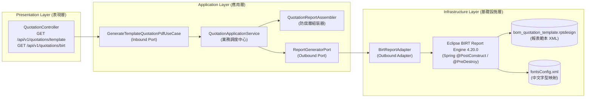
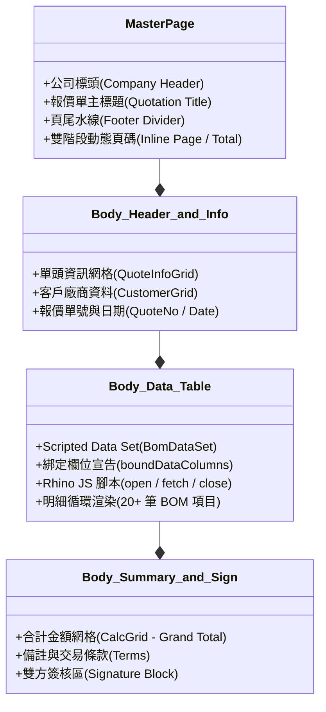

# Eclipse BIRT PDF 報表模組維運與使用指南 (BIRT Operations & Administration Guide)
**Document Version:** 1.0.0  
**Target Module:** `pdf-module`  
**Architecture Style:** Clean Architecture / Hexagonal Architecture (Ports & Adapters)  
**Target Audience:** 維運工程師 (DevOps / SRE)、系統維護人員、後端開發工程師  

---

## 1. 模組簡介與架構定位

### 1.1 為什麼需要 BIRT 模組？
在 `pdf-module` 中，我們提供了兩種互補的 PDF 生成架構：
1. **OpenPDF 引擎 (程式化排版)**：透過 Java 程式碼以像素級精確繪製 PDF。適合高吞吐、不需要外部設計器、版面極度固定的情境。
2. **Eclipse BIRT 引擎 (視覺化範本驅動)**：透過 Eclipse BIRT 報表設計檔（`.rptdesign`）實現版面與程式碼徹底解耦。適合業務單據（如報價單、出貨單、發票、對帳單），業務人員或維運人員可藉由視覺化報表設計器微調格式、調整欄位寬度、字體或新增計算欄位，**無需重新編譯 Java 核心程式碼即可更新報表版面**。

### 1.2 六角形架構 (Hexagonal Architecture) 元件職責圖



| 元件名稱 | 原始碼路徑 | 架構角色與職責說明 |
| :--- | :--- | :--- |
| **QuotationController** | `com.example.demo.presentation.controller.QuotationController` | 對外 REST API 接口，暴露 `/template` 與 `/birt` 端點，負責 HTTP 參數解析與回傳標準 PDF 串流及自定義 Header。 |
| **GenerateTemplateQuotationPdfUseCase** | `com.example.demo.application.port.in.GenerateTemplateQuotationPdfUseCase` | 應用層輸入端口 (Inbound Port)，規範「使用範本產出報價單 PDF」的業務合約。 |
| **QuotationApplicationService** | `com.example.demo.application.service.QuotationApplicationService` | 應用層用例實作服務，協調資料來源（`MockServicePort`）、組裝報表參數（`QuotationReportAssembler`）並調用報表引擎。 |
| **QuotationReportAssembler** | `com.example.demo.application.assembler.QuotationReportAssembler` | 防腐層（ACL）組裝器，將強型別業務 DTO 轉換為 BIRT 所需之 `Parameters Map` 與 `DataContext Map`。 |
| **ReportGeneratorPort** | `com.example.demo.application.port.out.ReportGeneratorPort` | 應用層輸出端口 (Outbound Port)，定義底層報表引擎必須履行的渲染行為。 |
| **BirtReportAdapter** | `com.example.demo.infrastructure.adapter.BirtReportAdapter` | 基礎設施層外向適配器 (Outbound Adapter)，託管 Eclipse BIRT Engine 的完整生命週期（啟動、載入範本、任務執行與資源回收）。 |
| **bom_quotation_template.rptdesign** | `src/main/resources/templates/bom_quotation_template.rptdesign` | 核心報表設計檔（XML 格式），定義報表網格排版、Scripted Data Set 與視覺外觀。 |
| **fontsConfig.xml** | `src/main/resources/fontsConfig.xml` | BIRT 字體路徑配置檔，負責跨平台字體（如微軟正黑體）路徑解析。 |

---

## 2. 維運快速上手與 API 調用驗證

維運人員可透過 Swagger UI、cURL 或監控腳本驗證 BIRT PDF 模組之健康狀況與產出品質。

### 2.1 服務端點規格表

| HTTP Method | API 端點路徑 | 說明 | 關鍵 Response Headers |
| :--- | :--- | :--- | :--- |
| `GET` | `/api/v1/quotations/template` | **正式推薦端點**：使用 BIRT 範本生成報價單 PDF | `Content-Type: application/pdf`<br/>`X-Pdf-Engine: BIRT (Template)`<br/>`Content-Disposition: attachment; filename="..."` |
| `GET` | `/api/v1/quotations/birt` | **相容別名端點**：功能與 `/template` 完全一致 | 同上 |
| `GET` | `/swagger-ui/index.html` | OpenAPI / Swagger 視覺化測試介面 | 點擊「Try it out」與「Execute」後，可直接透過「Download file」按鈕下載驗證。 |

### 2.2 請求參數說明 (Query Parameters)

| 參數名稱 | 型別 | 必填 | 預設值 | 說明與格式約束 |
| :--- | :--- | :---: | :---: | :--- |
| `id` | `string` | 否 | `QT-20261023-001` | 報價單單號。長度上限 50 字元，僅允許半形英數字、減號 `-` 與底線 `_`。 |
| `download` | `boolean` | 否 | `true` | `true`：以附件方式下載 (`Content-Disposition: attachment`)；<br/>`false`：於瀏覽器直接預覽 (`Content-Disposition: inline`)。 |

### 2.3 cURL 維運驗證指令集

#### (A) 基本健康度與下載驗證 (儲存為本機 PDF)
```bash
curl -X GET "http://localhost:8080/api/v1/quotations/template?download=true" \
     -o birt_quotation_test.pdf
```
* **驗證方式**：開啟 `birt_quotation_test.pdf`，確認報價單具備完整單頭、BOM 物料表格（序號 1~20）、計算匯總與跨頁雙面頁碼。

#### (B) 檢查 HTTP 標頭 (驗證引擎版本與狀態碼)
```bash
curl -I -X GET "http://localhost:8080/api/v1/quotations/template"
```
* **預期正確輸出**：
```http
HTTP/1.1 200 OK
Content-Type: application/pdf
Content-Disposition: attachment; filename="QT-20261023-001_template.pdf"
X-Pdf-Engine: BIRT (Template)
Content-Length: 64285
...
```

#### (C) 傳入特定報價單單號
```bash
curl -X GET "http://localhost:8080/api/v1/quotations/template?id=QT-2026-SPECIAL&download=true" \
     -o quotation_special.pdf
```

---

## 3. 報表範本 (`.rptdesign`) 結構與維護 SOP

報表範本檔案放置於：
`src/main/resources/templates/bom_quotation_template.rptdesign`

### 3.1 範本核心架構三板塊



### 3.2 參數與資料集資料流說明

#### 1. 單頭與統計參數 (Report Parameters)
由 `QuotationReportAssembler.toParameters(dto)` 注入，在範本內部使用 `<VALUE-OF format="...">params["參數名"].value</VALUE-OF>` 讀取：
* `quotationNo`：報價單號
* `customerName`：客戶名稱
* `customerTaxId`：統一編號
* `subtotalAmount` / `taxAmount` / `totalAmount`：格式化金額字串（千分位格式，如 `2,450,000`）
* `terms`：交易與付款條件

#### 2. 物料明細動態表格 (Scripted Data Set - `BomDataSet`)
由 `QuotationReportAssembler.toDataContext(dto)` 將明細封裝於鍵值 `items` 中，透過 Rhino JavaScript 引擎進行逐筆提取：
* **`open` 腳本**：
  ```javascript
  items = reportContext.getAppContext().get("items");
  totalRows = (items != null) ? items.size() : 0;
  count = 0;
  ```
* **`fetch` 腳本**：
  ```javascript
  if (count < totalRows) {
      var item = items.get(count);
      function getVal(key) {
          if (item == null) return "";
          var v = item.get(key);
          return (v == null) ? "" : String(v);
      }
      row["itemNo"] = getVal("itemNo");
      row["materialNo"] = getVal("materialNo");
      row["description"] = getVal("description");
      row["quantity"] = getVal("quantity");
      row["unit"] = getVal("unit");
      row["unitPrice"] = getVal("unitPrice");
      row["subtotal"] = getVal("subtotal");
      row["remark"] = getVal("remark");
      count++;
      return true;
  }
  return false;
  ```

### 3.3 範本修改與發布作業 SOP

1. **設計工具推薦**：
   * 建議下載安裝 [Eclipse BIRT Report Designer](https://eclipse.dev/birt/)。
   * 或直接以 VS Code / IntelliJ IDEA 編輯 XML 原始碼（需格外注意 XML Tag 閉合與屬性正確性）。
2. **本機驗證**：
   * 修改範本後，於終端機執行單元測試：
     ```powershell
     .\mvnw.cmd test -Dtest=BirtReportAdapterTest,QuotationControllerTest
     ```
   * 確保所有斷言與渲染流程全數通過 (`BUILD SUCCESS`)。
3. **部署與重啟**：
   * 目前範本打包於 JAR 檔 Classpath 內部，修改範本後需重新打包並重啟 Spring Boot 容器：
     ```powershell
     .\mvnw.cmd clean package -DskipTests
     ```

---

## 4. 字體配置與容器化跨平台部署 (Fonts & Docker)

### 4.1 字體配置檔 (`fontsConfig.xml`)
BIRT 引擎透過 `src/main/resources/fontsConfig.xml` 尋找本機或系統中文字體：
```xml
<?xml version="1.0" encoding="UTF-8"?>
<font-paths xmlns="http://www.eclipse.org/birt/2005/design">
    <font-path path="fonts" />
    <font-path path="C:/Windows/Fonts" />
    <font-path path="/usr/share/fonts" />
    <font-path path="/usr/local/share/fonts" />
</font-paths>
```

### 4.2 Linux / Docker 容器環境維運注意
> [!WARNING]
> **常見生產環境事故：中文輸出變為空白或方框 (Tofu Blocks □□□)**  
> 預設的 Linux Alpine / Debian / Ubuntu 基礎映像檔通常未內建中文字型（如微軟正黑體 `msjh.ttc` 或微軟雅黑 `msyh.ttc`）。當 BIRT 在 Linux 容器環境執行時，若找不到指定字體，將導致中文字元無法顯示或寬度計算崩潰。

#### Dockerfile 最佳實踐修復方案：
在 Docker 映像檔建置階段安裝開源思源黑體（Noto Sans CJK TC）或微軟正黑體：

```dockerfile
# 方案 A：使用 Alpine Linux 時安裝中文字體
FROM eclipse-temurin:21-jre-alpine
RUN apk add --no-cache fontconfig ttf-dejavu \
    && mkdir -p /usr/share/fonts/cjk
# 將微軟正黑體或 NotoSans 複製進容器
COPY src/main/resources/fonts/msjh.ttc /usr/share/fonts/cjk/
RUN fc-cache -fv

# 方案 B：使用 Ubuntu / Debian 映像檔
FROM eclipse-temurin:21-jre
RUN apt-get update && apt-get install -y --no-install-recommends \
    fontconfig \
    fonts-noto-cjk \
    && fc-cache -fv \
    && rm -rf /var/lib/apt/lists/*
```

---

## 5. 常見維運故障與排查速查手冊 (Troubleshooting Guide)

以下彙整 BIRT PDF 模組上線與排版調整時可能遭遇的 6 大經典故障、根因分析與標準解決方案：

### 故障 1：PDF 畫面上直接印出 `<VALUE-OF>...</VALUE-OF>` 原始標籤字樣
* **現象**：產出的 PDF 畫面中，客戶名稱或單號處直接顯示如 `<VALUE-OF>params["quotationNo"].value</VALUE-OF>` 的文字，未被求值替換。
* **根因**：BIRT 範本中的 `<text>` 元素之 `contentType` 屬性被設為了 `plain`。設為 `plain` 時，BIRT 會將內容視為純文字原樣輸出，不予解析標籤。
* **解法**：在 `.rptdesign` 中，將該 text 元件的 `contentType` 修改為 `html`：
  ```xml
  <!-- 正確寫法 -->
  <property name="contentType">html</property>
  <text-property name="content"><![CDATA[<VALUE-OF>params["quotationNo"].value</VALUE-OF>]]></text-property>
  ```

---

### 故障 2：BOM 物料表格僅有表頭，明細資料完全空白 (0 筆)
* **現象**：後端 Log 顯示查詢到 20 筆資料，但產出的 PDF 表格無任何明細資料列。
* **根因分析**：
  1. **未在 Table 宣告欄位綁定**：BIRT 的 Table 元素必須包含 `<list-property name="boundDataColumns">`，若未定義映射，儲存格內的 `<VALUE-OF>row["itemNo"]</VALUE-OF>` 會無法取得資料流。
  2. **Rhino 腳本錯誤**：在 `fetch` 腳本中若嘗試使用 Java 物件方法（例如 `row.itemNo()` 或 `item.itemNo()`），Rhino 會拋出 `TypeError: 1 is not a function` 異常並直接終止資料集迭代。
* **標準解法**：
  1. 確保 Table 定義了欄位綁定：
     ```xml
     <list-property name="boundDataColumns">
         <structure>
             <property name="name">itemNo</property>
             <expression name="expression">dataSetRow["itemNo"]</expression>
         </structure>
         ...
     </list-property>
     ```
  2. 確保 `fetch` 腳本使用防禦性 `item.get("欄位名")` 提取 Map 資料（參閱 3.2 節）。

---

### 故障 3：總計金額冒號被折行跑版 (`總計金額 (Grand Total)：` 斷成兩行)
* **現象**：右下角金額匯總區塊中，「總計金額 (Grand Total)」最後的冒號被擠壓到下一行。
* **根因**：標籤單元格寬度不足，且未設定禁止換行屬性。
* **解法**：
  1. 調整欄寬比例（例如將標籤欄設為 `60%`，數值欄設為 `40%`）。
  2. 在該 `<cell>` 加上 `<property name="noWrap">true</property>`。
  3. 微調字級大小（例如從 `10pt` 調整至 `9.5pt`）。

---

### 故障 4：頁尾動態頁碼呈現垂直直排 (`1` 在最上、`/` 在中、`2` 在最下)
* **現象**：頁尾頁碼預期應為橫排 `1 / 2`，結果卻換行成三行垂直排版。
* **根因**：BIRT 的 `<auto-text>`（頁碼元件）預設在 PDF 渲染層被視為區塊元素（Block Element），會強制換行。
* **解法**：在頁尾的兩個 `<auto-text>` 以及中間的文字 `<text>` 加上 `display: inline`：
  ```xml
  <auto-text id="305">
      <property name="display">inline</property>
      <property name="type">page-number</property>
  </auto-text>
  <text id="306">
      <property name="display">inline</property>
      <text-property name="content"><![CDATA[ / ]]></text-property>
  </text>
  <auto-text id="307">
      <property name="display">inline</property>
      <property name="type">total-page</property>
  </auto-text>
  ```

---

### 故障 5：記憶體佔用持續攀升或拋出 `OutOfMemoryError: Metaspace`
* **現象**：服務運行數天後，JVM Heap 或 Metaspace 不斷增長，最終發生崩潰。
* **根因**：
  1. 每次 Request 呼叫時重複執行了 `Platform.startup()` 與 `factory.createReportEngine()`。
  2. 渲染任務執行完畢後未關閉 `IRunAndRenderTask`。
* **防護機制（本模組已落實）**：
  * `BirtReportAdapter` 已改由 Spring 單例託管，在容器啟動時（`@PostConstruct`）僅初始化一次 BIRT Platform。
  * 每次報表渲染後，在 `finally` 區塊強制執行 `task.close()` 釋放 Rhino 上下文與暫存物件：
    ```java
    try {
        task.run();
        return bos.toByteArray();
    } finally {
        if (task != null) {
            task.close(); // 極為關鍵！防止記憶體洩漏
        }
    }
    ```

---

### 故障 6：BIRT 產生 `org.eclipse.birt.report.engine.api.EngineException: Can not load the report with public id: null`
* **現象**：調用 API 時回傳 HTTP 500，後端 Log 顯示無法載入範本。
* **根因**：Classpath 底下找不到指定路徑的 `.rptdesign` 檔案。
* **排查與處置**：
  1. 檢查 JAR 檔內是否存在 `templates/bom_quotation_template.rptdesign`。
  2. 確認 Spring Boot 打包配置未將 `.rptdesign` 當作二進位損毀或過濾掉。
  3. 檢視後端日誌中印出的路徑與檔名。

---

## 6. 維運監控與日誌等級配置

### 6.1 Logback / application.yml 日誌設定建議
BIRT 引擎在大量渲染時，若日誌級別設為 `DEBUG` 會輸出巨量的 Rhino 腳本執行追蹤，可能導致硬碟 I/O 飆高。維運建議配置如下：

```yaml
logging:
  level:
    # 應用程式自訂適配器與用例（保持 INFO 監控耗時與調用）
    com.example.demo.infrastructure.adapter.BirtReportAdapter: INFO
    com.example.demo.application.service.QuotationApplicationService: INFO
    com.example.demo.presentation.controller.QuotationController: INFO
    # BIRT 官方底層套件（建議保持 WARN，防止大量除錯資訊灌爆 Log）
    org.eclipse.birt: WARN
    org.eclipse.birt.report.engine: WARN
```

### 6.2 JVM 記憶體參數建議
針對以 BIRT PDF 產出為主的生產容器環境，建議設定適當的堆積記憶體與 Metaspace 邊界：
```bash
JAVA_OPTS="-Xms1024m -Xmx2048m -XX:MetaspaceSize=256m -XX:MaxMetaspaceSize=512m -XX:+UseG1GC"
```

---

## 7. 維運檢查檢核清單 (Maintenance Checklist)

上線或版本發布前，請維運同仁逐一確認下列檢查項目：

- [ ] **API 訪問正常**：以 cURL 或 Swagger 呼叫 `/api/v1/quotations/template` 回傳 HTTP 200。
- [ ] **Response Header 吻合**：包含 `X-Pdf-Engine: BIRT (Template)` 與正確的 PDF Content-Type。
- [ ] **中文字體不缺失**：確認 Linux/Docker 宿主機已掛載或安裝微軟正黑體/NotoSans 字體，PDF 無缺字方塊。
- [ ] **明細表格筆數完整**：PDF 明細筆數與測試資料一致，欄位無覆蓋或錯位。
- [ ] **合計欄位無斷行**：總計金額無冒號折行。
- [ ] **頁尾頁碼橫排**：頁碼正常顯示為 `1 / 2` 橫向排列。
- [ ] **JVM 資源正常釋放**：壓測 100 次並行請求後，記憶體無異常持續滯留。
