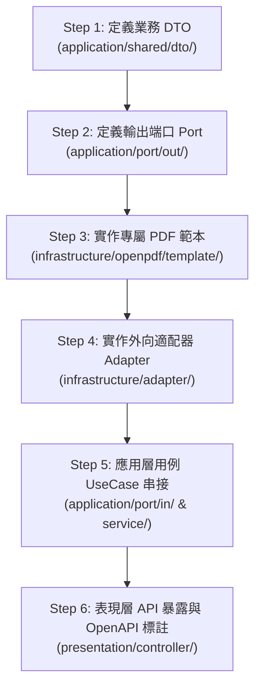

# 自定義 OpenPDF 業務範本開發實戰指南 (Custom Template Guide)
**Document Version:** 1.0.0  
**Target Module:** `pdf-module`  
**Architecture Style:** Clean Architecture / Hexagonal Architecture (Ports & Adapters)  

---

## 1. 概念與設計哲學回顧

本模組的核心排版哲學為**「通用積木下沉，業務範本自治」**：
* **通用排版積木 (`infrastructure/openpdf/core/`)**：提供無狀態、單例快取的字體載入 (`OpenPdfFontProvider`)、企業色彩與常數 (`OpenPdfStylePalette`)、儲存格與行排版工廠 (`OpenPdfCellFactory`) 以及跨頁「第 X 頁 / 共 Y 頁」雙階段計算動態頁碼控制器 (`OpenPdfPageEventHelper`)。
* **業務專屬範本 (`infrastructure/openpdf/template/`)**：每個業務單據（如報價單、出貨單、發票憑證、請購單等）各自擁有獨立的範本類別，依據自身版面規則調用通用積木進行拼裝，**互不干擾、修改單一報表絕不牽連全局**。

---

## 2. 新增自定義範本之六大落地步驟 (6-Step Workflow)

以下以新增一張**「出貨單 (Delivery Note)」**為實戰範例，展示從領域定義、應用層端口到基礎設施層範本排版的完整標準流程：



---

### Step 1：定義應用層業務資料載體 (DTO)

* **規範**：
  * 命名遵守 AGENTS.md 規範 3-6：`N + Gotten/Searched + Result`。
  * 放置於 `src/main/java/com/example/demo/application/shared/dto/`。
  * 嚴格作為純資料載體 (Java Record)，**嚴禁包含任何業務或轉換邏輯**。

```java
package com.example.demo.application.shared.dto;

import java.time.LocalDate;
import java.util.List;

/**
 * 出貨單資訊資料傳輸物件 (Pure Data Carrier)
 */
public record DeliveryNoteGottenResult(
        String deliveryNo,
        LocalDate deliveryDate,
        String customerName,
        String deliveryAddress,
        String contactPerson,
        String recipientPhone,
        String shippingMethod,
        String remarks,
        List<DeliveryItemGottenResult> items
) {
}
```

```java
package com.example.demo.application.shared.dto;

/**
 * 出貨單明細項目資料傳輸物件 (Pure Data Carrier)
 */
public record DeliveryItemGottenResult(
        Integer itemNo,
        String materialNo,
        String description,
        Integer quantity,
        String unit,
        String remark
) {
}
```

---

### Step 2：定義應用層外向輸出端口 (Outbound Port)

* **規範**：
  * 命名遵守 AGENTS.md 規範 3-8：結尾為 `Port`。
  * 放置於 `src/main/java/com/example/demo/application/port/out/`。
  * 方法簽名**純業務契約**，僅接收強型別業務 DTO，回傳原生 `byte[]`，絕不依賴任何底層 PDF 框架類別。

```java
package com.example.demo.application.port.out;

import com.example.demo.application.shared.dto.DeliveryNoteGottenResult;

/**
 * 出貨單 PDF 產出外向端口 (Outbound Port)
 */
public interface DeliveryNotePdfPort {

    /**
     * 依據出貨單資料產出二進位 PDF 檔案
     *
     * @param deliveryNote 出貨單完整資訊 DTO
     * @return PDF 二進位位元組陣列
     */
    byte[] generateDeliveryNotePdf(DeliveryNoteGottenResult deliveryNote);
}
```

---

### Step 3：實作業務專屬 PDF 範本 (Template)

* **規範**：
  * 實作 `PdfDocumentTemplate<T>` 契約介面。
  * 放置於 `src/main/java/com/example/demo/infrastructure/openpdf/template/`。
  * 標註 Spring `@Component`。
  * 注入 `OpenPdfFontProvider`，並搭配 `OpenPdfStylePalette`、`OpenPdfCellFactory`、`OpenPdfPageEventHelper` 快速拼裝。

#### 建議的類別結構與分解方法：

```java
package com.example.demo.infrastructure.openpdf.template;

import com.example.demo.application.shared.dto.DeliveryItemGottenResult;
import com.example.demo.application.shared.dto.DeliveryNoteGottenResult;
import com.example.demo.infrastructure.openpdf.core.OpenPdfCellFactory;
import com.example.demo.infrastructure.openpdf.core.OpenPdfFontProvider;
import com.example.demo.infrastructure.openpdf.core.OpenPdfPageEventHelper;
import com.example.demo.infrastructure.openpdf.core.OpenPdfStylePalette;
import lombok.RequiredArgsConstructor;
import lombok.extern.slf4j.Slf4j;
import org.openpdf.text.Document;
import org.openpdf.text.Element;
import org.openpdf.text.Font;
import org.openpdf.text.PageSize;
import org.openpdf.text.Paragraph;
import org.openpdf.text.Rectangle;
import org.openpdf.text.pdf.PdfPCell;
import org.openpdf.text.pdf.PdfPTable;
import org.openpdf.text.pdf.PdfWriter;
import org.springframework.stereotype.Component;

import java.awt.Color;
import java.io.OutputStream;
import java.time.format.DateTimeFormatter;
import java.util.List;

/**
 * 出貨單 PDF 專屬排版範本 (Delivery Note Template)
 */
@Slf4j
@Component
@RequiredArgsConstructor
public class DeliveryNotePdfTemplate implements PdfDocumentTemplate<DeliveryNoteGottenResult> {

    private final OpenPdfFontProvider fontProvider;

    @Override
    public void render(DeliveryNoteGottenResult data, OutputStream outputStream) throws Exception {
        if (data == null || outputStream == null) {
            throw new IllegalArgumentException("資料與輸出串流不可為 null");
        }

        // 1. 初始化 A4 頁面 (邊距: 左32, 右32, 上36, 下36 pt)
        Document document = new Document(PageSize.A4, 32f, 32f, 36f, 36f);
        PdfWriter writer = PdfWriter.getInstance(document, outputStream);

        // 2. 掛載跨頁動態頁碼控制器 (「第 X 頁 / 共 Y 頁」)
        OpenPdfPageEventHelper pageEventHelper = new OpenPdfPageEventHelper(fontProvider.getBaseFont());
        writer.setPageEvent(pageEventHelper);

        document.open();

        // 3. 模組化依序渲染各視覺區塊
        renderHeader(document, data);
        document.add(OpenPdfCellFactory.createSeparatorTable(OpenPdfStylePalette.ACCENT_BLUE, 2f, 8f, 8f));
        renderInfoGrid(document, data);
        document.add(new Paragraph(" "));
        renderItemsTable(document, data.items());
        renderFooterSignatures(document);

        document.close();
        log.info("出貨單 PDF 渲染完成: deliveryNo={}", data.deliveryNo());
    }

    /** 區塊 A: 公司標頭與單號 */
    private void renderHeader(Document document, DeliveryNoteGottenResult data) throws Exception {
        PdfPTable table = new PdfPTable(2);
        table.setWidthPercentage(100);
        table.setWidths(new float[]{60f, 40f});

        PdfPCell leftCell = new PdfPCell();
        leftCell.setBorder(Rectangle.NO_BORDER);
        leftCell.addElement(new Paragraph("晨星智造整合科技股份有限公司", fontProvider.getTitleFont()));
        leftCell.addElement(new Paragraph("出 貨 單 (DELIVERY NOTE)", fontProvider.getSubtitleFont()));
        table.addCell(leftCell);

        PdfPCell rightCell = new PdfPCell();
        rightCell.setBorder(Rectangle.NO_BORDER);
        rightCell.setHorizontalAlignment(Element.ALIGN_RIGHT);
        Paragraph info = new Paragraph("出貨單號：" + data.deliveryNo() + "\n出貨日期：" + data.deliveryDate(), fontProvider.getBodyBold());
        info.setAlignment(Element.ALIGN_RIGHT);
        rightCell.addElement(info);
        table.addCell(rightCell);

        document.add(table);
    }

    /** 區塊 B: 客戶交運資訊 4 欄網格 */
    private void renderInfoGrid(Document document, DeliveryNoteGottenResult data) throws Exception {
        PdfPTable grid = new PdfPTable(4);
        grid.setWidthPercentage(100);
        grid.setWidths(new float[]{15f, 35f, 15f, 35f});

        Font labelFont = fontProvider.getBodyBold();
        Font valFont = fontProvider.getBodyRegular();
        Color labelBg = OpenPdfStylePalette.BG_LIGHT_GRAY;
        Color border = OpenPdfStylePalette.BORDER_GRAY;

        OpenPdfCellFactory.addInfoCell(grid, "客戶名稱：", labelFont, true, labelBg, border);
        OpenPdfCellFactory.addInfoCell(grid, data.customerName(), valFont, false, Color.WHITE, border);
        OpenPdfCellFactory.addInfoCell(grid, "運送方式：", labelFont, true, labelBg, border);
        OpenPdfCellFactory.addInfoCell(grid, data.shippingMethod(), valFont, false, Color.WHITE, border);

        OpenPdfCellFactory.addInfoCell(grid, "收件地址：", labelFont, true, labelBg, border);
        OpenPdfCellFactory.addInfoCell(grid, data.deliveryAddress(), valFont, false, Color.WHITE, border);
        OpenPdfCellFactory.addInfoCell(grid, "聯絡電話：", labelFont, true, labelBg, border);
        OpenPdfCellFactory.addInfoCell(grid, data.recipientPhone(), valFont, false, Color.WHITE, border);

        document.add(grid);
    }

    /** 區塊 C: 出貨明細清單表格 (支援跨頁表頭重複) */
    private void renderItemsTable(Document document, List<DeliveryItemGottenResult> items) throws Exception {
        PdfPTable table = new PdfPTable(6);
        table.setWidthPercentage(100);
        table.setWidths(new float[]{8f, 22f, 40f, 10f, 8f, 12f});
        table.setHeaderRows(1); // 自動重複跨頁表頭

        // 表頭
        String[] headers = {"項次", "料號", "品名規格", "數量", "單位", "備註"};
        for (String h : headers) {
            table.addCell(OpenPdfCellFactory.createHeaderCell(h, fontProvider.getHeaderFont(), OpenPdfStylePalette.PRIMARY_NAVY));
        }

        // 資料行
        Font cellFont = fontProvider.getBodyRegular();
        Color border = OpenPdfStylePalette.BORDER_GRAY;
        for (int i = 0; i < items.size(); i++) {
            DeliveryItemGottenResult item = items.get(i);
            Color rowBg = (i % 2 == 1) ? OpenPdfStylePalette.ROW_ALT_BG : Color.WHITE;

            table.addCell(OpenPdfCellFactory.createDataCell(String.valueOf(item.itemNo()), cellFont, Element.ALIGN_CENTER, rowBg, border));
            table.addCell(OpenPdfCellFactory.createDataCell(item.materialNo(), cellFont, Element.ALIGN_LEFT, rowBg, border));
            table.addCell(OpenPdfCellFactory.createDataCell(item.description(), cellFont, Element.ALIGN_LEFT, rowBg, border));
            table.addCell(OpenPdfCellFactory.createDataCell(String.valueOf(item.quantity()), cellFont, Element.ALIGN_RIGHT, rowBg, border));
            table.addCell(OpenPdfCellFactory.createDataCell(item.unit(), cellFont, Element.ALIGN_CENTER, rowBg, border));
            table.addCell(OpenPdfCellFactory.createDataCell(item.remark(), cellFont, Element.ALIGN_LEFT, rowBg, border));
        }

        document.add(table);
    }

    /** 區塊 D: 簽核用印框 */
    private void renderFooterSignatures(Document document) throws Exception {
        PdfPTable signTable = new PdfPTable(2);
        signTable.setWidthPercentage(100);
        signTable.setWidths(new float[]{50f, 50f});
        signTable.setSpacingBefore(16f);

        PdfPCell left = new PdfPCell(new Paragraph("倉儲發貨簽章：__________________", fontProvider.getBodyBold()));
        left.setPadding(12f);
        left.setBorderColor(OpenPdfStylePalette.BORDER_GRAY);

        PdfPCell right = new PdfPCell(new Paragraph("客戶點收簽章：__________________", fontProvider.getBodyBold()));
        right.setPadding(12f);
        right.setBorderColor(OpenPdfStylePalette.BORDER_GRAY);

        signTable.addCell(left);
        signTable.addCell(right);
        document.add(signTable);
    }
}
```

---

### Step 4：實作基礎設施外向適配器 (Outbound Adapter)

* **規範**：
  * 命名遵守 AGENTS.md 規範 3-9：結尾為 `Adapter`。
  * 放置於 `src/main/java/com/example/demo/infrastructure/adapter/`。
  * 實作 Step 2 的 `DeliveryNotePdfPort`，協調 Step 3 的 `DeliveryNotePdfTemplate`。
  * 使用 `try-with-resources` 安全管理 `ByteArrayOutputStream`。

```java
package com.example.demo.infrastructure.adapter;

import com.example.demo.application.port.out.DeliveryNotePdfPort;
import com.example.demo.application.shared.dto.DeliveryNoteGottenResult;
import com.example.demo.infrastructure.openpdf.template.DeliveryNotePdfTemplate;
import lombok.RequiredArgsConstructor;
import lombok.extern.slf4j.Slf4j;
import org.springframework.stereotype.Component;

import java.io.ByteArrayOutputStream;

/**
 * 出貨單 PDF 輸出外向適配器 (Outbound Adapter)
 */
@Slf4j
@Component
@RequiredArgsConstructor
public class OpenPdfDeliveryNoteAdapter implements DeliveryNotePdfPort {

    private final DeliveryNotePdfTemplate deliveryNotePdfTemplate;

    @Override
    public byte[] generateDeliveryNotePdf(DeliveryNoteGottenResult deliveryNote) {
        if (deliveryNote == null) {
            log.error("產出出貨單失敗：傳入物件為 null");
            return null;
        }

        try (ByteArrayOutputStream baos = new ByteArrayOutputStream()) {
            deliveryNotePdfTemplate.render(deliveryNote, baos);
            return baos.toByteArray();
        } catch (Exception e) {
            log.error("渲染出貨單 PDF 發生異常: deliveryNo={}", deliveryNote.deliveryNo(), e);
            return null;
        }
    }
}
```

---

### Step 5：應用層用例 (UseCase & Service) 串接

* **Inbound Port** (`application/port/in/GenerateDeliveryNotePdfUseCase.java`):
  ```java
  public interface GenerateDeliveryNotePdfUseCase {
      byte[] generateDeliveryNotePdf(GetDeliveryNoteQuery query);
  }
  ```
* **Application Service** (`application/service/DeliveryNoteApplicationService.java`):
  ```java
  @Service
  @RequiredArgsConstructor
  public class DeliveryNoteApplicationService implements GenerateDeliveryNotePdfUseCase {
      private final DeliveryNoteRepositoryPort repositoryPort;
      private final DeliveryNotePdfPort deliveryNotePdfPort;

      @Override
      public byte[] generateDeliveryNotePdf(GetDeliveryNoteQuery query) {
          DeliveryNoteGottenResult data = repositoryPort.getDeliveryNote(query);
          return deliveryNotePdfPort.generateDeliveryNotePdf(data);
      }
  }
  ```

---

### Step 6：表現層 API 暴露與 OpenAPI 標註

在 Controller 中提供 HTTP 端點，並配合 OpenAPI 與下載標頭支援 Swagger UI 的直接下載功能：

```java
@Tag(name = "出貨單 PDF 生成 API", description = "提供出貨單 PDF 文件生成與下載服務")
@RestController
@RequestMapping("/api/v1/delivery-notes")
@RequiredArgsConstructor
public class DeliveryNoteController {

    private final GenerateDeliveryNotePdfUseCase useCase;

    @Operation(summary = "取得出貨單 PDF 檔案")
    @GetMapping(value = "/pdf", produces = MediaType.APPLICATION_PDF_VALUE)
    public ResponseEntity<byte[]> getPdf(
            @RequestParam("id") String id,
            @RequestParam(name = "download", defaultValue = "true") boolean download) {

        byte[] pdfBytes = useCase.generateDeliveryNotePdf(new GetDeliveryNoteQuery(id));

        HttpHeaders headers = new HttpHeaders();
        headers.setContentType(MediaType.APPLICATION_PDF);
        headers.setContentLength(pdfBytes.length);

        // 設定 attachment 支援 Swagger UI 下載與瀏覽器儲存
        ContentDisposition disposition = download
                ? ContentDisposition.attachment().filename(id + "_delivery.pdf", StandardCharsets.UTF_8).build()
                : ContentDisposition.inline().filename(id + "_delivery.pdf", StandardCharsets.UTF_8).build();
        headers.setContentDisposition(disposition);
        headers.add(HttpHeaders.ACCESS_CONTROL_EXPOSE_HEADERS, "Content-Disposition, Content-Length");

        return new ResponseEntity<>(pdfBytes, headers, HttpStatus.OK);
    }
}
```

---

## 3. 通用排版積木速查手冊 (Building Blocks Cheatsheet)

### 3.1 字體階層 (`OpenPdfFontProvider`)

| 方法名稱 | 預設大小 | 字重 | 預設顏色 | 適用場景 |
| :--- | :--- | :--- | :--- | :--- |
| `getTitleFont()` | 16pt | Bold | `PRIMARY_NAVY` (#0F172A) | 公司名稱、文件主抬頭 |
| `getSubtitleFont()` | 9pt | Normal | `TEXT_MUTED` (#64748B) | 英文副標題、機構代號 |
| `getQuotationTitleFont()` | 20pt | Bold | `PRIMARY_NAVY` (#0F172A) | 大標題 (如「報價單」、「出貨單」) |
| `getHeaderFont()` | 9.5pt | Bold | `Color.WHITE` | 表格深色表頭標題 |
| `getBodyBold()` | 9pt | Bold | `TEXT_DARK` (#1E293B) | 欄位 Label、總計摘要項 |
| `getBodyRegular()` | 9pt | Normal | `TEXT_DARK` (#1E293B) | 表格資料內文、明細品項 |
| `getBodyMuted()` | 8.5pt | Normal | `TEXT_MUTED` (#64748B) | 地址、備註條款、細則說明 |
| `getTotalFont()` | 11pt | Bold | `HIGHLIGHT_GREEN` (#047857) | 最終含稅總計大字 |
| `createFont(size, style, color)` | 自訂 | 自訂 | 自訂 | 特殊視覺或微調字級需求 |

### 3.2 企業配色調色盤 (`OpenPdfStylePalette`)

* **主要品牌色 (`PRIMARY_NAVY`)**：`#0F172A`（深海軍藍，用於主要表頭背景與大標題）。
* **裝飾點綴色 (`ACCENT_BLUE`)**：`#2563EB`（科技藍，用於區塊分隔裝飾線條）。
* **邊框與格線 (`BORDER_GRAY`)**：`#E2E8F0`（淡冷灰，細緻格線不干擾閱讀）。
* **卡片與標籤背景 (`BG_LIGHT_GRAY` / `CARD_BG_LIGHT`)**：`#F8FAFC`（柔和底色，用於 Label 標籤格）。
* **明細斑馬紋 (`ROW_ALT_BG`)**：`#F8FAFC`（偶數列背景色，提高多行表格掃視度）。
* **金額高亮背景 (`TOTAL_BG_LIGHT`)**：`#ECFDF5`（淺翠綠底，突顯最終總金額）。

### 3.3 儲存格工廠常用方法 (`OpenPdfCellFactory`)

* **表頭儲存格**：
  ```java
  table.addCell(OpenPdfCellFactory.createHeaderCell("品名規格", fontProvider.getHeaderFont(), OpenPdfStylePalette.PRIMARY_NAVY));
  ```
* **資料明細儲存格 (內建 Padding 6pt、指定對齊與邊框色)**：
  ```java
  table.addCell(OpenPdfCellFactory.createDataCell("MCU-STM32", fontProvider.getBodyRegular(), Element.ALIGN_LEFT, rowBg, border));
  ```
* **客戶網格資訊儲存格 (4 欄式 Label + Value)**：
  ```java
  OpenPdfCellFactory.addInfoCell(grid, "客戶名稱：", labelFont, true, labelBg, border);
  ```
* **水平裝飾分隔線**：
  ```java
  document.add(OpenPdfCellFactory.createSeparatorTable(OpenPdfStylePalette.ACCENT_BLUE, 2f, 8f, 8f));
  ```
* **右側小計/稅額計算列**：
  ```java
  OpenPdfCellFactory.addCalcRow(calcTable, "未稅合計：", "NT$ 10,000", regular, bold, false, null);
  ```

---

## 4. 常見陷阱與最佳實踐 (Gotchas & Best Practices)

> [!IMPORTANT]
> **1. 中文顯示必須使用 `OpenPdfFontProvider`**  
> 原生 OpenPDF 預設字體（`Helvetica`, `Times-Roman` 等）不支援 CJK 中文字元。所有中文字串輸出必須使用 `OpenPdfFontProvider` 取得已內嵌 `MSJHL.TTC`（微軟正黑體）的 `Font`，否則中文字將會變成空白或問號。

> [!TIP]
> **2. 跨頁明細表格的最佳配置**  
> 明細品項較多時，請務必加上 `table.setHeaderRows(1)`，OpenPDF 會在換頁時自動在次頁頂部重複印出表頭，維持單據專業度。

> [!WARNING]
> **3. 儲存格高度與不正常換頁**  
> 避免將大量段落包覆於單一儲存格中卻未設置自動拆分，否則可能引發單元格溢出頁面邊界。

> [!NOTE]
> **4. Swagger UI 下載按鈕觸發條件**  
> 回傳標頭必須明確設定 `Content-Disposition: attachment; filename="..."`，且透過 `Access-Control-Expose-Headers` 暴露該標頭，Swagger UI 才會自動將 Response 轉為「Download file」按鈕，而非印出 `%PDF-2.0` 的二進位亂碼文字。

> [!IMPORTANT]
> **5. 避免分頁資料剛好結束引發孤兒區塊 (Anti-Orphan Pagination)**  
> 當表格明細筆數剛好填滿第一頁底部時，為避免結尾區塊（合計、條款、簽核）孤立在第二頁，範本必須套用「雙層防孤兒排版機制」（原子化複合結尾區塊 `setKeepTogether(true)` + 錨點明細牽引換頁演算法）。  
> 詳細原理、動態資料量數學模型與完整範本實作請參閱專屬技術指南：  
> [OpenPDF 動態資料量智慧防孤兒區塊排版技術指南 (openpdf_anti_orphan_pagination_guide.md)](file:///d:/桌面/ModuleWorkSpace/pdf-module/doc/design/openpdf/openpdf_anti_orphan_pagination_guide.md)。

