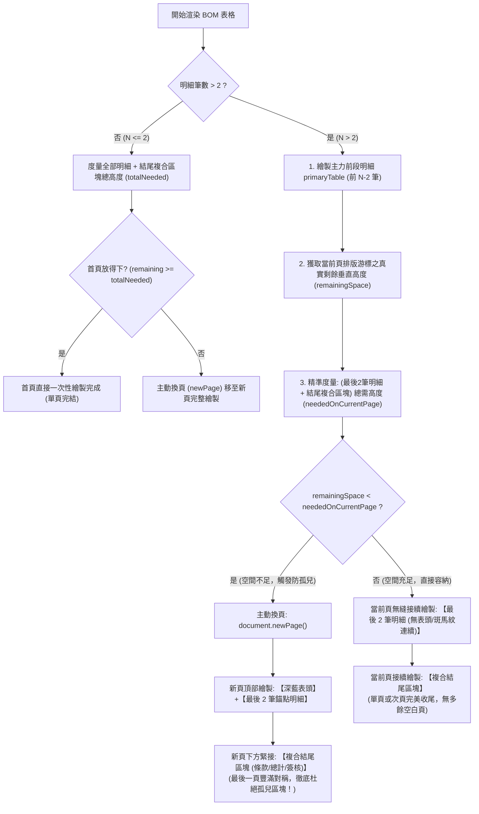

# OpenPDF 動態資料量智慧防孤兒區塊排版技術指南 (Anti-Orphan Pagination Guide)
**Document Version:** 1.0.0  
**Target Module:** `pdf-module`  
**Subsystem:** `infrastructure/openpdf/`  
**Architecture Style:** Clean Architecture / Hexagonal Architecture  
**Target Audience:** 架構師、後端研發工程師、報表維護人員  

---

## 1. 痛點背景與排版缺陷分析

### 1.1 何謂「孤兒區塊 (Orphan Block)」？
在企業商務單據（如 BOM 報價單、出貨單、驗收單、請購單與合約憑證）的 PDF 產生過程中，排版結構通常由兩大部分組成：
1. **主要資料載體**：動態筆數的物料明細表格（BOM Table）。
2. **結尾審核群組**：交易條款說明（Terms）、金額匯總（Subtotal / Tax / Grand Total）以及買賣雙方簽核用印框（Signature Block）。

#### 典型孤兒區塊缺陷現象：
當物料明細的數量**剛好填滿第一頁最底部**時（例如 12~16 筆資料剛好排到第 1 頁下邊緣），此時第一頁剩餘垂直可用高度僅剩 20~50pt。
後續繪製結尾審核群組時，因空間不足（通常需要 180~200pt），OpenPDF 的排版引擎被迫自動觸發換頁（`newPage()`）。
**其結果是：第二頁頂部完全沒有任何物料表格列，整頁開頭直接孤零零地呈現條款說明、合計金額與簽章框！**

```text
【傳統排版缺陷 - 孤兒區塊產生】
┌────────────────────────┐      ┌────────────────────────┐
│  晨星智造... (公司標頭) │      │ 【報價與交易條款說明】 │ <-- 孤兒區塊！
│  客戶名稱 / 報價單號   │      │ 未稅合計 / 營業稅      │     (整頁無任何明細，
│ ┌────────────────────┐ │      │ 總計金額 (Grand Total) │      容易引發審核爭議
│ │項次 1 ...          │ │      │ ┌────────────────────┐ │      與防偽抽換風險)
│ │項次 2 ...          │ │      │ │雙方經辦/主管簽核用印│ │
│ │...                 │ │      │ └────────────────────┘ │
│ │項次 14 (剛好到底部)│ │      │                        │
│ └────────────────────┘ │      │                        │
│             第 1 頁 / 共 2 頁 │      │             第 2 頁 / 共 2 頁 │
└────────────────────────┘      └────────────────────────┘
```

#### 商業與合約風險：
* **商業稽核爭議**：審核人員翻開第二頁看不到任何明細品項，容易誤認報表漏印或格式錯亂。
* **防偽與抽換風險**：最後一頁僅有簽名用印而無任何具體交易項目，在合約法律效力上極易遭受抽換或竄改質疑。
* **視覺比例失衡**：整頁上半部大面積空白或比例失調，嚴重影響企業對外專業形象。

---

## 2. 動態資料量全場景排版矩陣 (Dynamic Sizing Matrix)

本模組設計之防孤兒排版機制，保證能**100% 動態應對任意筆數的資料量**，從 0 筆到上百筆資料皆具備確定的排版決策路徑：

| 資料規模 | 明細筆數 ($N$) | 排版預期行為 | 決策路徑與防孤兒防護機制 |
| :--- | :---: | :--- | :--- |
| **極空邊界** | $N = 0$ | 呈現「目前無明細品項」提示，單頁結尾。 | 建立空資料提示行，檢查首頁剩餘空間確保放得下結尾區塊。 |
| **極少資料量** | $N = 1 \sim 2$ | 緊湊收斂於**第 1 頁**完整呈現。 | 走極少資料分支：計算全部明細與結尾區塊總高度，首頁空間充裕，不觸發換頁。 |
| **標準常規量** | $N = 3 \sim 10$ | 緊湊收斂於**第 1 頁**，無多餘分頁。 | 拆分前置明細與最後 2 筆錨點明細；首頁剩餘高度充足，以無表頭模式接續錨點明細並印出結尾群組。 |
| **臨界邊界量** | $N = 12 \sim 18$<br/>*(用戶截圖情境)* | **第 1 頁**：印前 $N-2$ 筆。<br/>**第 2 頁**：頂部具備深藍表頭 + 最後 2 筆明細 + 結尾區塊。 | **觸發防孤兒換頁**：首頁剩餘空間不足以容納 (最後2筆 + 結尾區塊)；主動換頁，將最後 2 筆攜帶至新頁，杜絕孤兒！ |
| **大量跨多頁** | $N \ge 20$<br/>*(例如 35~100 筆)* | **第 $1 \sim K-1$ 頁**：連續自然跨頁，每頁頂部自動重複表頭。<br/>**最後一頁**：必有表頭 + 最後 2 筆明細 + 結尾區塊。 | 前 $N-2$ 筆明細自然跨多頁；在最後一頁繪製錨點前即時度量剩餘高度，若空間不足再次主動換頁，確保最後一頁絕非孤兒。 |

---

## 3. 雙層防孤兒核心架構與演算法 (Dual-Layer Architecture)

為兼顧靈活性與絕對穩定性，本模組採用**「結尾原子防拆」**與**「錨點明細牽引換頁」**兩大防禦演算法協同運作：



### 3.1 第一層防禦：結尾區塊原子防拆化 (Atomic Footer Block)
在傳統排版中，條款說明表格與雙方簽核表格是分別被 `document.add()` 的。如果條款在第一頁勉強擠下，簽核框仍可能被單獨推到第二頁，形成「次級孤兒（只有簽名欄）」。
* **解決方案**：
  建立單一封裝容器 `compositeTable`，將條款、計算列與簽名框封裝於同一個外層 Table 儲存格中，並強制設定：
  ```java
  compositeTable.setKeepTogether(true);
  ```
* **效果**：保證條款、合計金額與雙方簽章三者**永遠視為單一原子整體**，要麼同在當前頁，要麼一起換到新頁，絕不被中途撕裂。

### 3.2 第二層防禦：錨點明細牽引換頁機制 (Anchor Row Pulling Mechanism)
* **黃金錨點法則**：
  設定常數 `ANCHOR_COUNT = 2`。在排版學中，最後一頁至少保留 2 行明細，能與表頭及頁首構成最穩定的矩形基底。
* **主力清單與錨點清單切分**：
  * 主力前置清單：`primaryItems = items.subList(0, items.size() - 2)`
  * 尾隨錨點清單：`anchorItems = items.subList(items.size() - 2, items.size())`
* **游標實時度量**：
  主力清單繪製完成後，透過 `pageEventHelper.getRemainingVerticalSpace(writer, document)` 取得當前頁面排版游標距離 `document.bottom()` 的**真實剩餘點數 (pt)**。
* **換頁決策**：
  * 若剩餘高度 $< (\text{最後 2 筆明細高度} + \text{結尾複合區塊高度} + \text{間距})$：
    **主動執行 `document.newPage()`**！
    換頁後，新頁面頂部以完整深藍表頭（`setHeaderRows(1)`）帶出最後 2 筆明細，下方緊接複合結尾區塊。
  * 若剩餘高度充足：
    以不帶表頭方式緊接繪製最後 2 筆明細，斑馬紋底色連續交替，視覺上完全無縫銜接。

---

## 4. 關鍵核心程式碼解析

### 4.1 `OpenPdfPageEventHelper.java`（度量與排版監控）

```java
public class OpenPdfPageEventHelper extends PdfPageEventHelper {

    // 1. 精準度量當前頁面排版游標距離底邊界的垂直可用高度
    public float getRemainingVerticalSpace(PdfWriter writer, Document document) {
        if (writer == null || document == null) {
            return 0f;
        }
        return writer.getVerticalPosition(false) - document.bottom();
    }

    // 2. 主動空間檢查與防孤兒換頁
    public boolean ensureSpaceOrNewPage(PdfWriter writer, Document document, float requiredHeight) {
        float remaining = getRemainingVerticalSpace(writer, document);
        if (remaining < requiredHeight) {
            log.info("【防孤兒排版】頁面剩餘空間 {}pt 不足容納區塊 (需 {}pt)，觸發主動換頁", remaining, requiredHeight);
            document.newPage();
            return true;
        }
        return false;
    }

    // 3. 在當前頁寬度約束下精準測量表格總高度
    public static float calculateTableHeight(PdfPTable table, Document document) {
        if (table == null || document == null) {
            return 0f;
        }
        float availableWidth = document.right() - document.left();
        table.setTotalWidth(availableWidth);
        table.setLockedWidth(true);
        table.calculateHeights(true);
        return table.getTotalHeight();
    }
}
```

### 4.2 `BomQuotationPdfTemplate.java`（動態排版實作）

```java
private void renderBomAndFooterSections(Document document, PdfWriter writer,
                                        OpenPdfPageEventHelper pageEventHelper,
                                        QuotationGottenResult quotation) throws Exception {
    List<QuotationItemGottenResult> items = quotation.items();
    PdfPTable footerBlock = buildFooterCompositeBlock(quotation);
    float footerHeight = OpenPdfPageEventHelper.calculateTableHeight(footerBlock, document);
    float footerTotalNeeded = footerHeight + 6f;

    // 情境 A：無明細資料 (N = 0)
    if (items == null || items.isEmpty()) {
        renderEmptyItemsTable(document);
        pageEventHelper.ensureSpaceOrNewPage(writer, document, footerTotalNeeded);
        document.add(footerBlock);
        return;
    }

    final int ANCHOR_COUNT = 2;

    // 情境 B：極少資料量 (N <= 2)
    if (items.size() <= ANCHOR_COUNT) {
        PdfPTable fullTable = createBomTable(items, true, 0);
        float tableHeight = OpenPdfPageEventHelper.calculateTableHeight(fullTable, document);
        float totalNeeded = tableHeight + footerTotalNeeded + 8f;

        // 若當前頁放不下明細與結尾區塊，主動換頁確保兩者同在新頁
        pageEventHelper.ensureSpaceOrNewPage(writer, document, totalNeeded);
        document.add(fullTable);
        pageEventHelper.recordItemRendered(items.size());
        document.add(footerBlock);
        return;
    }

    // 情境 C：常規與大量明細 (N > 2)
    int splitIndex = items.size() - ANCHOR_COUNT;
    List<QuotationItemGottenResult> primaryItems = items.subList(0, splitIndex);
    List<QuotationItemGottenResult> anchorItems = items.subList(splitIndex, items.size());

    // 1. 繪製主力前段明細 (支援跨多頁與自動表頭重複)
    PdfPTable primaryTable = createBomTable(primaryItems, true, 0);
    document.add(primaryTable);
    pageEventHelper.recordItemRendered(primaryItems.size());

    // 2. 獲取主力明細繪製後，當前頁面的真實剩餘垂直空間
    float remainingSpace = pageEventHelper.getRemainingVerticalSpace(writer, document);

    // 3. 預先建立帶表頭與不帶表頭之錨點表格
    PdfPTable anchorTableWithHeader = createBomTable(anchorItems, true, splitIndex);
    PdfPTable anchorTableWithoutHeader = createBomTable(anchorItems, false, splitIndex);

    float anchorWithoutHeaderHeight = OpenPdfPageEventHelper.calculateTableHeight(anchorTableWithoutHeader, document);
    float neededOnCurrentPage = anchorWithoutHeaderHeight + footerTotalNeeded + 6f;

    // 4. 關鍵防孤兒決策
    if (remainingSpace < neededOnCurrentPage) {
        log.info("【防孤兒排版觸發】剩餘高度 {}pt 不足 (需 {}pt)，主動換頁攜帶錨點至新頁", remainingSpace, neededOnCurrentPage);
        document.newPage();
        document.add(anchorTableWithHeader); // 新頁頂部包含表頭與最後 2 筆明細
        pageEventHelper.recordItemRendered(anchorItems.size());
        document.add(footerBlock);
    } else {
        document.add(anchorTableWithoutHeader); // 當前頁無縫接續 (斑馬紋連續)
        pageEventHelper.recordItemRendered(anchorItems.size());
        document.add(footerBlock);
    }
}
```

---

## 5. 自動化測試驗證與斷言矩陣

本機制在 `src/test/java/com/example/demo/infrastructure/adapter/OpenPdfQuotationAdapterTest.java` 中建立了涵蓋所有資料規模的自動化測試：

| 測試方法名稱 | 測試規模 | 驗證重點與斷言內容 |
| :--- | :---: | :--- |
| `generateQuotationPdf_emptyItems_success` | $N = 0$ | 驗證無拋出例外，且包含「目前無明細品項」提示。 |
| `generateQuotationPdf_with1Item_success` | $N = 1$ | 斷言總頁數精確為 **1 頁**，單頁緊湊呈現，不產生多餘空白頁。 |
| `generateQuotationPdf_withItems_success` | $N = 8$ | 斷言總頁數精確為 **1 頁**，常規業務資料單頁完整排版。 |
| `generateQuotationPdf_with12Items_triggersAntiOrphan_...` | $N = 18$<br/>*(分頁臨界值)* | 1. 斷言總頁數 $\ge 2$ 頁。<br/>2. 透過 PDFBox 獨立提取第 2 頁文字。<br/>3. **斷言第 2 頁頂部必須包含 BOM 表頭 (`物料料號`)**。<br/>4. **斷言第 2 頁頂部必須包含錨點明細 (`ANCHOR-ITEM-17`, `18`)**。<br/>5. 斷言第 2 頁下方包含條款、總計與簽章，證實非孤兒頁！ |
| `generateQuotationPdf_with35Items_triggersMultiPage...` | $N = 35$<br/>*(大量多頁)* | 斷言跨越多頁時，最後一頁依然頂部保有表頭與明細項目，杜絕末頁孤兒。 |

* **Maven 測試指令**：
  ```powershell
  .\mvnw.cmd test -Dtest=OpenPdfQuotationAdapterTest
  ```
* **驗證結果**：全數通過 (`BUILD SUCCESS`, 6/6 tests passing)。

---

## 6. 新增自定義範本之套用 SOP (Guidelines for Developers)

未來開發新單據（如「出貨單 DeliveryNote」或「採購單 PurchaseOrder」）時，請依照下列 SOP 套用防孤兒機制：

1. **實例化 PageEventHelper**：
   在範本 `render` 開始時掛載 `OpenPdfPageEventHelper`：
   ```java
   OpenPdfPageEventHelper pageEvent = new OpenPdfPageEventHelper(fontProvider.getBaseFont());
   writer.setPageEvent(pageEvent);
   ```
2. **建立結尾複合區塊**：
   將單據底部的總額、備註條款與用印框包裝入單一 `PdfPTable`，並呼叫 `footerBlock.setKeepTogether(true)`。
3. **明細清單切分錨點**：
   * 當資料筆數大於 2 筆時，前 $N-2$ 筆先行加入 Document。
   * 透過 `pageEvent.getRemainingVerticalSpace(writer, document)` 獲取剩餘高度。
   * 計算最後 2 筆加上 `footerBlock` 之高度。
   * 若空間不足，主動 `document.newPage()`，於次頁頂部以帶表頭方式繪製最後 2 筆明細。
4. **維持斑馬紋連續性**：
   在建立接續表格時，傳入起始索引 `startRowIndex = items.size() - 2`，以 `(startRowIndex + i) % 2` 計算背景色，確保底色完美交替。
