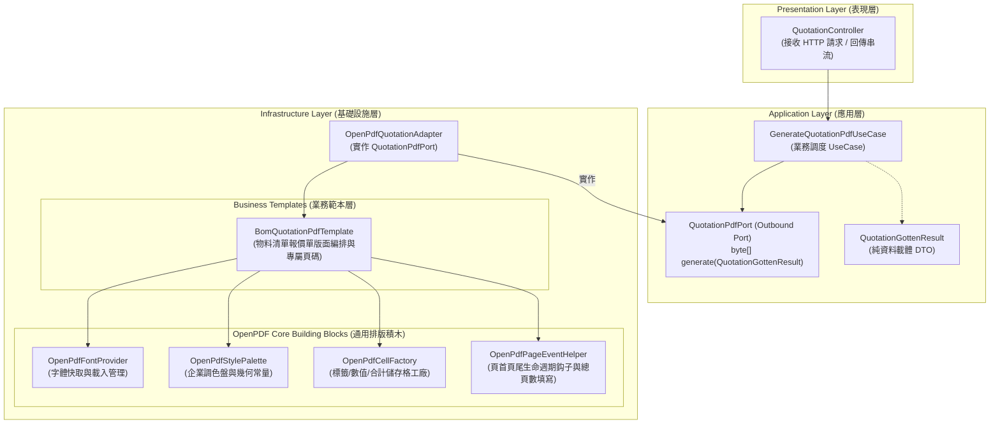
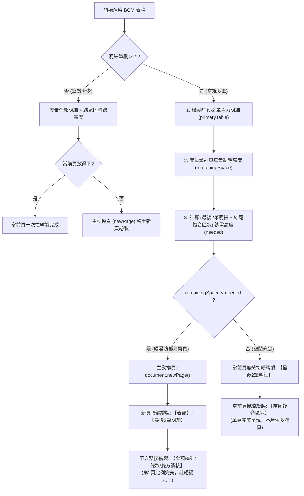
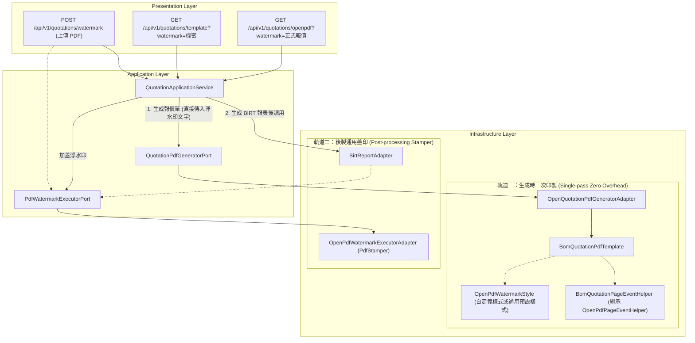

# OpenPDF 報表與文件範本生成架構設計文件
**Document Version:** 1.0.0  
**Target Module:** `pdf-module`  
**Architecture Style:** Clean Architecture / Hexagonal Architecture (Ports & Adapters)  

---

## 1. 架構願景與設計哲學 (Architecture Vision)

在企業級系統中，PDF 文件不僅僅是資料的輸出媒介，更是具有**高精確度視覺排版（Pixel-perfect Layout）**與**嚴謹商業法律效力**的載體（例如報價單、出貨單、發票憑證等）。

本設計旨在徹底解決傳統開發中常見的兩種反模式：
1. **反模式 A：上帝工具類（God Utility）**  
   試圖透過單一 `OpenPdfUtil` 與膨脹的引數（`headers`, `rows`, `widths`, `colors`, `alignments`...）涵蓋所有報表，最終導致不可維護、代碼腐化、修改單一報表牽連全局。
2. **反模式 B：複製貼上（Copy-Paste Sprawl）**  
   每個業務各自重複撰寫字體載入、色彩設定、頁首頁尾計算、流管理等樣板代碼，導致資源洩漏與風格不一致。

### 核心原則
- **「通用積木下沉，業務範本自治」**：底層提供無狀態、高效能的排版基礎元件（字體、樣式、分頁事件、儲存格工廠）；業務層專注於自身版面與欄位規則。
- **「Port 僅面向業務契約」**：依據 `AGENTS.md` 規範，應用層端口（Port）僅接收強型別業務 DTO，回傳原生 `byte[]`，絕不暴露底層 OpenPDF 物件。

---

## 2. 三層架構藍圖 (Architecture Blueprint)



---

## 3. 分層模組職責與詳細設計 (Component Design)

### 3.1 應用層：業務端口與資料載體 (Application Layer)
應用層完全不依賴 OpenPDF 任何類別，維持 100% 技術獨立。

#### 輸出端口 (Outbound Port)
- **檔案路徑**：`src/main/java/com/example/demo/application/port/out/QuotationPdfPort.java`
- **職責**：定義產出報價單 PDF 之業務契約。
```java
public interface QuotationPdfPort {
    /**
     * 依據報價單資料生成 PDF 文件位元組陣列
     *
     * @param quotation 報價單完整資訊 (強型別 DTO)
     * @return PDF 二進位位元組陣列
     */
    byte[] generateQuotationPdf(QuotationGottenResult quotation);
}
```

#### 業務 DTO (Pure Data Carriers)
- **檔案路徑**：`src/main/java/com/example/demo/application/shared/dto/QuotationGottenResult.java`
- **結構**：
  - `QuotationGottenResult`：包含單號、客戶資訊、報價日期、條款說明、合計金額、品項清單。
  - `QuotationItemGottenResult`：項次、料號、品名規格、數量、單位、單價、小計、備註。

---

### 3.2 基礎設施層：通用排版積木 (Core Building Blocks)
位於 `infrastructure/openpdf/core/`，作為無狀態或單例工具，負責解決底層 OpenPDF 技術細節。

#### ① 字體提供者：`OpenPdfFontProvider`
- **職責**：
  - 快取 `BaseFont` 實例，避免每次生成 PDF 時重複解析 12MB 的 `MSJHL.TTC` 導致記憶體與 CPU 飆高。
  - 統一封裝微軟正黑體 Light (`MSJHL.TTC`) 之 Classpath 載入、字體大小與粗體衍生樣式。
- **介面方法**：
  ```java
  public class OpenPdfFontProvider {
      public Font getTitleFont();      // 18pt 粗體
      public Font getSubtitleFont();   // 9pt 輔助色
      public Font getHeaderFont();     // 8.5pt 表頭白色
      public Font getBodyBold();       // 8pt 內文粗體
      public Font getBodyRegular();    // 8pt 內文常規
      public Font getBodyMuted();      // 7.5pt 灰色說明
      public Font getTotalFont();      // 11pt 金額強調色
  }
  ```

#### ② 樣式調色盤：`OpenPdfStylePalette`
- **職責**：集中管理企業標準色彩與視覺規範，防止魔法數字（Magic Numbers）散落在各業務範本中。
- **規格定義**：
  ```java
  public final class OpenPdfStylePalette {
      public static final Color PRIMARY_NAVY = new Color(26, 54, 93);      // 主品牌深藍
      public static final Color ACCENT_BLUE  = new Color(49, 130, 206);     // 裝飾藍
      public static final Color BG_LIGHT_GRAY= new Color(237, 242, 247);    // 淺灰背景
      public static final Color ROW_ALT_BG   = new Color(248, 250, 252);    // 斑馬紋交替底色
      public static final Color BORDER_GRAY  = new Color(203, 213, 225);    // 邊線淺灰
      public static final Color TEXT_DARK    = new Color(30, 41, 59);       // 主要文字
      public static final Color TEXT_MUTED   = new Color(100, 116, 139);    // 次要文字
      public static final Color HIGHLIGHT_RED= new Color(197, 48, 48);      // 總額警示紅
  }
  ```

#### ③ 儲存格建立工廠：`OpenPdfCellFactory`
- **職責**：建立具有一致 padding、邊框、對齊特性的 `PdfPCell`，大幅簡化範本排版程式碼。
- **工廠方法**：
  - `createHeaderCell(text, font, bgColor)`：表頭置中儲存格
  - `createTextCell(text, font, alignment, bgColor)`：標準內文儲存格
  - `createKeyValRow(table, key, val, ...)`：雙欄鍵值對資訊框
  - `createSeparator(color, thickness)`：全寬度裝飾分隔線

#### ④ 基礎分頁事件處理器：`OpenPdfPageEventHelper`
- **職責**：實作 OpenPDF 的 `PdfPageEventHelper`，作為通用分頁與排版度量基底類別。
- **功能**：
  - **範本方法鈎子 (Template Method Hooks)**：提供 `onDrawHeader`、`onDrawFooter` 與 `onFillTotalPages` 擴充點，交由具體單據範本自主定義頁首尾排版與座標，`core` 積木不再硬編碼特定單據格式。
  - **兩階段頁碼輔助方法**：提供 `drawFooterPageNumberWithTemplate` 與 `fillTotalPagesTemplate`，封裝底層 `PdfTemplate` 延遲計算與矩陣貼附樣板代碼。
  - **防偽浮水印原生印製 (In-flight Watermark Rendering)**：在頁面結束時（`onEndPage`），透過座標旋轉矩陣（`concatCTM`）於最底層畫布（`DirectContentUnder`）繪製傾斜文字，並支援防偽鋼印雙線圓角外框與企業副標，零額外 I/O 與零二次解析開銷。
  - **防孤兒區塊度量支援**：提供當前頁剩餘垂直可用高度計算（`getRemainingVerticalSpace`）、表格高度精確測量（`calculateTableHeight`）與主動防孤兒換頁決策（`ensureSpaceOrNewPage`）。

#### ⑤ 浮水印視覺樣式配置值物件：`OpenPdfWatermarkStyle`
- **檔案路徑**：`src/main/java/com/example/demo/infrastructure/openpdf/core/OpenPdfWatermarkStyle.java`
- **職責**：以純粹不可變值物件（Java Record）封裝浮水印外觀屬性，徹底告別魔法數值與硬編碼：
  - `fontSize`：字型大小 (pt，預設 46f)
  - `opacity`：不透明度 (預設 0.07f，通透柔和不遮擋表格)
  - `color`：填色 (AWT Color，預設深灰)
  - `rotation`：旋轉角度 (度數，預設 45f)
  - `boxed`：是否啟用防偽圓角鋼印邊框 (boolean，預設 false)
  - `subText`：可選次級防偽標註文字 (例如企業英文防偽標記)
- **通用標準樣式**：
  - `DEFAULT`：經典標準樣式 (46pt, 0.07f, 深灰, 45度, 無外框)
  - `CONFIDENTIAL`：機密文件樣式 (48pt, 0.10f, 醒目緋紅, 45度, 帶外框, "CONFIDENTIAL & PROPRIETARY")
  - `DRAFT`：草稿樣式 (46pt, 0.08f, 灰藍色, 45度)
  - *註：特定單據專屬樣式（如 BOM 尊榮鋼印）由各具體範本透過 `OpenPdfWatermarkStyle.builder()` 自主組裝，嚴守開閉原則。*

---

### 3.3 基礎設施層：業務專屬範本 (Business Templates)
位於 `infrastructure/openpdf/template/`。每個業務單據擁有獨立的 Template 實作類別（位於 `template/impl/`）。

#### 抽象範本契約：`PdfDocumentTemplate<T>`
```java
public interface PdfDocumentTemplate<T> {
    /**
     * 執行版面編排並將 PDF 寫入輸出流
     */
    void render(T data, OutputStream outputStream) throws Exception;

    /**
     * 取得此單據範本定義的預設浮水印樣式 (Template Method Hook)
     * 各業務範本可覆寫此方法，自訂專屬外觀。呼叫端只需傳入文字即可自動套用此樣式。
     */
    default OpenPdfWatermarkStyle getWatermarkStyle() {
        return OpenPdfWatermarkStyle.DEFAULT;
    }

    /**
     * 執行版面排版並印上防偽浮水印（自動套用範本專屬浮水印樣式）
     * 呼叫端只需傳入文字即可！
     */
    default void render(T data, OutputStream outputStream, String watermarkText) throws Exception {
        render(data, outputStream, watermarkText, getWatermarkStyle());
    }

    /**
     * 執行版面排版並印上防偽浮水印（支援外部動態自訂樣式）
     */
    default void render(T data, OutputStream outputStream, String watermarkText, OpenPdfWatermarkStyle watermarkStyle) throws Exception {
        render(data, outputStream);
    }
}
```

#### 物料清單報價單範本：`BomQuotationPdfTemplate`
- **檔案路徑**：`src/main/java/com/example/demo/infrastructure/openpdf/template/impl/BomQuotationPdfTemplate.java`
- **職責**：接收 `QuotationGottenResult`，按順序組裝：
  1. `renderHeader(doc, data)`：公司中英文標頭與報價單號
  2. `renderCustomerGrid(doc, data)`：客戶與交期付款條款網格
  3. `renderBomAndFooterSections(doc, writer, helper, data)`：BOM 智慧防孤兒物料清單與結尾複合區塊協同渲染
- **專屬浮水印樣式自治**：
  - 於範本內部透過 `OpenPdfWatermarkStyle.builder()` 自主組裝 `BOM_QUOTATION_WATERMARK_STYLE`（42pt, 0.075f, 企業深海軍藍 `PRIMARY_NAVY`, 45度, 雙線圓角鋼印外框, `"MORNING STAR INTELLIGENT • BOM QUOTATION"` 英文副標）。
  - 覆寫 `getWatermarkStyle()` 回傳專屬樣式，外部呼叫端僅需傳入浮水印文字即可自動印製專屬鋼印。
- **專屬分頁控制器內聚**：
  - 內部定義 `BomQuotationPageEventHelper` 繼承 `OpenPdfPageEventHelper`，覆寫 `onDrawFooter` 與 `onFillTotalPages`，將「第 X 頁 / 共 Y 頁」排版與精確座標 `(document.right() - 55pt, 18pt)` 內聚於範本內部。

---

### 3.4 基礎設施層：外向適配器 (Outbound Adapters)

#### ① 報價單輸出外向適配器：`OpenQuotationPdfGeneratorAdapter`
- **檔案路徑**：`src/main/java/com/example/demo/infrastructure/adapter/OpenQuotationPdfGeneratorAdapter.java`
- **職責**：實作 `QuotationPdfGeneratorPort`，協調 `BomQuotationPdfTemplate` 執行生成時單次印製 (Single-pass Rendering)。
```java
@Slf4j
@Component
@RequiredArgsConstructor
public class OpenQuotationPdfGeneratorAdapter implements QuotationPdfGeneratorPort {

    private final BomQuotationPdfTemplate quotationPdfTemplate;

    @Override
    public byte[] generateQuotationPdf(QuotationGottenResult quotation) {
        return generateQuotationPdf(quotation, null);
    }

    @Override
    public byte[] generateQuotationPdf(QuotationGottenResult quotation, String watermarkText) {
        try (ByteArrayOutputStream baos = new ByteArrayOutputStream()) {
            quotationPdfTemplate.render(quotation, baos, watermarkText);
            return baos.toByteArray();
        } catch (Exception e) {
            log.error("生成報價單 PDF 失敗: quotationNo={}", quotation.quotationNo(), e);
            return null;
        }
    }
}
```

#### ② 通用浮水印蓋印外向適配器：`OpenPdfWatermarkExecutorAdapter`
- **檔案路徑**：`src/main/java/com/example/demo/infrastructure/adapter/OpenPdfWatermarkExecutorAdapter.java`
- **職責**：實作 `PdfWatermarkExecutorPort`，透過 `PdfReader` 與 `PdfStamper`，專門為 Eclipse BIRT 報表生成後之後製蓋印，以及外部上傳之既有二進位 PDF 檔案進行通用浮水印疊加。
```

### 3.5 智慧防孤兒區塊排版機制 (Anti-Orphan Block Layout Mechanism)

#### ① 孤兒區塊痛點成因 (Problem Statement)
在商務單據（如報價單、出貨單、合約書）中，當主體物料明細表格（BOM Table）的資料筆數剛好填滿第一頁最底部時，接續的「備註條款、未稅合計/營業稅/總計金額、雙方簽核用印框」因當前頁剩餘垂直高度不足，會被 OpenPDF 自動觸發分頁（newPage）推至第二頁。
這將導致**第二頁頂部無任何物料明細，僅有孤零零的金額合計與簽名欄（形成孤兒區塊 / Orphan Block）**。此現象在商業稽核、防偽驗證與視覺美學上皆屬於嚴重排版缺陷。

#### ② 兩大核心防禦演算法
為徹底根除此問題，本模組實作了**雙層防孤兒防禦機制**：

1. **結尾區塊防拆原子化 (Atomic Footer Group)**：
   - 將「條款說明」、「金額統計」與「雙方簽核框」組合為單一複合表格，並啟用 `compositeTable.setKeepTogether(true)`。
   - 保證條款與簽核框永遠在同一頁緊密呈現，杜絕「條款在第一頁、簽名被擠到第二頁」的次級孤兒問題。

2. **錨點明細牽引換頁機制 (Anti-Orphan Row Pulling Mechanism)**：
   - 定義最後 2 筆明細為「防孤兒錨點項目 (Anchor Rows)」。
   - 在主力明細繪製完畢後，透過 `OpenPdfPageEventHelper.getRemainingVerticalSpace()` 精確計算當前頁面排版游標至底邊界的真實剩餘高度。
   - 計算「最後 2 筆明細高度」+「結尾複合區塊高度」+「間距」。
   - **空間不足時**：主動觸發 `document.newPage()` 換頁，在新頁面頂部以**深藍表頭（HeaderRows）**帶出最後 2 筆明細，下方緊接條款、總計與簽章；
   - **空間充足時**：在當前頁面無縫接續繪製最後 2 筆明細與結尾區塊，在單頁內完整呈現，絕不產生多餘空白頁。



---

### 3.6 浮水印雙軌協同架構 (Dual-Track Watermark Architecture)

在企業級 PDF 模組中，浮水印的需求來自兩種截然不同的業務情境：
1. **生成時單次印製 (In-flight / Single-pass)**：在排版渲染當下，直接將浮水印繪製於頁面最底層畫布。
2. **後製通用蓋印 (Post-processing / Stamper)**：針對已存在之二進位 PDF 檔案（例如 Eclipse BIRT 生成之報表、或外部使用者上傳之合約 PDF），透過 Stamper 進行動態加蓋。

本專案實作了**雙軌協同架構**，兼顧極致效能與通用防腐能力：



| 比較項目 | 軌道一：生成時一次印製 (Single-pass) | 軌道二：後製通用蓋印 (Post-processing) |
| :--- | :--- | :--- |
| **對應外向端口** | `QuotationPdfGeneratorPort.generateQuotationPdf(quotation, watermarkText)` | `PdfWatermarkExecutorPort.stampWatermark(sourcePdf, watermarkText)` |
| **適配器實作** | `OpenQuotationPdfGeneratorAdapter` | `OpenPdfWatermarkExecutorAdapter` |
| **底層技術手段** | `OpenPdfPageEventHelper.onEndPage` + `concatCTM` 向量變換 | `com.lowagie.text.pdf.PdfStamper` + `PdfReader` |
| **效能特性** | **極致效能 (Zero I/O Overhead)**，單次序列化輸出，無二次反序列化開銷。 | 需進行二進位反序列化解析與重新寫入，適合外部引擎產物或上傳檔案。 |
| **樣式能力** | 支援範本自治：各範本可透過 `getWatermarkStyle()` 定義專屬外觀（如 BOM 尊榮雙線鋼印與副標）。 | 支援全域通用半透明傾斜浮水印，相容任何規格尺寸之既有 PDF。 |

---

## 4. 模組目錄組織結構 (Directory Layout)

```text
src/main/java/com/example/demo/
│
├── application/
│   ├── port/
│   │   ├── in/                                      # UseCase 介面
│   │   │   ├── GenerateQuotationPdfUseCase.java     # 產出 OpenPDF 報價單用例
│   │   │   ├── GenerateTemplateQuotationPdfUseCase.java # 產出 BIRT 報表用例
│   │   │   ├── ParseQuotationPdfUseCase.java        # 解析 PDF 用例
│   │   │   ├── AddWatermarkUseCase.java             # 通用 PDF 加蓋浮水印用例
│   │   │   ├── EncryptPdfUseCase.java               # PDF 安全加密與權限控管用例
│   │   │   ├── DecryptPdfUseCase.java               # 受保護 PDF 密碼解密用例
│   │   │   └── SignPdfUseCase.java                  # PDF PKCS#7 數位簽章用例
│   │   └── out/                                     # Outbound Ports
│   │       ├── QuotationPdfGeneratorPort.java       # 報價單產出業務端口 (支援生成時單次印製浮水印)
│   │       ├── ReportGeneratorPort.java             # BIRT 報表產出端口
│   │       ├── PdfExtractorPort.java                # PDFBox 內容抽取端口
│   │       ├── QuotationParserPort.java             # 報價單語意剖析端口
│   │       ├── PdfWatermarkExecutorPort.java        # PDF 通用浮水印蓋印外向端口
│   │       └── PdfSecurityExecutorPort.java         # PDF 安全加密、解密與數位簽章外向端口
│   ├── shared/
│   │   ├── command/
│   │   │   ├── ParseQuotationPdfCommand.java        # 解析命令
│   │   │   ├── AddWatermarkCommand.java             # 加蓋浮水印命令
│   │   │   ├── EncryptPdfCommand.java               # 加密命令
│   │   │   ├── DecryptPdfCommand.java               # 解密命令
│   │   │   └── SignPdfCommand.java                  # 數位簽章命令
│   │   ├── query/
│   │   │   └── GetQuotationQuery.java               # 查詢物件 (包含 ID 與浮水印文字)
│   │   └── dto/
│   │       ├── QuotationGottenResult.java           # 報價單資料傳輸物件
│   │       └── QuotationItemGottenResult.java       # 報價單明細項目
│   └── service/
│       └── QuotationApplicationService.java         # 應用層用例調度協同服務
│
└── infrastructure/
    ├── adapter/
    │   ├── OpenQuotationPdfGeneratorAdapter.java    # 實作 QuotationPdfGeneratorPort (生成時單次印製)
    │   ├── OpenPdfWatermarkExecutorAdapter.java     # 實作 PdfWatermarkExecutorPort (後製通用蓋印)
    │   ├── OpenPdfSecurityExecutorAdapter.java      # 實作 PdfSecurityExecutorPort (加解密與 PKCS#7 數位簽章)
    │   ├── BirtReportAdapter.java                   # 實作 ReportGeneratorPort
    │   ├── PdfExtractorAdapter.java                 # 實作 PdfExtractorPort
    │   └── TextQuotationParserAdapter.java          # 實作 QuotationParserPort
    │
    └── openpdf/                                     # OpenPDF 實作子系統
        ├── core/                                    # 【通用排版積木】
        │   ├── OpenPdfFontProvider.java             # 字體快取與樣式衍生
        │   ├── OpenPdfStylePalette.java             # 色彩與幾何邊界常量
        │   ├── OpenPdfCellFactory.java              # 儲存格與行排版工廠
        │   ├── OpenPdfWatermarkStyle.java           # 浮水印視覺樣式值物件 (支援防偽鋼印與副標)
        │   └── OpenPdfPageEventHelper.java          # 頁首尾、頁碼與防偽鋼印浮水印事件
        │
        └── template/                                # 【業務範本層】
            ├── PdfDocumentTemplate.java             # 範本通用抽象契約 (提供 getWatermarkStyle Hook)
            └── impl/                                # 【具體範本實作】
                └── BomQuotationPdfTemplate.java     # 物料清單報價單版面實作 (內建 BOM 專屬鋼印樣式與 BomQuotationPageEventHelper)
```

---

## 5. 企業級安全加密與 PKCS#7 數位簽章架構 (Security & Digital Signatures)

依據 Clean Architecture 原則，安全防護能力獨立為 `PdfSecurityExecutorPort` 外向端口與 `OpenPdfSecurityExecutorAdapter` 基礎設施適配器，整合 OpenPDF 與 BouncyCastle 提供不可否認性與權限保護：

### 5.1 標準 128-bit 權限加密 (`encryptPdf`)
- **雙密碼分離控管**：
  - **使用者密碼 (User Password)**：開啟閱讀文件時驗證，若未設定則開啟不需密碼，但受限於權限限制。
  - **擁有者密碼 (Owner Password)**：擁有修改權限與解密許可之最高管理密碼。
- **細粒度操作授權**：
  - `allowPrinting`：透過 `PdfWriter.ALLOW_PRINTING` 控管高/低解析度列印。
  - `allowCopy`：透過 `PdfWriter.ALLOW_COPY` 與 `PdfWriter.ALLOW_SCREENREADERS` 控管文字複製與無障礙閱讀。

### 5.2 密碼驗證解鎖與限制解除 (`decryptPdf`)
- **安全防腐驗證**：接收加密 PDF 二進位 byte[] 與密碼憑據，透過 `PdfReader` 解鎖。
- **語意例外轉換**：底層拋出 `BadPasswordException` 時，由適配器捕獲並封裝為語意清晰之 `IllegalArgumentException("PDF 解密失敗：密碼錯誤或未授權存取")`，防止底層框架異常外洩。
- **無損重構**：解鎖成功後透過 `PdfStamper` 輸出為無加密保護之標準 PDF。

### 5.3 PKCS#7 / X.509 不可否認性數位簽章 (`signPdf`)
- **標準金鑰庫解析**：支援業界通用之 PKCS#12 (.p12 / .pfx) 金鑰庫，透過 BouncyCastle 解析 RSA/ECC 私鑰與完整 X.509 憑證信任鏈。
- **數位簽署外觀與詮釋資料**：
  - 封裝 Reason (簽署理由)、Location (簽署地點)、Contact (聯絡資訊)。
  - 支援在指定頁碼與座標加蓋具備企業字體之視覺簽名印章 (Visual Signature Stamp)。
- **PKCS#7 簽名演算法**：以 `PdfSignatureAppearance.SELF_SIGNED` 或 WIF 標準對 PDF 全文字節雜湊簽署，具備抗竄改與不可否認之法律效力。

---

## 6. 架構演進與優勢效益評估 (Benefits & Evolution)

| 評估維度 | 本設計方案效益 |
| :--- | :--- |
| **開閉原則 (OCP)** | 新增「採購單 (PO)」或「出貨單」時，只需新增專屬 Template，完全無需修改底層積木與既有範本。 |
| **單一職責 (SRP)** | 字體與頁碼技術問題由 `core/` 負責；報價單版面邏輯由 `BomQuotationPdfTemplate` 負責；安全防護由 `OpenPdfSecurityExecutorAdapter` 負責。 |
| **效能卓越** | 專案字體 `MSJHL.TTC` 透過單例快取，避免每份 PDF 重複解析 12MB 字體二進位資料。 |
| **高可測試性** | 業務範本可直接在測試中驗證像素排版，Adapter 與 Port 可輕鬆進行 Mock 隔離測試。 |
| **Clean Architecture 遵循度** | 應用層純粹無依賴，符合 `AGENTS.md` 規範中所有命名、Port 與防腐層要求。 |
