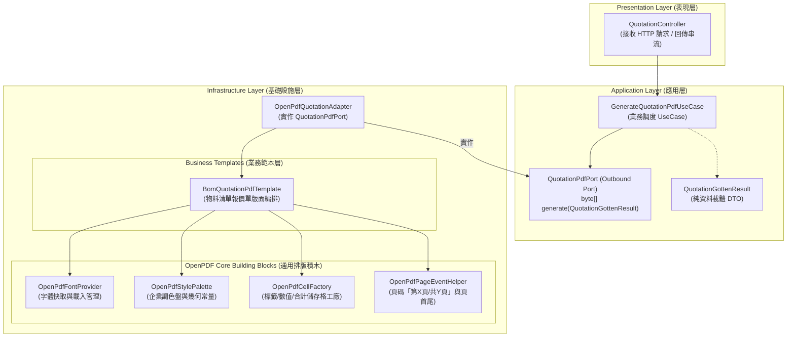
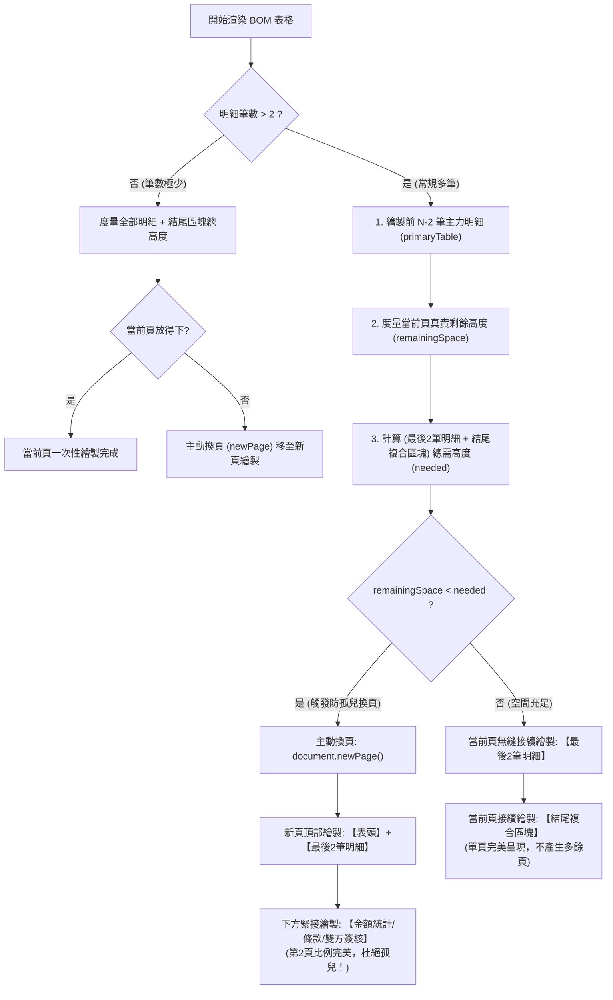

# OpenPDF 報表與文件範本生成架構設計文件
**Document Version:** 1.0.0  
**Target Module:** `pdf-module`  
**Architecture Style:** Clean Architecture / Hexagonal Architecture (Ports & Adapters)  

---

## 1. 架構願景與設計哲學 (Architecture Vision)

在企業級系統中，PDF 文件不僅僅是資料的輸出媒介，更是具有**高精確度視覺排版（Pixel-perfect Layout）**與**嚴謹商業法律效力**的載體（例如報價單、出貨單、發票憑證等）。

本設計旨在徹底解決傳統開發中常見的兩種反模式：
1. **反模式 A：上帝工具類（God Utility）**  
   試圖透過單一 `OpenPdfUtil` 與膨脹的引數（`headers`, `rows`, `widths`, `colors`, `alignments`...）涵蓋所有報表，最終導致不可維護、代碼腐化、修改單一報表牽連全局。
2. **反模式 B：複製貼上（Copy-Paste Sprawl）**  
   每個業務各自重複撰寫字體載入、色彩設定、頁首頁尾計算、流管理等樣板代碼，導致資源洩漏與風格不一致。

### 核心原則
- **「通用積木下沉，業務範本自治」**：底層提供無狀態、高效能的排版基礎元件（字體、樣式、分頁事件、儲存格工廠）；業務層專注於自身版面與欄位規則。
- **「Port 僅面向業務契約」**：依據 `AGENTS.md` 規範，應用層端口（Port）僅接收強型別業務 DTO，回傳原生 `byte[]`，絕不暴露底層 OpenPDF 物件。

---

## 2. 三層架構藍圖 (Architecture Blueprint)



---

## 3. 分層模組職責與詳細設計 (Component Design)

### 3.1 應用層：業務端口與資料載體 (Application Layer)
應用層完全不依賴 OpenPDF 任何類別，維持 100% 技術獨立。

#### 輸出端口 (Outbound Port)
- **檔案路徑**：`src/main/java/com/example/demo/application/port/out/QuotationPdfPort.java`
- **職責**：定義產出報價單 PDF 之業務契約。
```java
public interface QuotationPdfPort {
    /**
     * 依據報價單資料生成 PDF 文件位元組陣列
     *
     * @param quotation 報價單完整資訊 (強型別 DTO)
     * @return PDF 二進位位元組陣列
     */
    byte[] generateQuotationPdf(QuotationGottenResult quotation);
}
```

#### 業務 DTO (Pure Data Carriers)
- **檔案路徑**：`src/main/java/com/example/demo/application/shared/dto/QuotationGottenResult.java`
- **結構**：
  - `QuotationGottenResult`：包含單號、客戶資訊、報價日期、條款說明、合計金額、品項清單。
  - `QuotationItemGottenResult`：項次、料號、品名規格、數量、單位、單價、小計、備註。

---

### 3.2 基礎設施層：通用排版積木 (Core Building Blocks)
位於 `infrastructure/openpdf/core/`，作為無狀態或單例工具，負責解決底層 OpenPDF 技術細節。

#### ① 字體提供者：`OpenPdfFontProvider`
- **職責**：
  - 快取 `BaseFont` 實例，避免每次生成 PDF 時重複解析 12MB 的 `MSJHL.TTC` 導致記憶體與 CPU 飆高。
  - 統一封裝微軟正黑體 Light (`MSJHL.TTC`) 之 Classpath 載入、字體大小與粗體衍生樣式。
- **介面方法**：
  ```java
  public class OpenPdfFontProvider {
      public Font getTitleFont();      // 18pt 粗體
      public Font getSubtitleFont();   // 9pt 輔助色
      public Font getHeaderFont();     // 8.5pt 表頭白色
      public Font getBodyBold();       // 8pt 內文粗體
      public Font getBodyRegular();    // 8pt 內文常規
      public Font getBodyMuted();      // 7.5pt 灰色說明
      public Font getTotalFont();      // 11pt 金額強調色
  }
  ```

#### ② 樣式調色盤：`OpenPdfStylePalette`
- **職責**：集中管理企業標準色彩與視覺規範，防止魔法數字（Magic Numbers）散落在各業務範本中。
- **規格定義**：
  ```java
  public final class OpenPdfStylePalette {
      public static final Color PRIMARY_NAVY = new Color(26, 54, 93);      // 主品牌深藍
      public static final Color ACCENT_BLUE  = new Color(49, 130, 206);     // 裝飾藍
      public static final Color BG_LIGHT_GRAY= new Color(237, 242, 247);    // 淺灰背景
      public static final Color ROW_ALT_BG   = new Color(248, 250, 252);    // 斑馬紋交替底色
      public static final Color BORDER_GRAY  = new Color(203, 213, 225);    // 邊線淺灰
      public static final Color TEXT_DARK    = new Color(30, 41, 59);       // 主要文字
      public static final Color TEXT_MUTED   = new Color(100, 116, 139);    // 次要文字
      public static final Color HIGHLIGHT_RED= new Color(197, 48, 48);      // 總額警示紅
  }
  ```

#### ③ 儲存格建立工廠：`OpenPdfCellFactory`
- **職責**：建立具有一致 padding、邊框、對齊特性的 `PdfPCell`，大幅簡化範本排版程式碼。
- **工廠方法**：
  - `createHeaderCell(text, font, bgColor)`：表頭置中儲存格
  - `createTextCell(text, font, alignment, bgColor)`：標準內文儲存格
  - `createKeyValRow(table, key, val, ...)`：雙欄鍵值對資訊框
  - `createSeparator(color, thickness)`：全寬度裝飾分隔線

#### ④ 分頁與頁碼控制器：`OpenPdfPageEventHelper`
- **職責**：實作 OpenPDF 的 `PdfPageEventHelper`。
- **功能**：
  - 於文件渲染完成時（`onCloseDocument`），利用 `PdfTemplate` 延遲計算並填入「第 X 頁 / 共 Y 頁」精確總頁數。
  - 支援可選的全頁浮水印（Watermark，例如「機密草稿」、「正式報價」）。

---

### 3.3 基礎設施層：業務專屬範本 (Business Templates)
位於 `infrastructure/openpdf/template/`。每個業務單據擁有獨立的 Template 類別。

#### 抽象範本契約：`PdfDocumentTemplate<T>`
```java
public interface PdfDocumentTemplate<T> {
    /**
     * 執行版面編排並將 PDF 寫入輸出流
     *
     * @param data 業務資料物件
     * @param outputStream 輸出目標
     */
    void render(T data, OutputStream outputStream) throws Exception;
}
```

#### 物料清單報價單範本：`BomQuotationPdfTemplate`
- **職責**：接收 `QuotationGottenResult`，按順序組裝：
  1. `renderHeader(doc, data)`：公司中英文標頭與報價單號
  2. `renderCustomerGrid(doc, data)`：客戶與交期付款條款網格
  3. `renderBomTable(doc, data.items())`：BOM 8 欄明細表格（自動換頁、表頭跨頁重複 `table.setHeaderRows(1)`）
  4. `renderSummaryAndTerms(doc, data)`：稅額小計與商業保固條款
  5. `renderSignatureSection(doc)`：買賣雙方簽核用印框

---

### 3.4 基礎設施層：外向適配器 (Outbound Adapter)
- **檔案路徑**：`src/main/java/com/example/demo/infrastructure/adapter/OpenPdfQuotationAdapter.java`
- **職責**：實作 `QuotationPdfPort`，協調 `BomQuotationPdfTemplate` 生成二進位資料。
```java
@Slf4j
@Component
@RequiredArgsConstructor
public class OpenPdfQuotationAdapter implements QuotationPdfPort {

    private final BomQuotationPdfTemplate quotationPdfTemplate;

    @Override
    public byte[] generateQuotationPdf(QuotationGottenResult quotation) {
        try (ByteArrayOutputStream baos = new ByteArrayOutputStream()) {
            quotationPdfTemplate.render(quotation, baos);
            return baos.toByteArray();
        } catch (Exception e) {
            log.error("生成報價單 PDF 失敗: quotationNo={}", quotation.quotationNo(), e);
            return null;
        }
    }
}
```

### 3.5 智慧防孤兒區塊排版機制 (Anti-Orphan Block Layout Mechanism)

#### ① 孤兒區塊痛點成因 (Problem Statement)
在商務單據（如報價單、出貨單、合約書）中，當主體物料明細表格（BOM Table）的資料筆數剛好填滿第一頁最底部時，接續的「備註條款、未稅合計/營業稅/總計金額、雙方簽核用印框」因當前頁剩餘垂直高度不足，會被 OpenPDF 自動觸發分頁（newPage）推至第二頁。
這將導致**第二頁頂部無任何物料明細，僅有孤零零的金額合計與簽名欄（形成孤兒區塊 / Orphan Block）**。此現象在商業稽核、防偽驗證與視覺美學上皆屬於嚴重排版缺陷。

#### ② 兩大核心防禦演算法
為徹底根除此問題，本模組實作了**雙層防孤兒防禦機制**：

1. **結尾區塊防拆原子化 (Atomic Footer Group)**：
   - 將「條款說明」、「金額統計」與「雙方簽核框」組合為單一複合表格，並啟用 `compositeTable.setKeepTogether(true)`。
   - 保證條款與簽核框永遠在同一頁緊密呈現，杜絕「條款在第一頁、簽名被擠到第二頁」的次級孤兒問題。

2. **錨點明細牽引換頁機制 (Anti-Orphan Row Pulling Mechanism)**：
   - 定義最後 2 筆明細為「防孤兒錨點項目 (Anchor Rows)」。
   - 在主力明細繪製完畢後，透過 `OpenPdfPageEventHelper.getRemainingVerticalSpace()` 精確計算當前頁面排版游標至底邊界的真實剩餘高度。
   - 計算「最後 2 筆明細高度」+「結尾複合區塊高度」+「間距」。
   - **空間不足時**：主動觸發 `document.newPage()` 換頁，在新頁面頂部以**深藍表頭（HeaderRows）**帶出最後 2 筆明細，下方緊接條款、總計與簽章；
   - **空間充足時**：在當前頁面無縫接續繪製最後 2 筆明細與結尾區塊，在單頁內完整呈現，絕不產生多餘空白頁。



---

## 4. 模組目錄組織結構 (Directory Layout)

```text
src/main/java/com/example/demo/
│
├── application/
│   ├── port/
│   │   ├── in/                                      # UseCase 介面 (如 GenerateQuotationUseCase)
│   │   └── out/                                     # Outbound Ports
│   │       ├── QuotationPdfPort.java                # 報價單產出業務端口
│   │       ├── ReportGeneratorPort.java             # BIRT 報表產出端口
│   │       └── PdfExtractorPort.java                # PDFBox 內容抽取端口
│   └── dto/
│       ├── QuotationGottenResult.java               # 報價單資料傳輸物件
│       └── QuotationItemGottenResult.java           # 報價單明細項目
│
└── infrastructure/
    ├── adapter/
    │   ├── OpenPdfQuotationAdapter.java             # 實作 QuotationPdfPort
    │   ├── BirtReportAdapter.java                   # 實作 ReportGeneratorPort
    │   └── PdfBoxAdapter.java                       # 實作 PdfExtractorPort
    │
    └── openpdf/                                     # OpenPDF 實作子系統
        ├── core/                                    # 【通用排版積木】
        │   ├── OpenPdfFontProvider.java             # 字體快取與樣式衍生
        │   ├── OpenPdfStylePalette.java             # 色彩與幾何邊界常量
        │   ├── OpenPdfCellFactory.java              # 儲存格與行排版工廠
        │   └── OpenPdfPageEventHelper.java          # 頁首尾與動態頁碼事件
        │
        └── template/                                # 【業務專屬範本】
            ├── PdfDocumentTemplate.java             # 範本通用抽象契約
            └── BomQuotationPdfTemplate.java         # 物料清單報價單版面實作
```

---

## 5. 架構演進與優勢效益評估 (Benefits & Evolution)

| 評估維度 | 本設計方案效益 |
| :--- | :--- |
| **開閉原則 (OCP)** | 新增「採購單 (PO)」或「出貨單」時，只需新增專屬 Template，完全無需修改底層積木與既有範本。 |
| **單一職責 (SRP)** | 字體與頁碼技術問題由 `core/` 負責；報價單版面邏輯由 `BomQuotationPdfTemplate` 負責。 |
| **效能卓越** | 專案字體 `MSJHL.TTC` 透過單例快取，避免每份 PDF 重複解析 12MB 字體二進位資料。 |
| **高可測試性** | 業務範本可直接在測試中驗證像素排版，Adapter 與 Port 可輕鬆進行 Mock 隔離測試。 |
| **Clean Architecture 遵循度** | 應用層純粹無依賴，符合 `AGENTS.md` 規範中所有命名、Port 與防腐層要求。 |
