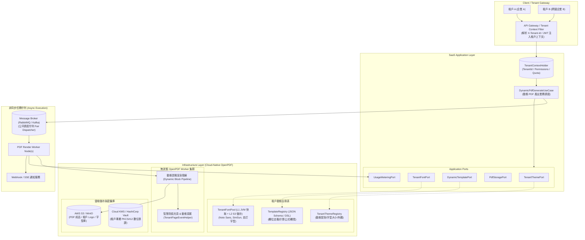
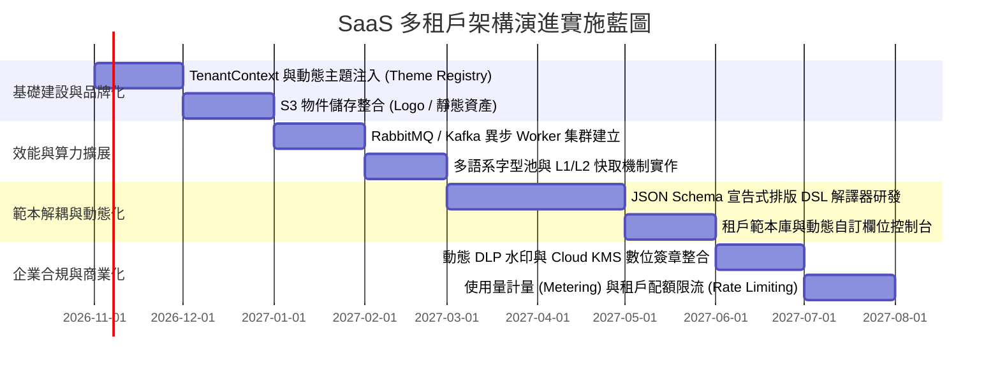

# OpenPDF 子系統 SaaS 多租戶架構演進與擴充規劃技術手冊 (SaaS Evolution Roadmap)

**Document Version:** 1.0.0  
**Target Module:** `pdf-module` (`src/main/java/com/example/demo/infrastructure/openpdf`)  
**Architecture Style:** Clean Architecture / Hexagonal Architecture (Ports & Adapters) -> Multi-Tenant Cloud-Native SaaS  
**Related Documents:**
* 🔗 回到 [技術設計文檔導覽 (doc/design/README.md)](file:///d:/桌面/ModuleWorkSpace/pdf-module/doc/design/README.md)
* 🏛️ [OpenPDF 報表與文件範本生成整體架構設計](file:///d:/桌面/ModuleWorkSpace/pdf-module/doc/design/openpdf/openpdf_architecture_design.md)
* 🛠️ [自定義業務單據範本開發實戰指南](file:///d:/桌面/ModuleWorkSpace/pdf-module/doc/design/openpdf/custom_openpdf_template_guide.md)

---

## 1. 演進背景與核心願景 (Evolution Vision)

### 1.1 現行架構剖析 (Current State)
目前 `pdf-module` 中的 OpenPDF 子系統遵循極致純粹的六角形架構（Hexagonal Architecture）與領域驅動設計（DDD），建構了高內聚、低耦合的通用排版積木：
* [OpenPdfFontProvider](file:///d:/桌面/ModuleWorkSpace/pdf-module/src/main/java/com/example/demo/infrastructure/openpdf/core/OpenPdfFontProvider.java)：單一中文字型快取（微軟正黑體 `MSJHL.TTC`），具備 4 階降級備援機制。
* [OpenPdfStylePalette](file:///d:/桌面/ModuleWorkSpace/pdf-module/src/main/java/com/example/demo/infrastructure/openpdf/core/OpenPdfStylePalette.java)：靜態企業級深藍調色盤常數。
* [OpenPdfCellFactory](file:///d:/桌面/ModuleWorkSpace/pdf-module/src/main/java/com/example/demo/infrastructure/openpdf/core/OpenPdfCellFactory.java)：無狀態儲存格與行排版工廠。
* [OpenPdfPageEventHelper](file:///d:/桌面/ModuleWorkSpace/pdf-module/src/main/java/com/example/demo/infrastructure/openpdf/core/OpenPdfPageEventHelper.java)：防孤兒頁智慧偵測與雙階段總頁數印製。
* [BomQuotationPdfTemplate](file:///d:/桌面/ModuleWorkSpace/pdf-module/src/main/java/com/example/demo/infrastructure/openpdf/template/impl/BomQuotationPdfTemplate.java)：純 Java 代碼寫死的物料清單報價單排版範本。

### 1.2 SaaS 化轉型挑戰與瓶頸
當本模組由「單一企業專屬內部系統」擴充為面向公有雲或私有雲的 **多租戶 SaaS PDF 平台（PDF Generation as a Service）** 時，面臨以下關鍵架構瓶頸：

1. **品牌視覺硬編碼 (Hardcoded Theming)**：不同企業客戶（租戶）擁有獨特的 CI/VI（品牌主色、Logo、頁尾抬頭、聯絡地址），目前調色盤為 Java 靜態常數，無法動態切換。
2. **代碼即範本 (Code-as-Template)**：版面與欄位由 Java 類別寫死，租戶若要增減欄位、修改順序或調整寬度百分比，必須修改程式碼重新編譯部署。
3. **字型與語系單一 (Single Font & Language Lock-in)**：單一微軟正黑體無法滿足國際化跨國租戶（簡體中文、日文、歐美字系）或租戶自備版權字型之需求。
4. **同步請求之算力風險 (Noisy Neighbor & CPU Saturation)**：PDF 生成屬高 CPU 與記憶體密集型運算，大量租戶同時發送大報表請求時，易引發 JVM 執行緒耗盡與 OOM。
5. **缺乏多租戶資產與安全隔離**：租戶專屬的數位憑證 (.p12)、動態審核浮水印、產生文件的存放與防洩密缺乏租戶邊界。
6. **缺乏商業化計量 (Metering & Quota)**：無租戶級別的產出頁數統計、呼叫次數限制與訂閱方案配額管控。

---

## 2. SaaS 多租戶架構藍圖 (Architecture Blueprint)



---

## 3. 六大核心維度演進規格 (6 Core Evolution Pillars)

### 維度一：多租戶視覺與品牌動態化 (Multi-Tenant Theming & Branding)

#### 1. 靜態色彩改造為動態主題上下文
* **現狀**：[OpenPdfStylePalette.java](file:///d:/桌面/ModuleWorkSpace/pdf-module/src/main/java/com/example/demo/infrastructure/openpdf/core/OpenPdfStylePalette.java) 定義了固定的 `PRIMARY_NAVY`, `ACCENT_BLUE`, `BORDER_GRAY`。
* **演進規格**：
  * 定義 `TenantTheme` 值物件（Value Object），支援自租戶組態或資料庫載入：
    ```java
    public record TenantTheme(
        String tenantId,
        Color primaryColor,       // 品牌主色 (表頭、主標題)
        Color accentColor,        // 強調裝飾色 (重要標記、徽章)
        Color tableHeaderBg,      // 表格主標頭底色
        Color tableHeaderTextColor, // 表格主標頭文字色
        Color zebraStripeBg,      // 隔行交替底色
        Color borderColor,        // 線條與格線邊框色
        Density density           // 排版密度 (COMPACT, NORMAL, RELAXED)
    ) {}
    ```
  * 將原本 `OpenPdfStylePalette` 升級為 `TenantThemeRegistry`，提供快取與預設風格降級機制。

#### 2. 儲存格工廠動態化 ([OpenPdfCellFactory](file:///d:/桌面/ModuleWorkSpace/pdf-module/src/main/java/com/example/demo/infrastructure/openpdf/core/OpenPdfCellFactory.java))
* 由原本無狀態的靜態工具類別，演進為接收 `TenantTheme` 的組件工廠。
* 儲存格的邊距 (Padding)、字體大小 (Font Size)、外框線粗細與圓角，均依租戶指定之 `Density` 進行等比例自適應縮放。

#### 3. 企業實體資產動態注入
* 租戶 Logo、公司中英文抬頭、統一編號、地址、印章圖檔不再寫死於範本，改由 `TenantBrandAssetPort` 動態解析。
* 支援 S3 Pre-signed URL 或內網 MinIO 串流即時取得影像，並利用本機暫存目錄快取高頻存取的企業 Logo。

---

### 維度二：字型庫池化與雲端多層快取 (Tenant Font Pool & Cloud Cache)

#### 1. 痛點與現狀
[OpenPdfFontProvider.java](file:///d:/桌面/ModuleWorkSpace/pdf-module/src/main/java/com/example/demo/infrastructure/openpdf/core/OpenPdfFontProvider.java) 目前在 JVM 啟動時單例載入微軟正黑體（約 12MB）。在多租戶場景下，若 1,000 個租戶各自上傳 20MB 的客製字型，直接載入 JVM 將耗費 20GB 記憶體，引發嚴重的記憶體耗盡。

#### 2. 兩級快取架構設計 (Two-Tier Font Cache)
* **L1 快取（JVM Heap In-Memory LRU Cache）**：
  * 使用 Google Guava Cache 或 Caffeine，限制快取最多活躍的 N 套字型（例如上限 20 套常用字型）。
  * 支援弱引用 (SoftReference) 在記憶體吃緊時自動 GC。
* **L2 快取（分散式物件儲存 S3 / MinIO）**：
  * 所有租戶自訂字型檔統一存放於 `s3://pdf-module-assets/{tenantId}/fonts/{fontName}.ttf`。
  * Worker 節點於 L1 Miss 時從 S3 下載至本機暫存目錄（`/tmp/fonts/`），再構建 `BaseFont` 實例。

#### 3. 多語系支援矩陣 (i18n Font Mapping)
建立動態字型對應器：
* 繁體中文：Noto Sans TC / 微軟正黑體
* 簡體中文：Noto Sans SC / 思源黑體
* 日文：Noto Sans JP
* 歐美語系：Inter / Roboto / Helvetica
* 程式碼/等寬單號：JetBrains Mono / Courier

---

### 維度三：範本解耦與宣告式排版引擎 (Schema-Driven Template Engine)

#### 1. 現狀問題
[BomQuotationPdfTemplate.java](file:///d:/桌面/ModuleWorkSpace/pdf-module/src/main/java/com/example/demo/infrastructure/openpdf/template/impl/BomQuotationPdfTemplate.java) 採用純 Java 實作繪製：
* 增加欄位、調整表格寬度比例 `setWidths(new float[]{5f, 18f, 25f...})` 均為寫死常數。
* 租戶無法自主變更版面結構。

#### 2. 宣告式 JSON/YAML 排版 DSL
將版面編排抽離為宣告式結構，由通用動態解譯器（`DynamicDocumentInterpreter`）執行 OpenPDF 渲染：

```json
{
  "$schema": "https://schema.example.com/pdf-template/v1",
  "templateId": "quotation-commercial-v1",
  "pageSize": "A4",
  "orientation": "PORTRAIT",
  "margins": { "top": 36, "bottom": 36, "left": 40, "right": 40 },
  "components": [
    {
      "type": "HEADER_GRID",
      "leftContent": { "logo": "${tenant.logoUrl}", "title": "${document.title}" },
      "rightContent": { "companyName": "${tenant.companyName}", "docNo": "${quotation.no}" }
    },
    {
      "type": "METADATA_GRID",
      "columns": 4,
      "fields": ["customerName", "contactPerson", "quotationDate", "validityPeriod"]
    },
    {
      "type": "DYNAMIC_TABLE",
      "dataSource": "items",
      "columns": [
        { "key": "itemNo", "label": "項次", "widthRatio": 8, "align": "CENTER" },
        { "key": "partNumber", "label": "料號", "widthRatio": 22, "align": "LEFT" },
        { "key": "description", "label": "品名規格", "widthRatio": 30, "align": "LEFT" },
        { "key": "quantity", "label": "數量", "widthRatio": 12, "align": "RIGHT", "format": "number:0" },
        { "key": "unitPrice", "label": "單價", "widthRatio": 13, "align": "RIGHT", "format": "currency" },
        { "key": "subtotal", "label": "小計", "widthRatio": 15, "align": "RIGHT", "format": "currency" }
      ]
    },
    {
      "type": "COMPOSITE_FOOTER_BLOCK",
      "antiOrphan": { "minimumBottomSpacePt": 115 },
      "sections": ["amountSummary", "paymentTerms", "signatureBlock"]
    }
  ]
}
```

#### 3. 範本市集與自訂範本管理
* **系統預設範本 (Official Templates)**：標準商業報價單、BOM 原物料清單、出貨單、驗收折讓單。
* **租戶自訂範本 (Custom Tenant Templates)**：租戶可複製官方範本並自訂欄位顯示與否、調整順序，存於租戶範本庫中，支援版本管理（Draft / Published / Rollback）。

---

### 維度四：高併發負載隔離與非同步任務佇列 (Async Scalability)

#### 1. 雙軌生成機制 (Dual-Track Generation)

```text
                  ┌─── [即時預覽 / 單頁草稿] ──────> 同步處理 (Web API 執行緒，限時 < 1.5s)
[HTTP PDF Request]─┤
                  └─── [大量批次 / 正式歸檔] ──────> 非同步處理 (寫入 MQ，回傳 202 Accepted + JobID)
```

1. **同步預覽模式 (Live Preview)**：
   * 限制渲染頁數（如上限 3 頁），以低畫質壓縮模式快速產出 base64 或二進位串流，供租戶前端畫面預覽。
2. **非同步生產模式 (Asynchronous Job Execution)**：
   * 接收資料後發送至佇列，立即釋放 HTTP 連線，回應 `202 Accepted` 與 `jobId`。
   * 後端 Worker 集群競爭消費並生成 PDF。
   * 完成後上傳至 S3，以 Webhook 或 SSE（Server-Sent Events）通知前端取得下載 URL。

#### 2. 公平調度防霸佔 (Fair Queueing & Noisy Neighbor Prevention)
* 避免大租戶（一次發送 10,000 份報價單）塞滿佇列，造成小租戶（單次產出一份）無限等待。
* 依租戶 ID 實施 **虛擬佇列 (Virtual Per-Tenant Queues)** 或基於 Redis 的 **滑動窗口與權重調度（Weighted Round-Robin）**。

---

### 維度五：企業安全、數據防洩密與動態浮水印 (DLP & Tenant Compliance)

#### 1. 使用者動態審核與防外洩浮水印 (DLP Dynamic Watermarking)
* **現狀**：[OpenPdfWatermarkStyle.java](file:///d:/桌面/ModuleWorkSpace/pdf-module/src/main/java/com/example/demo/infrastructure/openpdf/core/OpenPdfWatermarkStyle.java) 支援自訂靜態文字。
* **演進規格**：
  * 支援動態環境變數替換注入：
    ```text
    "內部機密 - 限 ${user.email} 查閱 [IP: ${request.ip}] ${timestamp:yyyy-MM-dd HH:mm}"
    ```
  * 提供「隱形盲水印（Zero-Visibility Steganography）」模式：於文字字距（Kerning）或底色中嵌入微小二進位擾動編碼，當員工外洩截圖時，可透過演算法反查洩密者帳號與時間。

#### 2. 租戶獨立 PKCS#12 數位憑證與雲端 KMS / HSM
* 現行架構將 `enterprise_signer.p12` 儲存於專案資源目錄中。
* SaaS 模式下：
  * 各租戶上傳自身企業憑證與私鑰，儲存至 **AWS Secrets Manager / Azure Key Vault / HashiCorp Vault**，禁止明文落盤。
  * 對於金融與政企租戶，支援無私鑰導出模式：透過 **Cloud KMS / HSM API** 進行遠端 PKCS#7 增量雜湊簽名。

---

### 維度六：計費計量、配額限流與可觀測性 (Metering, Quota & Observability)

#### 1. 商業化計費事件發布 (Usage Metering Events)
每次 OpenPDF 渲染完成後，由 Outbound Adapter 發布領域事件：
```java
public record TenantPdfGeneratedEvent(
    String tenantId,
    String documentId,
    String templateId,
    int pageCount,
    long renderDurationMs,
    long fileSizeBytes,
    boolean hasDigitalSignature,
    Instant generatedAt
) {}
```
* 計費系統依據 **產出頁數 (Page Count)**、**儲存容量 (GB-Month)** 與 **簽章調用次數** 進行精確計量收費（Stripe / Chargebee 整合）。

#### 2. 訂閱階層配額與限流 (Tiered Quotas & Rate Limiting)

| 訂閱方案 | QPS 限制 | 單月頁數配額 | 單檔最大頁數 | 字型自訂 | 數位簽章 | 專屬 Worker |
| :--- | :---: | :---: | :---: | :---: | :---: | :---: |
| **Free / Starter** | 2 req/s | 1,000 頁 | 20 頁 | 僅系統內建 | ❌ | 共享佇列 |
| **Professional** | 20 req/s | 50,000 頁 | 200 頁 | 支援 5 套自訂字型 | OpenPDF 128-bit | 優先佇列 |
| **Enterprise** | 100+ req/s | 無限制 (按量計費) | 1,000+ 頁 | 無限制 S3 字型池 | PDFBox 256-bit + KMS | 專屬獨立 Worker 集群 |

#### 3. APM 與效能觀測 (Observability)
* 透過 Micrometer + Prometheus 暴露指標：
  * `pdf.render.duration.seconds`（以 tenantId, templateId 為維度標籤）。
  * `pdf.font.cache.hit.ratio`（字型快取命中率）。
  * `pdf.orphan.recalculation.count`（防孤兒頁重新計算次數）。

---

## 4. 現狀 vs. SaaS 演進詳細對照矩陣 (Comparison Matrix)

| 模組元件 | 現行架構 (單體內部應用) | SaaS 擴充架構 (多租戶雲端平台) | 演進必要性與收益 |
| :--- | :--- | :--- | :--- |
| **樣式色彩**<br>`OpenPdfStylePalette` | 靜態寫死深藍色彩常數 (`PRIMARY_NAVY`) | `TenantThemeRegistry` 動態載入配色與間距 Density | 實現租戶白牌化（White-labeling）與企業 CI 品牌識別。 |
| **字型提供者**<br>`OpenPdfFontProvider` | 本地單一微軟正黑體快取 (12MB) | 兩級快取池：L1 JVM LRU + L2 S3 儲存庫 | 支援多國語系 (CJK/Latin) 與租戶專屬自備字型，防範 JVM OOM。 |
| **報表範本**<br>`*PdfTemplate` | 純 Java 代碼撰寫版面編排 | 宣告式 JSON/YAML Schema + 動態直譯渲染管線 | 欄位增減、調寬與順序熱更新，無須重新編譯程式碼發版。 |
| **排版事件**<br>`OpenPdfPageEventHelper` | 單一固定 A4、簡單頁尾文字 | 支援多尺寸紙張 (A4/Letter/收據規格) + 多語系數字格式化 | 跨國業務標準適配，支援各地發票與收據規格。 |
| **浮水印**<br>`OpenPdfWatermarkStyle` | 靜態固定文字浮水印 | 租戶/使用者動態防外洩水印 (Audit Trail & 盲水印) | 企業機密防洩漏（DLP）與資料合規審計。 |
| **簽章密鑰**<br>`enterprise_signer.p12` | 單一本機實體檔案 | 雲端 KMS / HSM / Vault 租戶金鑰隔離管理 | 解決金鑰外洩風險，滿足企業金融級法務存檔標準。 |
| **執行調度** | 同步阻塞 HTTP 回傳 `byte[]` | 同步預覽 + Kafka/RabbitMQ 異步 Worker 批次產出 | 算力解耦，避免大報表拖垮 Web 伺服器，防止租戶間相互影響。 |
| **商業營運** | 僅本機檔案日誌 | 頁數計量 (Metering)、訂閱配額限流、Prometheus 指標 | 建立 SaaS 商業變現模式，精準核算各租戶算力成本。 |

---

## 5. 分階段落地里程碑 (Phased Implementation Roadmap)



### 里程碑交付目標：
* **階段一：租戶品牌外觀動態化 (MVP Phase)**：完成 `TenantTheme` 動態配色與 S3 Logo 載入，達成白牌報價單客製。
* **階段二：非同步高可用運算架構 (Scale Phase)**：解耦 Web API 與 PDF 渲染運算，確保萬級報表穩定產出不當機。
* **階段三：範本 No-Code / DSL 動態化 (Productivity Phase)**：完成 JSON Schema 範本引擎，免工程師介入即可熱更新版面。
* **階段四：企業安全與合規加固 (Enterprise Phase)**：支援多國語系字型池、動態 DLP 浮水印與雲端 KMS 數位簽章。
* **階段五：SaaS 商業化閉環 (Monetization Phase)**：上線計量計費系統與訂閱方案控管，實現商業化運營。

---

> 📌 **架構設計總結**：  
> `pdf-module` 目前具備極度健全的六角形分層設計（Clean Architecture）。在進行 SaaS 擴充時，**完全無需破壞原有的 Application Port 與 Domain 邊界**；只需在 Infrastructure 層將原有的單例實作（如 `OpenPdfStylePalette`、`OpenPdfFontProvider`）透過「裝飾者模式 (Decorator)」或「動態解析器 (Dynamic Resolver)」擴展為租戶感知版本，即可平滑升級為世界級的多租戶 PDF 雲端生成平台。
