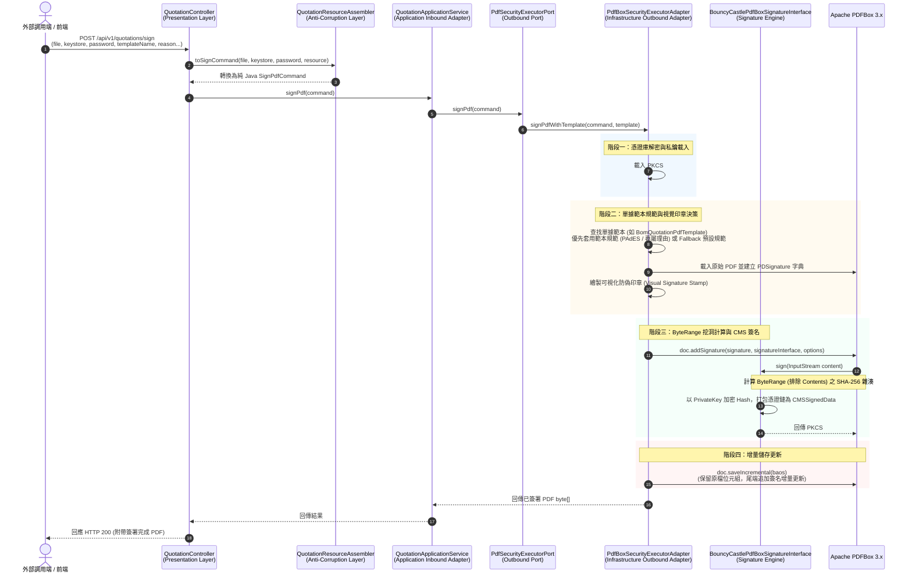
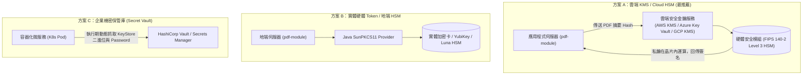

# PDF 數位簽章完整流程與憑證密鑰管理實戰指南 (PDF Digital Signature Workflow & Secret Management Guide)

> 🔗 回到 [技術設計文檔導覽 (doc/design/README.md)](file:///d:/桌面/ModuleWorkSpace/pdf-module/doc/design/README.md) 或 [PDFBox 安全防護與自定義規範設計 (pdfbox_security_signature_design.md)](file:///d:/桌面/ModuleWorkSpace/pdf-module/doc/design/pdfbox/pdfbox_security_signature_design.md)

---

## 1. 導論與核心概念

在企業級電子商務、原物料採購（BOM）與合約放行流程中，PDF 文件的真實性與防偽造能力至關重要。一般人在 PDF 上貼上一張印章圖片（電子簽名，Electronic Signature）在法律與密碼學上**不具備任何防竄改能力**。

本模組基於 **Apache PDFBox 3.x** 與 **BouncyCastle 1.80** 實現的**數位簽章（Digital Signature）**，遵循國際 PKCS#7 / CMS (Cryptographic Message Syntax) 與歐盟 PAdES (PDF Advanced Electronic Signatures) 標準，提供三大密碼學保證：
1. **身分真實性 (Authenticity)**：確認文件確實由具備私鑰的特定經辦主管或企業組織所簽署。
2. **內容完整性 (Integrity / 防竄改)**：簽署後只要文件的任何一個位元（甚至一個空白字元）遭修改，閱讀器即可精準偵測並標註簽名失效。
3. **不可否認性 (Non-repudiation)**：簽署人無法否認曾經簽署過該份文件，具備法律證據力。

---

## 2. 數位簽章執行流程詳解

### 2.1 系統架構層級流程 (六角形架構調度)

從 API 呼叫至完成簽名，系統遵循嚴格的 Clean Architecture / 六角形架構調度：



---

### 2.2 底層密碼學與 PDF 簽署核心運作機制

```text
原始 PDF 檔案結構：
+------------------------------------+
| Header (%PDF-1.7)                  |
+------------------------------------+
| Catalog, Pages, Streams            | <-- 偏移 0 至 偏移 A
+------------------------------------+
| /ByteRange [ 0, A, B, C ]          |
| /Contents < 00000000000000000000 > | <-- 挖洞預留空間 (不納入 Hash 計算)
+------------------------------------+
| 剩餘物件與交叉引用表 (XRef)         | <-- 偏移 B 至 長度 C
+------------------------------------+

增量儲存簽章後的 PDF 檔案結構：
+------------------------------------+
| 原 PDF 內容 (完全不變動！)           |
+------------------------------------+
| 增量追加部分 (Incremental Update)   |
|  - 更新的交叉引用表 (XRef)          |
|  - 填入真實 CMS 簽名的 /Contents   | <-- BouncyCastle 產生的 PKCS#7 密文與憑證
|  - %%EOF                           |
+------------------------------------+
```

1. **憑證庫解密與私鑰載入 (Keystore Parsing)**：
   - 讀取 PKCS#12 二進位串流，使用解鎖密碼載入 `KeyStore`。
   - 提取簽名者專屬的 `PrivateKey` 與完整的 `X.509 Certificate Chain`（包含公鑰憑證、中繼 CA、根 CA 憑證）。
2. **單據範本規範與視覺印章決策 (Policy & Stamp Resolution)**：
   - 依據 `templateName` 動態查找對應的 `PdfDocumentTemplate`。
   - 若範本指定規範（如 `BomQuotationPdfTemplate` 指定 `PAdESCompliantSignaturePolicy`），則自動套用 PAdES-BES 標準（`ETSI.CAdES.detached`）與認證等級 `DocMDP=2`；若未指定或範本未覆寫，則自動平滑降級至 `@Primary` 系統預設標準規範（`DefaultPdfSignaturePolicy`）。
3. **建立簽章字典 (`PDSignature`)**：
   - 在 PDF 內部配置簽名物件字典，填入 `Filter` (`Adobe.PPKLite`)、`SubFilter`、簽署人別名、理由 (`Reason`)、地點 (`Location`)、簽署時間。
   - 若為認證簽章（Certified Signature），寫入 DocMDP Transform Parameters。
4. **ByteRange 挖洞計算機制**：
   - PDF 簽章面臨的最大挑戰是：「簽名本身必須放在 PDF 檔案內，但若對整份檔案計算 Hash，將簽名放進去後 Hash 就會改變」。
   - **解決方案**：PDFBox 透過 `ByteRange` 陣列定義出除了 `/Contents` 以外的所有位元組區段（`[0, A, B, C]`），並僅對這兩個區段進行 SHA-256 雜湊摘要計算。
5. **BouncyCastle CMS/PKCS#7 簽名運算**：
   - 由 [BouncyCastlePdfBoxSignatureInterface.java](file:///d:/桌面/ModuleWorkSpace/pdf-module/src/main/java/com/example/demo/infrastructure/pdfbox/security/BouncyCastlePdfBoxSignatureInterface.java) 的 `sign(InputStream content)` 處理串流。
   - 使用簽署者的私鑰（`PrivateKey`）對上述 ByteRange 雜湊進行非對稱加密。
   - 將加密簽名、演算法識別碼、以及簽署者的公鑰憑證鏈打包成符合 RFC 5652 的 CMS (`CMSSignedData`) 結構，寫入 PDF 預留的 `/Contents` 中。
6. **增量更新 (Incremental Save)**：
   - **嚴格禁止使用一般的 `doc.save()`**！一般的 `save()` 會重構整份文件的物件偏移量，使原先計算好的 ByteRange 雜湊徹底毀損。
   - 必須呼叫 `doc.saveIncremental()`，原汁原味保留原始 PDF 的每一位元組，僅在文件尾端追加簽章資料與新 XRef 表。

---

## 3. 相關 Secret 與材料清單

進行數位簽署需要下列核心憑證與金鑰材料：

| 材料名稱 | 技術格式 / 型態 | 作用與安全性要求 |
| :--- | :--- | :--- |
| **金鑰庫 (Keystore)** | PKCS#12 (`.p12` / `.pfx`) | 國際標準容器，將私鑰與憑證鏈加密封裝於單一二進位檔案中。 |
| **金鑰庫密碼 (`keyStorePassword`)** | 字串 / Secret | 用於解密金鑰庫檔案的對稱加密密鑰。**嚴禁明文寫入程式碼**。 |
| **私鑰 (`PrivateKey`)** | RSA (2048/4096-bit) 或 ECDSA | 簽署者唯一的機密金鑰，用來執行加密計算。私鑰一旦外洩，任何人皆可假冒簽章。 |
| **公鑰憑證鏈 (`Certificate[]`)** | X.509 v3 憑證鏈 | 包含簽署者公鑰、身分資訊（名稱、組織、國別），以及中繼 CA 與根 CA 的簽署證明。 |
| **金鑰別名 (`keyAlias`)** | 字串 (如 `pdfbox-signer`) | 當金鑰庫內包含多組私鑰時，用於精準指定由哪一組金鑰進行簽署。 |

---

## 4. 開發與測試環境 Secret 取得與產製指引 (Dev & Test Guide)

在開發與測試階段，無須向外部機構付費申請，可自行產製**自簽憑證金鑰庫（Self-signed Keystore）**：

### 4.1 使用 Java 內建 `keytool` 指令（最推薦，跨平台免安裝額外軟體）

開啟 PowerShell 或 Bash，執行以下指令：

```bash
keytool -genkeypair \
  -alias pdfbox-signer \
  -keyalg RSA \
  -keysize 2048 \
  -validity 365 \
  -keystore enterprise_signer.p12 \
  -storetype PKCS12 \
  -storepass SecretPassword123 \
  -dname "CN=晨星智造系統核准章, OU=研發處, O=MorningStar Corp, C=TW"
```

> 💡 **Windows PowerShell 提示**：若終端機提示 `無法辨識 'keytool' 詞彙`，代表環境變數尚未將 JDK `bin` 目錄加入 `PATH`。您可以直接引用 `JAVA_HOME` 執行：
> ```powershell
> & "$env:JAVA_HOME\bin\keytool.exe" -genkeypair -alias pdfbox-signer -keyalg RSA -keysize 2048 -validity 365 -keystore enterprise_signer.p12 -storetype PKCS12 -storepass SecretPassword123 -dname "CN=晨星智造系統核准章, OU=研發處, O=MorningStar Corp, C=TW"
> ```

產出結果：
- **金鑰庫檔案**：`enterprise_signer.p12`
- **金鑰別名 (`keyAlias`)**：`pdfbox-signer`
- **金鑰庫密碼 (`keyStorePassword`)**：`SecretPassword123`

### 4.2 使用 OpenSSL 指令產製

若已有現成的伺服器憑證或偏好 OpenSSL 工具鏈：

```bash
# 1. 產生 2048-bit RSA 私鑰
openssl genrsa -out private.key 2048

# 2. 建立自簽 X.509 憑證 (有效期限 365 天)
openssl req -new -x509 -key private.key -out certificate.crt -days 365 \
  -subj "/CN=Enterprise Signer/OU=IT/O=MorningStar/C=TW"

# 3. 將私鑰與憑證封裝成 PKCS#12 (.p12)
openssl pkcs12 -export \
  -out enterprise_signer.p12 \
  -inkey private.key \
  -in certificate.crt \
  -name "pdfbox-signer" \
  -passout pass:SecretPassword123
```

### 4.3 於 Java 單元測試中透過記憶體動態產製（零檔案依賴）

參考本專案測試案例 [PdfBoxSecurityExecutorAdapterTest.java](file:///d:/桌面/ModuleWorkSpace/pdf-module/src/test/java/com/example/demo/infrastructure/adapter/PdfBoxSecurityExecutorAdapterTest.java#L70-L101)：

```java
KeyPairGenerator kpg = KeyPairGenerator.getInstance("RSA");
kpg.initialize(2048);
KeyPair keyPair = kpg.generateKeyPair();

X500Name subject = new X500Name("CN=PDFBox Test, O=Enterprise, C=TW");
SubjectPublicKeyInfo subPubKeyInfo = SubjectPublicKeyInfo.getInstance(keyPair.getPublic().getEncoded());
X509v3CertificateBuilder certBuilder = new X509v3CertificateBuilder(
        subject,
        BigInteger.valueOf(System.currentTimeMillis()),
        new Date(System.currentTimeMillis() - 60_000L),
        new Date(System.currentTimeMillis() + 365L * 24 * 60 * 60 * 1000L),
        subject,
        subPubKeyInfo
);

ContentSigner signer = new JcaContentSignerBuilder("SHA256withRSA").build(keyPair.getPrivate());
X509CertificateHolder certHolder = certBuilder.build(signer);
X509Certificate cert = new JcaX509CertificateConverter().getCertificate(certHolder);

KeyStore ks = KeyStore.getInstance("PKCS12");
ks.load(null, null);
ks.setKeyEntry("pdfbox-signer", keyPair.getPrivate(), "testSecret".toCharArray(), new Certificate[]{cert});

ByteArrayOutputStream baos = new ByteArrayOutputStream();
ks.store(baos, "testSecret".toCharArray());
byte[] testKeyStoreBytes = baos.toByteArray();
```

---

## 5. 企業級生產環境憑證取得與金鑰安全管理 (Production Guide)

在具備法律效益的正式商業合約與對外單據中，自簽憑證在 Adobe Acrobat Reader 中開啟時會被標註為「⚠️ 簽章者的身分未知，因為它不是來自受信任的授權單位」。

### 5.1 國際 AATL 權威憑證授權中心 (CA) 申請

生產環境的數位簽章必須向通過 **AATL (Adobe Approved Trust List)** 國際認可的憑證機構申請「**PDF 文件簽章憑證 (Document Signing Certificate)**」：

| 憑證發行機構 (CA) | 涵蓋地區 | 特點與適用場景 |
| :--- | :--- | :--- |
| **臺灣網路認證 (TWCA)** | 臺灣 / 大中華區 | 臺灣金融體系、證券業與政府機關標準採用之商業憑證機構，符合《電子簽章法》規範。 |
| **中華電信 HiPKI** | 臺灣 | 適用於企業工商憑證、政府機關公務簽約整合。 |
| **DigiCert** | 全球 | 全球市佔率最高的頂級 CA，全面相容 Windows、macOS 與所有 PDF 閱讀器。 |
| **GlobalSign / Sectigo** | 全球 | 提供企業級自動化簽名解決方案與雲端簽署服務。 |

> **AATL 的優勢**：
> 凡是由 AATL 成員簽發的憑證所簽署的 PDF，世界上任何人在沒有安裝任何自訂根憑證的情況下，開啟 Adobe Reader 即會自動點亮**綠色勾勾**：
> `✔ 已認證，由 [您的企業名稱] 簽署。自簽署後未曾變更過。`

---

### 5.2 生產環境私鑰安全保管架構 (Secret Security Architecture)

依據 CA/Browser 論壇自 2023 年 6 月起生效的最新國際安全法規，**商業文件簽名憑證的私鑰不得以軟體檔案方式（明文 `.p12` 檔）保存在常規伺服器硬碟中**。實務上有 3 種推薦架構：



#### 方案 A：雲端 KMS / Cloud HSM (最推薦，適合現代雲原生架構)
- **架構特點**：
  - 私鑰永遠儲存於符合 **FIPS 140-2 Level 3** 的硬體模組中，**完全無法被匯出或拷貝**。
  - 應用程式只需要將 PDF 的 ByteRange Hash 送至雲端 KMS API，KMS 於硬體晶片內部簽署後回傳 Signature 結果。
- **支援平台**：
  - **AWS CloudHSM / AWS KMS (Custom Key Store)**
  - **Azure Key Vault (Managed HSM)**
  - **Google Cloud HSM**

#### 方案 B：地端實體硬體 Token / HSM (適合合規地端機房)
- **架構特點**：
  - CA 核發時會將私鑰預載於 FIPS 認證的實體 USB 憑證卡（如 YubiKey FIPS）或機架式 HSM（如 Thales Luna HSM）。
  - Java 透過標準的 `SunPKCS11` 驅動介接，程式內的 `PrivateKey` 物件僅為指向硬體 Token 的指標，金鑰不出晶片。

#### 方案 C：企業機密保管庫 (適合內部業務流程)
- **架構特點**：
  - 將加密的金鑰庫二進位檔案以 Base64 或安全資源形式存放於 **HashiCorp Vault** 或 **AWS Secrets Manager**。
  - 金鑰庫解鎖密碼（`keyStorePassword`）於 Pod 啟動時動態注入為環境變數。
  - **嚴格規範**：
    - 嚴禁將 `.p12` 檔案或密碼提交至 Git 倉庫。
    - 嚴禁以明文寫在 `application.properties` 中。

---

## 6. 常見問題與排障手冊 (FAQ & Troubleshooting)

### Q1: 為什麼 Adobe Reader 打開 PDF 顯示「至少有一項簽名有問題」或「簽名者的身分不明」？
- **原因**：使用的是本機產製的自簽憑證（Self-signed），或者發證機構不在作業系統與 Adobe 的受信任根憑證清單（AATL）中。
- **解法**：
  - 測試環境：可在 Adobe Reader 點擊簽名面板 ->「簽章內容」->「顯示簽署者的憑證」->「信任」->「新增至受信任的憑證」。
  - 生產環境：向 TWCA 或 DigiCert 申請符合 AATL 標準的商業簽章憑證。

### Q2: 為什麼簽名後的 PDF 提示「簽署後文件已經過修改，簽名無效」？
- **原因**：程式碼中使用了 `doc.save(baos)` 而非 `doc.saveIncremental(baos)`，或者簽章後又由其他函式庫（如浮水印工具）重新寫入該 PDF。
- **解法**：
  - 簽章必須是**最後一道工序**。所有文字排版、圖片載入、浮水印印製必須在 `doc.saveIncremental()` 之前完成。
  - 務必確認儲存方法為 `doc.saveIncremental(baos)`。

### Q3: 視覺印章中的中文字型呈現亂碼或缺字問號？
- **原因**：PDFBox 預設 Helvetica 等標準字型（Standard 14 Fonts）不支援中文 Unicode 字元。
- **解法**：
  - 本專案已在 `config/` 套件中建立 [PdfFontProperties.java](file:///d:/桌面/ModuleWorkSpace/pdf-module/src/main/java/com/example/demo/config/PdfFontProperties.java)，並於 [application.properties](file:///d:/桌面/ModuleWorkSpace/pdf-module/src/main/resources/application.properties) 中配置 `pdf.font.path=fonts/MSJHL.TTC`。
  - [DefaultPdfBoxVisualSignatureCustomizer](file:///d:/桌面/ModuleWorkSpace/pdf-module/src/main/java/com/example/demo/infrastructure/pdfbox/security/customizer/DefaultPdfBoxVisualSignatureCustomizer.java) 與 [BomQuotationVisualSignatureCustomizer](file:///d:/桌面/ModuleWorkSpace/pdf-module/src/main/java/com/example/demo/infrastructure/pdfbox/security/customizer/BomQuotationVisualSignatureCustomizer.java) 皆具備微軟正黑體 TrueType 字型載入與多層階層式備援機制。

---

## 7. 本專案 Quotation 報價單數位簽章完整實務範例 (Quotation End-to-End Walkthrough)

本節以本專案核心業務「**晨星智造 BOM 物料清單報價單**」為例，完整示範從 API 呼叫、六角形架構各層調度、範本客製化綁定到增量簽署完成的端到端實務程式碼。

### 7.1 業務場景說明
1. 產出之報價單 PDF（例如單號 `QT-20261023-001`）需經原物料審批主管核准放行。
2. 簽章標準須符合歐盟 PAdES / ETSI CAdES 規範，認證等級設為 `DocMDP=2`（僅允許後續填表與簽名）。
3. 於報價單首頁右下角疊加晨星智造專屬「★ 晨星智造 • 原物料放行審批 ★」雙重防偽鋼印與審批元數據。

---

### 7.2 API 呼叫端範例 (cURL / HTTP Request)

客戶端或前端透過 `multipart/form-data` 呼叫簽章端點，並傳入 `template=bom` 指定套用 BOM 範本規範：

```bash
curl -X POST "http://localhost:8080/api/v1/quotations/sign" \
  -H "accept: application/pdf" \
  -H "Content-Type: multipart/form-data" \
  -F "file=@bom_quotation.pdf;type=application/pdf" \
  -F "keystore=@manager_signer.p12;type=application/x-pkcs12" \
  -F "password=SecretPassword123" \
  -F "template=bom" \
  -F "reason=BOM 原物料報價核准簽署" \
  -F "location=台北營運總部" \
  -F "visual=true" \
  -F "page=1" \
  -F "download=true" \
  --output bom_quotation_signed.pdf
```

**回應 HTTP 標頭**：
```http
HTTP/1.1 200 OK
Content-Type: application/pdf
Content-Disposition: attachment; filename="bom_quotation_signed.pdf"
X-Pdf-Engine: PDFBox (Digital Signature)
```

---

### 7.3 六角形架構全流程原始碼貫穿

#### (1) 表現層 (Presentation Layer) - [QuotationController.java](file:///d:/桌面/ModuleWorkSpace/pdf-module/src/main/java/com/example/demo/presentation/controller/QuotationController.java#L671-L734)
接收 HTTP Multipart 請求，由防腐層 Assembler 轉換為純 Java 命令後呼叫應用層 UseCase：

```java
@PostMapping(value = "/sign", consumes = MediaType.MULTIPART_FORM_DATA_VALUE, produces = MediaType.APPLICATION_PDF_VALUE)
public ResponseEntity<byte[]> signPdf(
        @RequestParam("file") MultipartFile file,
        @RequestParam("keystore") MultipartFile keystore,
        @RequestParam("password") String password,
        @RequestParam(value = "template", required = false) String template,
        @RequestParam(value = "reason", required = false) String reason,
        @RequestParam(value = "location", required = false) String location,
        @RequestParam(value = "visual", defaultValue = "true") boolean visual,
        @RequestParam(value = "page", defaultValue = "1") int page,
        @RequestParam(value = "download", defaultValue = "true") boolean download) throws IOException {

    // 1. 防腐層組裝純 Java Command 物件
    SignPdfCommand command = quotationResourceAssembler.toSignCommand(
            file, keystore, password, null, reason, location, null, visual, page, 360f, 50f, 180f, 60f, template
    );

    // 2. 調用應用層 UseCase
    byte[] signedPdf = signPdfUseCase.signPdf(command);

    return buildPdfResponse(signedPdf, "quotation_signed.pdf", download, "PDFBox (Digital Signature)");
}
```

#### (2) 防腐層組裝器 (Anti-Corruption Layer) - [QuotationResourceAssembler.java](file:///d:/桌面/ModuleWorkSpace/pdf-module/src/main/java/com/example/demo/presentation/assembler/QuotationResourceAssembler.java#L130-L155)
嚴守單一職責，將 Spring 框架相關之 `MultipartFile` 解構為記憶體二進位 `byte[]`：

```java
public SignPdfCommand toSignCommand(
        MultipartFile file, MultipartFile keystore, String password,
        String alias, String reason, String location, String contact,
        boolean visual, int page, float x, float y, float width, float height, String template) throws IOException {
    
    return new SignPdfCommand(
            file.getBytes(),
            keystore.getBytes(),
            password,
            alias,
            reason,
            location,
            contact,
            visual,
            page,
            x, y, width, height,
            template,
            PdfCertificationLevel.NOT_CERTIFIED,
            PdfSignatureSubFilter.ADBE_PKCS7_DETACHED
    );
}
```

#### (3) 單據範本規範定義 (Template Method) - [BomQuotationPdfTemplate.java](file:///d:/桌面/ModuleWorkSpace/pdf-module/src/main/java/com/example/demo/infrastructure/openpdf/template/impl/BomQuotationPdfTemplate.java)
具體單據範本直接覆寫規範與視覺客製器 Hook，達到業務差異化隔離：

```java
@Component
public class BomQuotationPdfTemplate implements PdfDocumentTemplate<QuotationGottenResult> {

    @Override
    public String getTemplateName() {
        return "bom";
    }

    @Override
    public PdfSignaturePolicy getSignaturePolicy() {
        // 套用歐盟 PAdES / ETSI CAdES 規範 (DocMDP=2)
        return new PAdESCompliantSignaturePolicy();
    }

    @Override
    public PdfVisualSignatureCustomizer getVisualSignatureCustomizer() {
        // 綁定晨星智造專屬硃砂紅/金銅防偽鋼印繪製器
        return new BomQuotationVisualSignatureCustomizer();
    }

    @Override
    public String getDefaultSignatureReason() {
        return "BOM 原物料報價核准簽署";
    }

    @Override
    public String getDefaultSignatureLocation() {
        return "台北營運總部";
    }
}
```

#### (4) 基礎設施層簽章適配器 (Outbound Adapter) - [PdfBoxSecurityExecutorAdapter.java](file:///d:/桌面/ModuleWorkSpace/pdf-module/src/main/java/com/example/demo/infrastructure/adapter/PdfBoxSecurityExecutorAdapter.java#L195-L315)
負責動態綁定範本、解鎖 PKCS#12 金鑰庫並執行增量簽署：

```java
public byte[] signPdf(SignPdfCommand command) {
    // 依 templateName 解析對應單據範本 (例如 "bom" -> BomQuotationPdfTemplate)
    PdfDocumentTemplate<?> template = resolveTemplate(command.templateName());
    return signPdfWithTemplate(command, template);
}

private byte[] signPdfWithTemplate(SignPdfCommand command, PdfDocumentTemplate<?> template) {
    // 1. 動態決定簽章策略與視覺外觀 (優先套用範本定義，未定義則 Fallback 預設規範)
    PdfSignaturePolicy effectivePolicy = (template != null && template.getSignaturePolicy() != null)
            ? template.getSignaturePolicy() : this.defaultSignaturePolicy;
    PdfVisualSignatureCustomizer effectiveVisualCustomizer = (template != null && template.getVisualSignatureCustomizer() != null)
            ? template.getVisualSignatureCustomizer() : this.defaultVisualCustomizer;

    // 2. 解鎖 PKCS#12 金鑰庫提取私鑰與憑證鏈
    KeyStore ks = KeyStore.getInstance("PKCS12");
    try (ByteArrayInputStream is = new ByteArrayInputStream(command.keyStoreBytes())) {
        ks.load(is, command.keyStorePassword().toCharArray());
    }
    String alias = command.keyAlias() != null ? command.keyAlias() : ks.aliases().nextElement();
    PrivateKey privateKey = (PrivateKey) ks.getKey(alias, command.keyStorePassword().toCharArray());
    Certificate[] chain = ks.getCertificateChain(alias);

    // 3. 載入 PDF、建立 PDSignature、繪製視覺印章並以 BouncyCastle 進行增量簽署
    try (PDDocument doc = Loader.loadPDF(command.fileBytes())) {
        PDSignature signature = new PDSignature();
        signature.setFilter(COSName.getPDFName(effectivePolicy.getFilter()));
        signature.setSubFilter(COSName.getPDFName(effectivePolicy.getSubFilter()));
        signature.setName(alias);
        signature.setReason(command.reason() != null ? command.reason() : template.getDefaultSignatureReason());
        signature.setLocation(command.location() != null ? command.location() : template.getDefaultSignatureLocation());

        if (command.visualSignature()) {
            effectiveVisualCustomizer.customizeAppearance(doc, command.page() - 1, command, signature);
        }

        BouncyCastlePdfBoxSignatureInterface signatureInterface =
                new BouncyCastlePdfBoxSignatureInterface(privateKey, chain, effectivePolicy.getSignatureAlgorithm());

        doc.addSignature(signature, signatureInterface, new SignatureOptions());

        ByteArrayOutputStream baos = new ByteArrayOutputStream();
        doc.saveIncremental(baos); // 增量儲存更新
        return baos.toByteArray();
    }
}
```

---

### 7.4 整合測試實務代碼範例

參考專案實測 [PdfBoxSecurityExecutorAdapterTest.java](file:///d:/桌面/ModuleWorkSpace/pdf-module/src/test/java/com/example/demo/infrastructure/adapter/PdfBoxSecurityExecutorAdapterTest.java#L235-L270)：

```java
@SpringBootTest
class QuotationSignatureIntegrationTest {

    @Autowired
    private PdfBoxSecurityExecutorAdapter pdfBoxSecurityAdapter;

    @Autowired
    private OpenQuotationPdfGeneratorAdapter quotationGeneratorAdapter;

    @Test
    @DisplayName("驗證BOM報價單整合簽署-成功套用PAdES規範與BOM專屬防偽鋼印")
    void signBomQuotation_success() throws Exception {
        // Given: 生成一份合法的 BOM 原物料報價單 PDF
        byte[] originalPdf = quotationGeneratorAdapter.generateQuotationPdf(
                new GetQuotationQuery("QT-20261023-001", null)
        );

        // Given: 準備主管簽章命令 (指定 templateName = "bom")
        SignPdfCommand signCommand = new SignPdfCommand(
                originalPdf,
                testKeyStoreBytes,        // PKCS#12 二進位憑證庫
                "pdfBoxSecret123",        // 金鑰庫密碼
                "pdfbox-signer",          // 金鑰別名
                null,                     // 理由留空 (自動套用範本預設理由)
                null,                     // 地點留空 (自動套用範本預設地點)
                "purchasing@morningstar.com",
                true,                     // 印製視覺印章
                1, 360f, 50f, 180f, 60f,
                "bom"                     // 指定 BOM 範本
        );

        // When: 執行數位簽署
        byte[] signedPdf = pdfBoxSecurityAdapter.signPdf(signCommand);

        // Then: 驗證輸出 PDF 具備合法簽名字典與 PAdES 規範
        assertNotNull(signedPdf);
        try (PDDocument doc = Loader.loadPDF(signedPdf)) {
            PDSignature signature = doc.getLastSignatureDictionary();
            assertNotNull(signature, "簽章字典不得為空");
            assertEquals("ETSI.CAdES.detached", signature.getSubFilter(), "應套用 BOM 專屬 PAdES/CAdES 規範");
            assertEquals("BOM 原物料報價核准簽署", signature.getReason(), "應自動套用範本預設理由");
            assertEquals("台北營運總部", signature.getLocation(), "應自動套用範本預設地點");
        }
    }
}
```

---

## 8. 相關原始碼與參考指引

- **簽章核心適配器**：[PdfBoxSecurityExecutorAdapter.java](file:///d:/桌面/ModuleWorkSpace/pdf-module/src/main/java/com/example/demo/infrastructure/adapter/PdfBoxSecurityExecutorAdapter.java)
- **CMS 串流簽章介面**：[BouncyCastlePdfBoxSignatureInterface.java](file:///d:/桌面/ModuleWorkSpace/pdf-module/src/main/java/com/example/demo/infrastructure/pdfbox/security/BouncyCastlePdfBoxSignatureInterface.java)
- **BOM 專屬防偽印章客製器**：[BomQuotationVisualSignatureCustomizer.java](file:///d:/桌面/ModuleWorkSpace/pdf-module/src/main/java/com/example/demo/infrastructure/pdfbox/security/customizer/BomQuotationVisualSignatureCustomizer.java)
- **簽章規範契約介面**：[PdfSignaturePolicy.java](file:///d:/桌面/ModuleWorkSpace/pdf-module/src/main/java/com/example/demo/infrastructure/pdfbox/security/policy/PdfSignaturePolicy.java)
- **自簽憑證動態生成測試**：[PdfBoxSecurityExecutorAdapterTest.java](file:///d:/桌面/ModuleWorkSpace/pdf-module/src/test/java/com/example/demo/infrastructure/adapter/PdfBoxSecurityExecutorAdapterTest.java)

