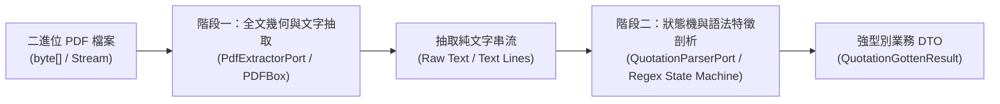
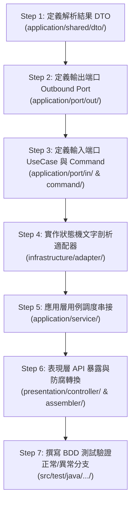

# PDF 結構化解析與 Parser 開發實戰指南 (PDF Parser Development Guide)
**Document Version:** 1.0.0  
**Target Module:** `pdf-module`  
**Architecture Style:** Clean Architecture / Hexagonal Architecture (Ports & Adapters)  

---

## 1. 核心概念與架構設計哲學

在企業級報表系統中，**「PDF 生成」** 與 **「PDF 逆向解析 (Parsing)」** 是一體兩面的關鍵能力。為了讓系統能夠將產出的 PDF（或外部供應商上傳的單據 PDF）重新轉換為強型別的資料結構，本模組採用 **「職責解耦、兩階段管線化」** 的解析設計哲學：



### 兩階段職責嚴格隔離
1. **階段一：底層抽取 (Extraction - `PdfExtractorPort`)**：
   * 專職負責與底層二進位 PDF 引擎（Apache PDFBox 3.x）溝通。
   * 將二進位串流解碼為結構化的純文字（Text Stream），亦支援依據座標區域（Bounding Box）抽取特定區塊文字。
   * **不包含任何業務規則**，只專注於字元編碼、座標順序與換行萃取。
2. **階段二：語法剖析 (Parsing - `QuotationParserPort`)**：
   * 專職負責將非結構化的純文字字串解析為強型別業務 DTO。
   * 內部封裝**正規表示式（Regex）**、**單行/跨行狀態機（State Machine）**、**表格邊界識別**與**防禦性數值轉換**。
   * **完全與底層 PDF 引擎解耦**，輸入僅為純字串，具備極高的可單元測試性（Unit Testability）與維護性。

---

## 2. 新增 Parser 之七大標準落地步驟 (7-Step Workflow)

以下以新增**「出貨單 (Delivery Note) PDF 解析」**為範例，展示從領域定義、應用層端口到基礎設施層剖析器的完整標準實作流程：



---

### Step 1：定義應用層解析結果資料載體 (DTO)

* **規範**：
  * 命名遵守 AGENTS.md 規範 3-6：`N + Gotten/Searched + Result`。
  * 放置於 `src/main/java/com/example/demo/application/shared/dto/`。
  * 使用 Java Record 作為純資料載體，嚴禁在此實作轉換邏輯或技術類依賴。

```java
package com.example.demo.application.shared.dto;

import java.time.LocalDate;
import java.util.List;

/**
 * 出貨單解析完整結果資料傳輸物件 (Pure Data Carrier)
 */
public record DeliveryNoteGottenResult(
        String deliveryNo,
        LocalDate deliveryDate,
        String customerName,
        String deliveryAddress,
        String contactPerson,
        List<DeliveryItemGottenResult> items
) {
}
```

```java
package com.example.demo.application.shared.dto;

/**
 * 出貨單明細項目資料傳輸物件 (Pure Data Carrier)
 */
public record DeliveryItemGottenResult(
        Integer itemNo,
        String materialNo,
        String description,
        Integer quantity,
        String unit,
        String remark
) {
}
```

---

### Step 2：定義應用層外向輸出端口 (Outbound Port)

* **規範**：
  * 命名遵守 AGENTS.md 規範 3-8：結尾為 `Port`。
  * 放置於 `src/main/java/com/example/demo/application/port/out/`。
  * 傳參為純字串（`String rawText`），回傳型別為業務 DTO。**嚴禁依賴 PDFBox 等技術類套件**。

```java
package com.example.demo.application.port.out;

import com.example.demo.application.shared.dto.DeliveryNoteGottenResult;

/**
 * 出貨單文字內容結構化剖析端口 (Outbound Port)
 */
public interface DeliveryNoteParserPort {

    /**
     * 剖析純文字內容並轉換為結構化出貨單 DTO
     *
     * @param rawText 自 PDF 萃取出的全文文字字串
     * @return 結構化出貨單完整資訊 DTO
     */
    DeliveryNoteGottenResult parse(String rawText);
}
```

---

### Step 3：定義應用層用例 Inbound Port 與 Command

* **規範**：
  * Inbound Port 命名遵守規範 3-8：結尾為 `UseCase`。
  * Command 命名遵守規範 3-4：`V + N + Command`（例如 `ParseDeliveryNotePdfCommand`）。
  * Command 內封裝二進位檔案 `byte[]` 與檔名，**嚴禁傳入 Spring 的 `MultipartFile`**（維持防腐隔離）。

```java
package com.example.demo.application.shared.command;

/**
 * 解析出貨單 PDF 命令物件 (Pure Data Carrier)
 */
public record ParseDeliveryNotePdfCommand(
        byte[] fileBytes,
        String fileName
) {
}
```

```java
package com.example.demo.application.port.in;

import com.example.demo.application.shared.command.ParseDeliveryNotePdfCommand;
import com.example.demo.application.shared.dto.DeliveryNoteGottenResult;

/**
 * 解析出貨單 PDF 業務入向用例端口 (Inbound Port)
 */
public interface ParseDeliveryNotePdfUseCase {

    /**
     * 解析上傳之出貨單 PDF 二進位位元組串流
     *
     * @param command 包含 PDF byte[] 與檔名之命令物件
     * @return 結構化出貨單 DTO
     */
    DeliveryNoteGottenResult parseDeliveryNotePdf(ParseDeliveryNotePdfCommand command);
}
```

---

### Step 4：實作文字剖析適配器 (Regex & State Machine Adapter)

* **規範**：
  * 命名遵守規範 3-9：結尾為 `Adapter`（例如 `TextDeliveryNoteParserAdapter`）。
  * 放置於 `src/main/java/com/example/demo/infrastructure/adapter/`。
  * 實作 `DeliveryNoteParserPort`。內部採用**正規表示式 + 行狀態機**。

#### 狀態機與折行處理核心機制：
```java
package com.example.demo.infrastructure.adapter;

import com.example.demo.application.port.out.DeliveryNoteParserPort;
import com.example.demo.application.shared.dto.DeliveryItemGottenResult;
import com.example.demo.application.shared.dto.DeliveryNoteGottenResult;
import lombok.extern.slf4j.Slf4j;
import org.springframework.stereotype.Component;

import java.time.LocalDate;
import java.time.format.DateTimeFormatter;
import java.util.ArrayList;
import java.util.Collections;
import java.util.List;
import java.util.regex.Matcher;
import java.util.regex.Pattern;

/**
 * 出貨單文字結構化剖析適配器 (Outbound Adapter)
 */
@Slf4j
@Component
public class TextDeliveryNoteParserAdapter implements DeliveryNoteParserPort {

    // 1. 標頭網格欄位特徵正規式
    private static final Pattern DELIVERY_NO_PATTERN = Pattern.compile("單號[：:]?\\s*([A-Za-z0-9_-]+)");
    private static final Pattern DELIVERY_DATE_PATTERN = Pattern.compile("日期[：:]?\\s*(\\d{4}[-/年]\\d{1,2}[-/月]\\d{1,2}日?)");
    private static final Pattern CUSTOMER_NAME_PATTERN = Pattern.compile("客戶名稱[：:]?\\s*([^\\r\\n]+?)(?=\\s+送貨地點|\\r|\\n|$)");

    // 2. 單行完整品項模式 (項次 料號 描述 數量 單位 [備註])
    private static final Pattern SINGLE_LINE_ITEM_PATTERN = Pattern.compile(
            "^(\\d{1,4})\\s+([A-Za-z0-9_-]+)\\s+(.+?)\\s+(\\d+)\\s+([A-Za-z\\u4e00-\\u9fa5]+)(?:\\s+(.*))?$"
    );

    // 3. 多行品項首行模式 (項次 料號 [描述前半段])
    private static final Pattern MULTI_LINE_HEADER_PATTERN = Pattern.compile(
            "^(\\d{1,4})\\s+([A-Za-z0-9_-]+)(?:\\s+(.*))?$"
    );

    // 4. 多行品項數值尾行模式 ([描述後半段] 數量 單位 [備註])
    // 關鍵設計：開頭使用 ^(?:(.*)\\s+)? 允許捕捉折行殘存的描述文字！
    private static final Pattern MULTI_LINE_NUMERIC_PATTERN = Pattern.compile(
            "^(?:(.*)\\s+)?(\\d+)\\s+([A-Za-z\\u4e00-\\u9fa5]+)(?:\\s+(.*))?$"
    );

    @Override
    public DeliveryNoteGottenResult parse(String rawText) {
        if (rawText == null || rawText.trim().isEmpty()) {
            return new DeliveryNoteGottenResult("UNKNOWN", LocalDate.now(), "", "", "", Collections.emptyList());
        }

        String deliveryNo = extractMatch(DELIVERY_NO_PATTERN, rawText, "UNKNOWN");
        LocalDate deliveryDate = extractDate(rawText);
        String customerName = extractMatch(CUSTOMER_NAME_PATTERN, rawText, "");
        List<DeliveryItemGottenResult> items = extractItems(rawText);

        return new DeliveryNoteGottenResult(deliveryNo, deliveryDate, customerName, "", "", Collections.unmodifiableList(items));
    }

    private List<DeliveryItemGottenResult> extractItems(String text) {
        List<DeliveryItemGottenResult> items = new ArrayList<>();
        String[] lines = text.split("\\r?\\n");

        boolean inTable = false;
        ItemBuilder currentItem = null;

        for (String rawLine : lines) {
            String line = rawLine.trim();
            if (line.isEmpty()) {
                continue;
            }

            // A. 偵測表格開始標記
            if (line.contains("項次") && line.contains("物料料號")) {
                inTable = true;
                continue;
            }

            // B. 偵測表格結束標記
            if (inTable && (line.contains("合計") || line.contains("備註說明") || line.contains("簽核"))) {
                if (currentItem != null && currentItem.isValid()) {
                    items.add(currentItem.build());
                    currentItem = null;
                }
                break;
            }

            if (!inTable) {
                continue;
            }

            // C. 優先比對：單行完整品項
            Matcher singleLineMatcher = SINGLE_LINE_ITEM_PATTERN.matcher(line);
            if (singleLineMatcher.matches()) {
                if (currentItem != null && currentItem.isValid()) {
                    items.add(currentItem.build());
                    currentItem = null;
                }
                items.add(new DeliveryItemGottenResult(
                        Integer.parseInt(singleLineMatcher.group(1)),
                        singleLineMatcher.group(2).trim(),
                        singleLineMatcher.group(3).trim(),
                        Integer.parseInt(singleLineMatcher.group(4)),
                        singleLineMatcher.group(5).trim(),
                        singleLineMatcher.group(6) != null ? singleLineMatcher.group(6).trim() : ""
                ));
                continue;
            }

            // D. 優先比對：數值行 (支援長描述折行與數值同行的情境)
            if (currentItem != null) {
                Matcher numericMatcher = MULTI_LINE_NUMERIC_PATTERN.matcher(line);
                if (numericMatcher.matches()) {
                    String descSuffix = numericMatcher.group(1);
                    if (descSuffix != null && !descSuffix.trim().isEmpty()) {
                        currentItem.descriptionParts.add(descSuffix.trim());
                    }
                    currentItem.quantity = Integer.parseInt(numericMatcher.group(2));
                    currentItem.unit = numericMatcher.group(3).trim();
                    currentItem.remark = numericMatcher.group(4) != null ? numericMatcher.group(4).trim() : "";

                    items.add(currentItem.build());
                    currentItem = null;
                    continue;
                }
            }

            // E. 比對新品項首行
            Matcher headerMatcher = MULTI_LINE_HEADER_PATTERN.matcher(line);
            if (headerMatcher.matches() && isNumeric(headerMatcher.group(1))) {
                if (currentItem != null && currentItem.isValid()) {
                    items.add(currentItem.build());
                }
                currentItem = new ItemBuilder();
                currentItem.itemNo = Integer.parseInt(headerMatcher.group(1));
                currentItem.materialNo = headerMatcher.group(2).trim();
                String initialDesc = headerMatcher.group(3);
                if (initialDesc != null && !initialDesc.trim().isEmpty()) {
                    currentItem.descriptionParts.add(initialDesc.trim());
                }
                continue;
            }

            // F. 純描述換行延續
            if (currentItem != null) {
                currentItem.descriptionParts.add(line);
            }
        }

        if (currentItem != null && currentItem.isValid()) {
            items.add(currentItem.build());
        }

        return items;
    }

    private String extractMatch(Pattern pattern, String text, String defaultValue) {
        Matcher m = pattern.matcher(text);
        return m.find() ? m.group(1).trim() : defaultValue;
    }

    private LocalDate extractDate(String text) {
        Matcher m = DELIVERY_DATE_PATTERN.matcher(text);
        if (m.find()) {
            String dateStr = m.group(1).trim().replace("年", "-").replace("月", "-").replace("日", "");
            try {
                return LocalDate.parse(dateStr, DateTimeFormatter.ofPattern("yyyy-M-d"));
            } catch (Exception ignored) {
            }
        }
        return LocalDate.now();
    }

    private boolean isNumeric(String str) {
        return str != null && str.chars().allMatch(Character::isDigit);
    }

    private static class ItemBuilder {
        Integer itemNo;
        String materialNo;
        List<String> descriptionParts = new ArrayList<>();
        Integer quantity;
        String unit;
        String remark = "";

        boolean isValid() {
            return itemNo != null && materialNo != null;
        }

        DeliveryItemGottenResult build() {
            return new DeliveryItemGottenResult(
                    itemNo,
                    materialNo,
                    String.join(" ", descriptionParts).trim(),
                    quantity != null ? quantity : 0,
                    unit != null ? unit : "",
                    remark != null ? remark : ""
            );
        }
    }
}
```

---

### Step 5：應用層用例調度串接 (`ApplicationService`)

在應用層服務中，協調 `PdfExtractorPort`（階段一）與 `DeliveryNoteParserPort`（階段二）：

```java
package com.example.demo.application.service;

import com.example.demo.application.port.in.ParseDeliveryNotePdfUseCase;
import com.example.demo.application.port.out.DeliveryNoteParserPort;
import com.example.demo.application.port.out.PdfExtractorPort;
import com.example.demo.application.shared.command.ParseDeliveryNotePdfCommand;
import com.example.demo.application.shared.dto.DeliveryNoteGottenResult;
import lombok.RequiredArgsConstructor;
import lombok.extern.slf4j.Slf4j;
import org.springframework.stereotype.Service;

import java.io.ByteArrayInputStream;

@Slf4j
@Service
@RequiredArgsConstructor
public class DeliveryNoteApplicationService implements ParseDeliveryNotePdfUseCase {

    private final PdfExtractorPort pdfExtractorPort;
    private final DeliveryNoteParserPort deliveryNoteParserPort;

    @Override
    public DeliveryNoteGottenResult parseDeliveryNotePdf(ParseDeliveryNotePdfCommand command) {
        if (command == null || command.fileBytes() == null || command.fileBytes().length == 0) {
            throw new IllegalArgumentException("上傳之 PDF 檔案內容不可為空");
        }

        try (ByteArrayInputStream is = new ByteArrayInputStream(command.fileBytes())) {
            // 階段一：PDFBox 抽取全文文字
            String rawText = pdfExtractorPort.readPdfContent(is);

            // 階段二：狀態機解析業務結構
            return deliveryNoteParserPort.parse(rawText);
        } catch (Exception e) {
            log.error("解析出貨單 PDF 失敗: fileName={}", command.fileName(), e);
            throw new IllegalStateException("解析出貨單 PDF 發生錯誤: " + e.getMessage(), e);
        }
    }
}
```

---

### Step 6：表現層 API 暴露與防腐轉換 (`assembler/` & `controller/`)

1. **定義 Response Resource** (`presentation/resource/out/DeliveryNoteParsedResource.java`)：
   命名遵守規範 3-2：`N + Ved + Resource`。
2. **防腐組裝轉換** (`presentation/assembler/DeliveryNoteResourceAssembler.java`)：
   將 DTO 轉換為 Response Resource。
3. **REST Controller 暴露** (`presentation/controller/DeliveryNoteController.java`)：
   接收 `MultipartFile`，封裝為 `ParseDeliveryNotePdfCommand`，調用 UseCase 並回傳 JSON。

```java
@PostMapping(value = "/delivery-notes/parse", consumes = MediaType.MULTIPART_FORM_DATA_VALUE, produces = MediaType.APPLICATION_JSON_VALUE)
public ResponseEntity<DeliveryNoteParsedResource> parseDeliveryNotePdf(@RequestParam("file") MultipartFile file) throws IOException {
    if (file == null || file.isEmpty()) {
        return ResponseEntity.badRequest().build();
    }
    ParseDeliveryNotePdfCommand command = new ParseDeliveryNotePdfCommand(file.getBytes(), file.getOriginalFilename());
    DeliveryNoteGottenResult result = parseDeliveryNotePdfUseCase.parseDeliveryNotePdf(command);
    return ResponseEntity.ok(assembler.toParsedResource(result));
}
```

---

## 3. 關鍵解析策略與狀態機模式 (State Machine Deep-Dive)

### 3-1. 表格折行 (Wrapping) 與文字混入數值行問題

當 PDFBox 從單元格表格中抽取文字時，它是依照幾何基線由上至下、由左至右萃取文字。當品名描述文字較長時，會發生以下關鍵行為：

| 單元格項目 | 第一行文字 (Top Baseline) | 第二行文字 (Wrapped Baseline) |
| :--- | :--- | :--- |
| **項次 + 料號** | `1 MCU-STM32-H743` | *(無文字)* |
| **品名與描述** | `嵌入式高性能核心控制器 ARM Cortex-M7` | `480MHz 2MB Flash` |
| **數量 + 單位** | *(無文字)* | `100 PCS` |
| **單價 + 小計** | *(無文字)* | `520 52,000` |
| **備註** | *(無文字)* | `原廠出廠證明` |

* **PDFBox 抽取後的純文字產出**：
  ```text
  1 MCU-STM32-H743 嵌入式高性能核心控制器 ARM Cortex-M7
  480MHz 2MB Flash 100 PCS 520 52,000 原廠出廠證明
  ```

> [!CAUTION]
> **陷阱警示**：  
> 若數值行的正規式僅寫成 `^(\\d+)\\s+([A-Za-z]+)...`，第二行會因為開頭是 `480MHz 2MB Flash` 而**匹配失敗**，整行將會被誤判為純描述，導致數量與金額全部歸零！

* **正確解法（容許前置描述末段前綴）**：
  ```java
  // 前綴 (?:(.*)\\s+)? 會以貪婪模式吃下所有在「數量 單位」之前的字串
  private static final Pattern MULTI_LINE_NUMERIC_PATTERN = Pattern.compile(
          "^(?:(.*)\\s+)?(\\d+)\\s+([A-Za-z\\u4e00-\\u9fa5]+)\\s+([0-9,]+(?:\\.[0-9]+)?)\\s+([0-9,]+(?:\\.[0-9]+)?)(?:\\s+(.*))?$"
  );
  ```
  * Group 1: `480MHz 2MB Flash` ➔ 存入 `descriptionParts`
  * Group 2: `100` ➔ 存入 `quantity`
  * Group 3: `PCS` ➔ 存入 `unit`
  * Group 4: `520` ➔ 存入 `unitPrice`
  * Group 5: `52,000` ➔ 存入 `subtotal`
  * Group 6: `原廠出廠證明` ➔ 存入 `remark`

---

## 4. 常見陷阱與防禦指南 (Gotchas & Best Practices)

> [!IMPORTANT]
> **1. 中文字元與 Unicode 正規式區間**  
> 單位通常包含中文（如「台」、「片」、「條」、「組」、「套」）或英文（如「PCS」、「SET」）。匹配單位時，務必在字元集中加入中文字元範圍 `[A-Za-z\\u4e00-\\u9fa5]+`，切勿僅使用 `[A-Za-z]+` 或 `\\w+`。

> [!TIP]
> **2. 金額千分位與小數點安全轉換**  
> PDF 上的金額通常格式化為 `52,000` 或 `NT$ 52,000.00`。在轉換 `BigDecimal` 前，必須先剔除貨幣符號與逗號（`raw.replace(",", "").replace("NT$", "").trim()`），並使用 `try-catch` 包裹防禦解析異常。

> [!WARNING]
> **3. 跨頁重複表頭對狀態機的影響**  
> 若 PDF 產生時開啟了 `table.setHeaderRows(1)`，每一頁上方都會重複出現表頭「項次 物料料號 ...」。狀態機在遇到重複表頭時，應維持 `inTable = true` 並略過該行，不可重複重置或中斷品項讀取。

> [!NOTE]
> **4. 伺服器熱重載注意事項**  
> 當修改 Parser 或正規表示式後，若是在 IDE（如 IntelliJ IDEA / VS Code）中手動進行 Postman / Swagger 測試，**請務必重新啟動 Spring Boot 應用程式**（`Rerun`），避免 JVM 記憶體中仍執行舊版 Bytecode 而造成測試結果與代碼不一致。

---

## 5. BDD 測試規範與範例 (Testing & Verification)

依據專案規範，每個 Parser 必須具備對應的單元測試，並使用 **BDD Gherkin 語法（Feature, Scenario, Given-When-Then）** 撰寫 Javadoc：

```java
/**
 * Feature: 出貨單文字抽取與結構化剖析
 * Scenario: 當品項描述過長折行且第二行與數值欄位共存時，成功解析品項數值並完整拼接品名描述
 *
 * Given: 模擬 PDF 抽取文字中品名換行且尾行包含「描述末段 + 數量 + 單位 + 備註」
 * When: 調用 TextDeliveryNoteParserAdapter.parse(rawText)
 * Then: 成功解析出正確的數量與單位，且品名描述完整合併前後兩行文字
 */
@Test
@DisplayName("解析出貨單文字-多行品項描述末段含數值-成功解析")
void parse_multiLineItemWithWrappedDescription_success() {
    // Given
    String rawText = """
            單號： DN-20261023-001
            日期： 2026-10-23
            客戶名稱： 台灣智能科技股份有限公司
            項次 物料料號 品名與規格描述 數量 單位 備註
            1 MCU-STM32-H743 嵌入式高性能核心控制器 ARM Cortex-M7
            480MHz 2MB Flash 100 PCS 原廠出廠證明
            合計： 100 PCS
            """;

    // When
    DeliveryNoteGottenResult result = adapter.parse(rawText);

    // Then
    assertNotNull(result);
    assertEquals(1, result.items().size());
    DeliveryItemGottenResult item = result.items().get(0);
    assertEquals("MCU-STM32-H743", item.materialNo());
    assertEquals("嵌入式高性能核心控制器 ARM Cortex-M7 480MHz 2MB Flash", item.description());
    assertEquals(100, item.quantity());
    assertEquals("PCS", item.unit());
    assertEquals("原廠出廠證明", item.remark());
}
```
