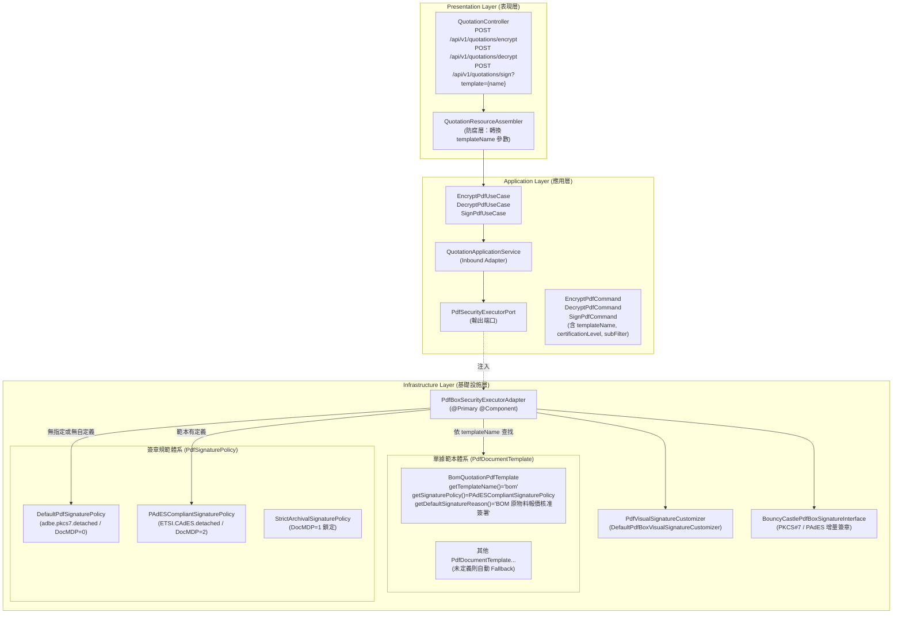

# Apache PDFBox 3.x 安全防護、數位簽章與單據範本自定義規範體系設計文檔 (PDFBox Security & Signature Architecture Design)

> 🔗 回到 [技術設計文檔導覽 (doc/design/README.md)](file:///d:/桌面/ModuleWorkSpace/pdf-module/doc/design/README.md) 或 [專案根目錄 README.md](file:///d:/桌面/ModuleWorkSpace/pdf-module/README.md)

---

## 1. 架構概述與設計原則

本模組全面接納高度自定義的 **Apache PDFBox 3.x** 作為安全加解密與數位簽章之核心專屬引擎，並結合 **Clean Architecture 六角形架構** 與 **模板方法模式 (Template Method Pattern)**，設計出能夠針對個別單據範本（`PdfDocumentTemplate`）量身自定義簽章規範與視覺印章外觀，若無指定或範本未定義則自動平滑降級（Fallback）使用系統預設規範的靈活架構。

### 核心設計亮點
1. **全面接納 Apache PDFBox 3.x 核心引擎**：
   - 移除非必要之雙引擎切換負擔與中介枚舉 (`PdfSecurityEngine`)，由標註 `@Primary` 的 `PdfBoxSecurityExecutorAdapter` 擔任主要輸出適配器 (`PdfSecurityExecutorPort`)。
   - 支援 256-bit AES 軍規級加密與細粒度 8 項權限矩陣控管（列印、複製、表單填寫等）。
2. **單據範本感知與個別簽章定義 (`PdfDocumentTemplate` Hook)**：
   - 在抽象契約 `PdfDocumentTemplate` 中新增簽章規範 Hook 方法：`getSignaturePolicy()`、`getVisualSignatureCustomizer()`、`getDefaultSignatureReason()`、`getDefaultSignatureLocation()`。
   - 具體單據範本（如 `BomQuotationPdfTemplate`）可依其業務標準（如原物料審批、PAdES-BES 合規要求）覆寫並定義專屬簽章規範與印章。
3. **智慧降級與預設簽章機制 (Fallback to Default Policy)**：
   - 當呼叫端未指定單據範本（`templateName = null`）或指定之範本未覆寫自定義規範（回傳 `null`）時，系統自動套用標準預設規範（`DefaultPdfSignaturePolicy` 與 `DefaultPdfBoxVisualSignatureCustomizer`），兼具高度靈活性與安全性。
4. **自定義數位簽章規範體系 (Custom Signature Policy Framework)**：
   - 提供開放擴充介面 `PdfSignaturePolicy`，解耦簽章演算法、認證等級 (DocMDP) 與標準格式 (Adobe PKCS#7 vs. PAdES/CAdES)。
   - 開箱即用提供：
     - `DefaultPdfSignaturePolicy`：企業內部標準 Adobe PKCS#7 增量簽名。
     - `PAdESCompliantSignaturePolicy`：歐盟 PAdES / ETSI CAdES 高級電子簽章規範。
     - `StrictArchivalSignaturePolicy`：嚴格法務存檔封存規範（DocMDP `CERTIFIED_NO_CHANGES_ALLOWED`，鎖定文件禁止後續任何變更）。
5. **自定義視覺印章客製化介面 (Visual Signature Customizer)**：
   - 提供 `PdfVisualSignatureCustomizer` 介面，允許各業務單元自由客製化簽名可見印章方塊外觀。
   - 內建 `DefaultPdfBoxVisualSignatureCustomizer`，具備微軟正黑體雙線防偽鋼印、雙語標註與安全校驗資訊。

---

## 2. 系統架構與呼叫流程



> 📘 **深入閱讀**：關於底層密碼學 ByteRange 挖洞計算、CMS 簽名細節、本機 `keytool` 自簽產製與企業級 AATL / HSM Secret 管理實踐，請參閱專屬指南：
> [PDF 數位簽章完整流程與憑證密鑰管理實戰指南 (pdf_digital_signature_workflow_and_secret_guide.md)](file:///d:/桌面/ModuleWorkSpace/pdf-module/doc/design/pdfbox/pdf_digital_signature_workflow_and_secret_guide.md)。

---

## 3. 單據範本自定義簽章規範實踐 (`PdfDocumentTemplate`)

### 3.1 範本抽象契約擴充

在 `PdfDocumentTemplate<T>` 中宣告以下 Hook 方法：

```java
public abstract class PdfDocumentTemplate<T> {
    /** 範本唯一識別名稱 (預設為類別 SimpleName 小寫) */
    public String getTemplateName() {
        return getClass().getSimpleName().toLowerCase();
    }

    /** 該單據範本專屬的數位簽章規範 (若為 null 則採用系統預設規範) */
    public PdfSignaturePolicy getSignaturePolicy() {
        return null;
    }

    /** 該單據範本專屬的視覺印章客製器 (若為 null 則採用系統預設客製器) */
    public PdfVisualSignatureCustomizer getVisualSignatureCustomizer() {
        return null;
    }

    /** 該單據預設簽署理由 */
    public String getDefaultSignatureReason() {
        return null;
    }

    /** 該單據預設簽署地點 */
    public String getDefaultSignatureLocation() {
        return null;
    }
}
```

### 3.2 具體單據範本實作範例 (`BomQuotationPdfTemplate`)

以 BOM 原物料報價單為例，其需要滿足更嚴格的合約與歐盟 PAdES 簽章標準：

```java
@Component
public class BomQuotationPdfTemplate extends PdfDocumentTemplate<QuotationGottenResult> {
    
    @Override
    public String getTemplateName() {
        return "bom";
    }

    @Override
    public PdfSignaturePolicy getSignaturePolicy() {
        // 套用 PAdES / CAdES 國際電子簽署規範 (DocMDP=2)
        return new PAdESCompliantSignaturePolicy();
    }

    @Override
    public PdfVisualSignatureCustomizer getVisualSignatureCustomizer() {
        return new BomQuotationVisualSignatureCustomizer();
    }

    @Override
    public String getDefaultSignatureReason() {
        return "BOM 原物料報價核准簽署";
    }

    @Override
    public String getDefaultSignatureLocation() {
        return "台北營運總部";
    }
}
```

---

## 4. 簽章規範與視覺印章體系

### 4.1 簽章規範矩陣

| 規範名稱 | 適用場景 | SubFilter | 認證等級 (DocMDP) | 特色說明 |
| :--- | :--- | :--- | :--- | :--- |
| **`DefaultPdfSignaturePolicy`** | 一般企業商務單據、通用簽署 | `adbe.pkcs7.detached` | `NOT_CERTIFIED (0)` | 系統預設規範，相容絕大多數 PDF 閱讀器，支援後續增量追加簽章。 |
| **`PAdESCompliantSignaturePolicy`** | BOM 單據、跨國採購與合約 | `ETSI.CAdES.detached` | `CERTIFIED_FORM_FILLING (2)` | 遵循 PAdES-BES 標準，僅允許簽署後填寫表單與簽章欄位。 |
| **`StrictArchivalSignaturePolicy`** | 法務合約封存、不可竄改歷史記錄 | `ETSI.CAdES.detached` | `CERTIFIED_NO_CHANGES_ALLOWED (1)` | 最高等級防護，簽署後若文件發生任何微小變更，閱讀器皆標註為無效。 |

### 4.2 視覺印章客製器 (`PdfVisualSignatureCustomizer`)
- **防偽雙線鋼印外框**：外層 1.2pt 深藍框線 (`#1B365D`)，內層 0.6pt 輔助框線，塑造權威鋼印質感。
- **微軟正黑體繁體中文標籤**：動態載入 `fonts/MSJHL.TTC`，保證繁體中文無缺字亂碼。
- **業務元數據排版**：包含數位認證標題、簽章人 CN、事由 (Reason)、地點 (Location)、時間 (ISO 8601)。

---

## 5. REST API 端點規格與調用

### 5.1 數位簽章端點：`POST /api/v1/quotations/sign`
- **Content-Type**: `multipart/form-data`
- **參數列表**：
  - `file` (必填): 欲簽章之原始 PDF 文件。
  - `keystore` (必填): PKCS#12 (.p12 / .pfx) 金鑰庫憑證。
  - `password` (必填): 金鑰庫解鎖密碼。
  - `template` (可選): 指定套用之單據範本名稱（例如 `bom`；未指定時自動採用預設簽章規範）。
  - `reason` (可選): 覆寫簽章理由（若未提供且範本有定義，則優先採用範本理由）。
  - `location` (可選): 覆寫簽章地點（若未提供且範本有定義，則優先採用範本地點）。
  - `visual` (可選，預設 `true`): 是否加蓋可見印章方塊。
  - `page` (可選，預設 `1`): 視覺印章印製頁碼。
  - `download` (可選，預設 `true`): 是否以 attachment 下載。
- **回應標頭**：`X-Pdf-Engine: PDFBox (Digital Signature)`

### 5.2 安全加密端點：`POST /api/v1/quotations/encrypt`
- **參數列表**：`file`, `userPassword`, `ownerPassword`, `allowPrinting`, `allowCopy`, `download`
- **回應標頭**：`X-Pdf-Engine: PDFBox (Security)`

### 5.3 安全解密端點：`POST /api/v1/quotations/decrypt`
- **參數列表**：`file`, `password`, `download`
- **回應標頭**：`X-Pdf-Engine: PDFBox (Security)`

---

## 6. 測試驗證與合規保障

本模組的安全與簽章實作具備 100% 完整的自動化測試保護（符合 AGENTS.md 規範）：
- `PdfBoxSecurityExecutorAdapterTest`：
  - ✅ 256-bit AES 加密驗證（未帶密碼無法開啟文件）。
  - ✅ 正確密碼解密還原驗證（解除限制為無加密乾淨 PDF）。
  - ✅ 密碼錯誤異常攔截（精準拋出 `IllegalArgumentException`）。
  - ✅ 標準數位簽章與增量儲存（`doc.saveIncremental` 保持簽名雜湊完整性）。
  - ✅ 嚴格法務存檔規範驗證（`StrictArchivalSignaturePolicy`）。
  - ✅ **個別單據範本簽章規範驗證**（指定 `bom` 範本自動帶出 PAdES 規範、專屬理由「BOM 原物料報價核准簽署」與地點「台北營運總部」）。
- `QuotationControllerTest`：
  - ✅ 驗證表現層在預設與指定單據範本簽章時的回應標頭 (`PDFBox (Digital Signature)`) 與檔案串流。
  - ✅ 驗證加解密端點回應標頭 (`PDFBox (Security)`)。
